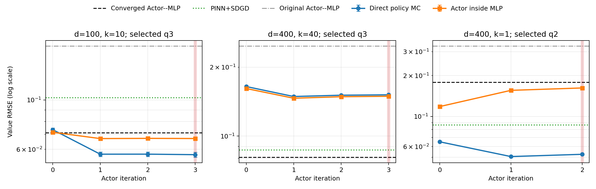

# Teacher-free Actor Iteration pilot

## Numerical answer

Teacher-free Actor Iteration is a **mixed result**. It clearly improves `q0`
as a policy in all 3/3 cells. Direct policy evaluation and the
new actor inside the old MLP beat the **original Actor--MLP in
3/3 and 3/3 cells**, respectively.
Against the stronger high-budget converged Actor--MLP, the corresponding counts
are 2/3 and 2/3. Against the best
of the five non-actor baselines, they are 2/3 and
1/3.

The stopping-selected actor itself beats the previous converged actor's direct
gradient RMSE in only 1/3 cells. The Value gain therefore
does not mean that Actor Iteration learned the most accurate gradient in every
cell, and it does not transfer to `(400,40)`.

- **(100,10)** selected `q3`: direct-policy RMSE 0.05673, Actor--MLP RMSE 0.06706, and direct actor gradient RMSE 0.3037 (from 0.6485 at `q0`).
- **(400,40)** selected `q3`: direct-policy RMSE 0.1514, Actor--MLP RMSE 0.1493, and direct actor gradient RMSE 0.8767 (from 0.9277 at `q0`).
- **(400,1)** selected `q2`: direct-policy RMSE 0.05258, Actor--MLP RMSE 0.1621, and direct actor gradient RMSE 0.5032 (from 0.9645 at `q0`).

The failure modes differ. At `(400,40)`, `q1` improves the direct actor
gradient RMSE only from 0.9277 to 0.869, still far above
the converged actor's 0.5262; both Value estimators remain
near 0.15. This points to insufficient policy accuracy under the frozen small
label budget as the leading diagnosis, rather than an MLP-only evaluation
failure. At `(400,1)`, direct policy RMSE improves from 0.065 to
0.05258, while the same actor inside the old MLP worsens from
0.1182 to 0.1621. That cell supports the earlier
diagnosis that the low-rank Actor--MLP recursion can be the bottleneck even when
the learned policy improves.

The iteration was selected only from independent controlled-policy Value
estimates. Exact values and gradients were first used after all checkpoints and
the stopping decision were frozen. Post-hoc best iterations are diagnostic and
did not replace the selected checkpoint.

## Selected checkpoints

| d | k | Selected | Direct policy | Actor--MLP | Direct actor gradient | Original Actor--MLP | Converged Actor--MLP | Best five-method baseline |
|---:|---:|:---:|---:|---:|---:|---:|---:|:---|
| 100 | 10 | q3 | 0.05673 ± 0.0015 | 0.06706 ± 0.00078 | 0.3037 | 0.1747 | 0.0711 | PINN+SDGD: 0.1022 |
| 400 | 40 | q3 | 0.1514 ± 0.0013 | 0.1493 ± 0.00033 | 0.8767 | 0.2472 | 0.08087 | PINN+SDGD: 0.087 |
| 400 | 1 | q2 | 0.05258 ± 0.00053 | 0.1621 ± 0.0016 | 0.5032 | 0.3302 | 0.1786 | PINN+SDGD: 0.08632 |

`Direct policy` and `Actor--MLP` are different estimators. Direct policy uses
the controlled linear Feynman--Kac estimator; Actor--MLP plugs the same actor
into the previous nonlinear `n=3, M=16` recursion. Intervals are 95% normal
approximations across three direct-policy seeds or ten Actor--MLP seeds.



## Every iteration and measured GPU phases

| d | k | q | Policy MC RMSE | Actor--MLP RMSE | Actor gradient RMSE | Validation Δ (prev-current) | Labels s | Train s | Direct s | Actor--MLP s |
|---:|---:|---:|---:|---:|---:|---:|---:|---:|---:|---:|
| 100 | 10 | 0 | 0.07346 ± 0.0014 | 0.07153 ± 0.00092 | 0.6485 | — | 0.07 | 12.87 | 3.68 | 1.21 |
| 100 | 10 | 1 | 0.05701 ± 0.0014 | 0.06702 ± 0.00079 | 0.3167 | 0.008423 ± 0.00012 | 12.53 | 9.77 | 3.59 | 1.18 |
| 100 | 10 | 2 | 0.05703 ± 0.0013 | 0.06716 ± 0.0008 | 0.3071 | 0.000174 ± 5.6e-05 | 12.47 | 7.23 | 3.55 | 1.18 |
| 100 | 10 | 3 | 0.05673 ± 0.0015 | 0.06706 ± 0.00078 | 0.3037 | -3.792e-05 ± 2.4e-05 | 12.62 | 7.37 | 3.54 | 1.18 |
| 400 | 40 | 0 | 0.1645 ± 0.0014 | 0.1613 ± 0.00028 | 0.9277 | — | 0.07 | 8.73 | 3.36 | 4.95 |
| 400 | 40 | 1 | 0.1489 ± 0.0013 | 0.1463 ± 0.00028 | 0.869 | 0.006918 ± 0.00012 | 12.64 | 7.61 | 3.36 | 4.81 |
| 400 | 40 | 2 | 0.1508 ± 0.0013 | 0.1486 ± 0.00031 | 0.8743 | -0.0009838 ± 1.4e-05 | 12.53 | 6.83 | 3.38 | 4.81 |
| 400 | 40 | 3 | 0.1514 ± 0.0013 | 0.1493 ± 0.00033 | 0.8767 | -0.0001376 ± 2.5e-06 | 12.52 | 6.71 | 3.41 | 4.82 |
| 400 | 1 | 0 | 0.065 ± 0.00017 | 0.1182 ± 0.0014 | 0.9645 | — | 0.06 | 7.52 | 3.02 | 3.19 |
| 400 | 1 | 1 | 0.05061 ± 0.00056 | 0.1557 ± 0.0016 | 0.539 | -0.0003611 ± 7.3e-05 | 10.95 | 6.17 | 3.04 | 3.04 |
| 400 | 1 | 2 | 0.05258 ± 0.00053 | 0.1621 ± 0.0016 | 0.5032 | -0.0006052 ± 9e-06 | 10.89 | 6.23 | 3.03 | 3.04 |

Positive validation Δ means the new policy reduced estimated cost. Validation Value was not monotone within MC uncertainty. The statistically resolved regressions were (100,10) q3 (-3.792e-05 ± 2.4e-05), (400,40) q2 (-0.0009838 ± 1.4e-05), (400,40) q3 (-0.0001376 ± 2.5e-06), (400,1) q1 (-0.0003611 ± 7.3e-05), (400,1) q2 (-0.0006052 ± 9e-06). They were still within the predeclared 0.001 absolute plateau tolerance when used by the stopping rule.

Label construction used 16 Euler steps and 128 antithetic paths for each
improvement dataset. The stopping audit used 256 paths, three common-random
banks, and fixed independent validation points. Final direct evaluation used
the original 960 Stage B points, 16 steps, 256 paths, and three seeds.

Across the three cells, program-measured elapsed time was
4.71 minutes. The separately measured
phase totals were 1.62 minutes for
label generation, 1.45 for actor
optimization, 0.17 for stopping
audits, 0.62 for final direct
policy inference, and 0.56 for
final Actor--MLP inference. The two Slurm allocations used 6.00 GPU-minutes including environment startup and final serialization.

## Correctness and stability

The pre-run suite had 27 passing tests, including the controlled-drift sign,
terminal exactness, zero-policy heat expectation, common-random-number finite
differences, frozen actor parameters, unbroken input-state gradients, shapes,
and finite values. The artifact validator passed all three cells, all actor
checkpoints were distinct, and no run produced a NaN, OOM, or nonzero exit.

Training and stopping did not use the analytic nonterminal solution. `q0` used
only terminal pathwise derivatives. Improvement labels differentiated through
the frozen actor drift with a VJP; no explicit d-by-d Jacobian was constructed.

## Reproduction

From the repository root inside a single-GH200 allocation:

```bash
python -m pytest -q invariant_region_mlp/experiments/main_b1_sixmethods
python -m invariant_region_mlp.experiments.main_b1_sixmethods.run_actor_iteration --d 100 --k 10
python -m invariant_region_mlp.experiments.main_b1_sixmethods.run_actor_iteration --d 400 --k 40
python -m invariant_region_mlp.experiments.main_b1_sixmethods.run_actor_iteration --d 400 --k 1
python -m invariant_region_mlp.experiments.main_b1_sixmethods.actor_iteration_report
```

Remove the corresponding result, cache, and checkpoint files or pass `--force`
only when a clean rerun is intended.

## Artifacts

- `result_d*_k*.json`: complete per-cell seed rows, costs, protocol, and stopping decision.
- `summary_d*_k*.csv`: compact per-iteration cell results.
- `comparison.csv`: combined three-cell comparison.
- `summary.json`: machine-readable conclusions and compute totals.
- `validation.json`: hashes, shape checks, seed counts, and finite-value checks.
- `scheduler_accounting.json`: Slurm states and elapsed GPU allocation time.
- `manifest.json`: SHA-256 hashes for this report and compact artifacts.
