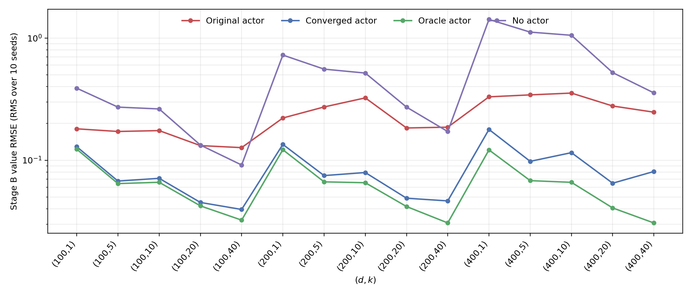
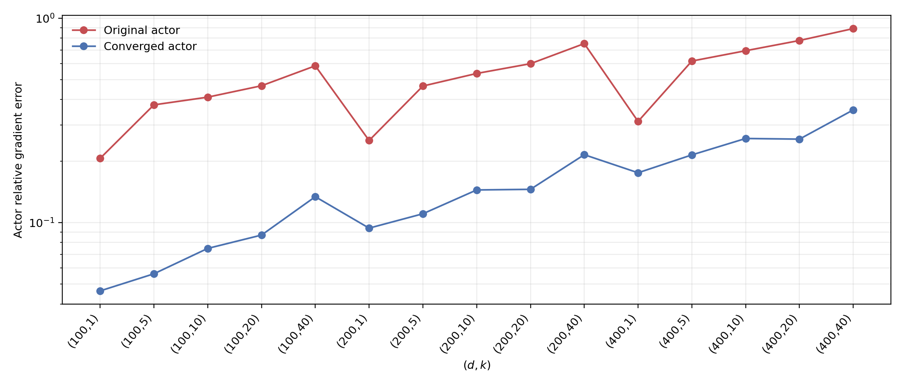
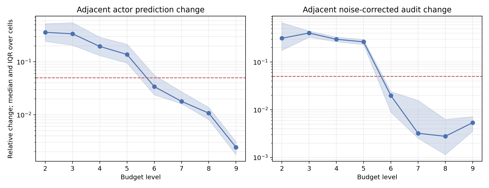

# Main B1 actor label-quality and convergence study

## Status

All 15 B1 cells reached the frozen optimizer and cross-budget convergence
criterion.  The main six-method benchmark and its tables remain unchanged;
this is a supplemental actor study evaluated on the same 960 held-out points,
10 MLP repetitions, `n=3`, `M=16`, and paired Actor--MLP random numbers.

The final actor beats the original learned actor and Pathwise + Baseline without
an actor in **15/15** cells.  Its geometric-mean value-RMSE ratio versus the
original actor is **0.347**,
a **65.3%** reduction.  The geometric-mean ratio to Oracle Actor is
**1.320**;
4 cells are within 10% of Oracle value RMSE.

## What changed

The original actor used a 2×128 SiLU network, one `n=2, M=8` label per point,
4,096 training points, and at most 1,000 optimizer steps.  The new actor uses a
fixed 4×384 ambient-input network and five progressive label budgets, ending at
`n=3, M=20`, ten independent labels averaged at each of 32,768 training points,
followed by low-learning-rate confirmation stages.

High-dimensional label noise was removed without reading the analytic active
basis.  For each cell, a rank-`k` output subspace was learned from independent
`n=1` pathwise terminal-gradient labels.  Training, validation, audit labels,
and actor outputs were projected into this data-derived space.  The public
effective dimension `k` fixes the rank.  No nonterminal exact solution was used
for labels, optimization, early stopping, budget escalation, or selection.

A budget transition is stable only when the optimizer converged, the
noise-corrected stochastic-audit RMSE changed by at most 5%, and actor
predictions changed by at most 5%.  Selection required two consecutive stable
transitions.  The exact solution was evaluated only after the checkpoint was
frozen.

## Results

| d | k | Original | Converged | Oracle | No actor | New / old | Actor rel. old → new | Level |
|---:|---:|---:|---:|---:|---:|---:|---:|:---|
| 100 | 1 | 0.1807 | 0.1290 | 0.1231 | 0.3885 | 0.714 | 0.206 → 0.046 | level_9_confirmation |
| 100 | 5 | 0.1719 | 0.0675 | 0.0644 | 0.2720 | 0.393 | 0.377 → 0.056 | level_8_confirmation |
| 100 | 10 | 0.1747 | 0.0711 | 0.0660 | 0.2628 | 0.407 | 0.411 → 0.075 | level_8_confirmation |
| 100 | 20 | 0.1317 | 0.0451 | 0.0423 | 0.1330 | 0.343 | 0.467 → 0.087 | level_7_confirmation |
| 100 | 40 | 0.1268 | 0.0395 | 0.0323 | 0.0914 | 0.312 | 0.585 → 0.134 | level_7_confirmation |
| 200 | 1 | 0.2216 | 0.1347 | 0.1219 | 0.7253 | 0.608 | 0.252 → 0.094 | level_7_confirmation |
| 200 | 5 | 0.2728 | 0.0749 | 0.0665 | 0.5565 | 0.274 | 0.466 → 0.111 | level_9_confirmation |
| 200 | 10 | 0.3237 | 0.0793 | 0.0654 | 0.5167 | 0.245 | 0.537 → 0.145 | level_8_confirmation |
| 200 | 20 | 0.1836 | 0.0489 | 0.0418 | 0.2721 | 0.266 | 0.599 → 0.146 | level_7_confirmation |
| 200 | 40 | 0.1864 | 0.0465 | 0.0307 | 0.1716 | 0.249 | 0.752 → 0.215 | level_7_confirmation |
| 400 | 1 | 0.3302 | 0.1786 | 0.1215 | 1.4198 | 0.541 | 0.313 → 0.175 | level_7_confirmation |
| 400 | 5 | 0.3426 | 0.0979 | 0.0681 | 1.1178 | 0.286 | 0.618 → 0.215 | level_8_confirmation |
| 400 | 10 | 0.3544 | 0.1153 | 0.0659 | 1.0530 | 0.325 | 0.694 → 0.258 | level_8_confirmation |
| 400 | 20 | 0.2778 | 0.0649 | 0.0407 | 0.5213 | 0.233 | 0.778 → 0.256 | level_8_confirmation |
| 400 | 40 | 0.2472 | 0.0809 | 0.0307 | 0.3556 | 0.327 | 0.890 → 0.356 | level_8_confirmation |

The median same-audit actor relative-gradient error fell from
**0.537** to **0.145**.  Its geometric-mean new/old ratio is
**0.276**, and the new actor
improves all 15 cells.  The remaining gap is concentrated in
the hardest ambient settings: the maximum post-selection relative actor error
is **0.356**.

## Cost and interpretation

The full investigation, including the provisional pilots that exposed the
overly permissive noise-floor shortcut, used **1.510 GH200 hours**.  Unique final label generation accounts for
67.7 sequential GPU-minutes, and neural optimization for
14.7 minutes.  Parallel array execution reduced wall-clock time;
scheduler usage is the sum over allocated GPUs.

The result confirms the original diagnosis.  The pathwise terminal and
level-matched baseline components were useful, but the small noisy-label actor
was the dominant avoidable error.  Raising label fidelity, removing
orthogonal label noise, and training to a measured plateau closes most of the
learned-to-Oracle gap.  At `d=400`, especially large `k`, a material Oracle gap
remains, so this study supports improved actors rather than claiming that actor
error has vanished.

## Artifacts

- `actor_convergence_comparison.csv`: full 15-cell comparison.
- `actor_convergence_trajectory.csv`: every budget-level convergence record.
- `summary.json`: aggregate findings and validation counts.
- `execution_accounting.json`: all 19 GH200 allocations.
- `artifact_manifest.json`: SHA-256 hashes of the report artifacts and 15 final
  scalar cell records.
- Checkpoints, label caches, and paired prediction arrays remain in the local
  experiment workspace and are excluded from Git because of their size.
