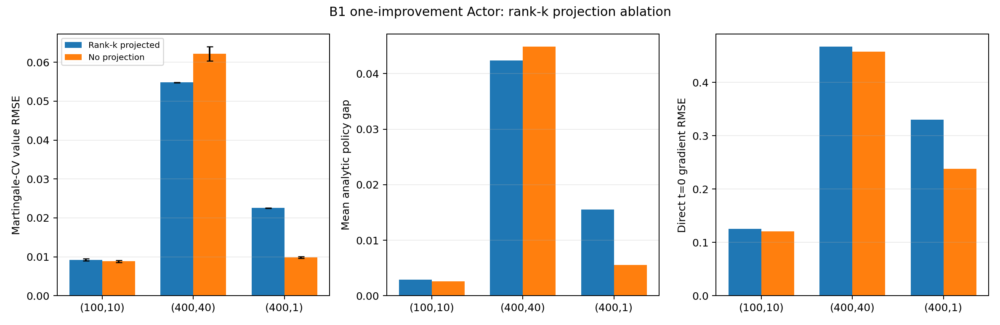

# B1 Actor Iteration rank-k projection ablation

## Numerical answer

The projection ablation is configuration-dependent: no projection wins 2 of 3 tested cells.

- `(100,10)`: removing projection gives 4.3% lower CV RMSE; paired `no projection - projected` = -0.00040 ± 0.00007.
- `(400,40)`: removing projection gives 13.5% higher CV RMSE; paired `no projection - projected` = 0.00741 ± 0.00188.
- `(400,1)`: removing projection gives 56.4% lower CV RMSE; paired `no projection - projected` = -0.01271 ± 0.00028.

| Cell | Actor output | Direct grad. RMSE | Raw value RMSE | CV value RMSE | CV bias | Mean policy gap | Gap RMS | CV variance factor |
|:---:|:---|---:|---:|---:|---:|---:|---:|---:|
| (100,10) | Rank-k projected | 0.12531 | 0.04904 | 0.00924 ± 0.00026 | 0.00550 | 0.00287 | 0.00350 | 48.00x |
| (100,10) | No projection | 0.12086 | 0.04900 | 0.00884 ± 0.00023 | 0.00512 | 0.00257 | 0.00301 | 49.70x |
| (400,40) | Rank-k projected | 0.46717 | 0.06310 | 0.05481 ± 0.00008 | 0.04404 | 0.04235 | 0.05072 | 4.47x |
| (400,40) | No projection | 0.45717 | 0.06908 | 0.06222 ± 0.00183 | 0.04654 | 0.04489 | 0.05806 | 4.01x |
| (400,1) | Rank-k projected | 0.33024 | 0.02839 | 0.02254 ± 0.00009 | 0.01583 | 0.01549 | 0.02058 | 5.33x |
| (400,1) | No projection | 0.23756 | 0.02118 | 0.00983 ± 0.00023 | 0.00593 | 0.00555 | 0.00778 | 13.37x |



The analytic trajectory policy gap is the main check on the value ranking: it
uses the same controlled paths but does not rely on the martingale-CV value
noise. Direct `t=0` gradient RMSE is also reported as a post hoc diagnostic.

## What the no-projection Actor learned

| Cell | Exact z* residual outside fitted basis | No-projection Actor off-basis RMS | Relative off-basis RMS |
|:---:|---:|---:|---:|
| (100,10) | 5.313e-08 | 0.00788 | 0.380% |
| (400,40) | 3.678e-08 | 0.01289 | 1.022% |
| (400,1) | 8.493e-08 | 0.00921 | 0.279% |

At the held-out starting states, the fitted terminal-gradient basis contains
the analytic gradient to numerical precision. The unconstrained Actor also
places only a small fraction of its output outside that basis. The final
differences at `t=0` therefore cannot be explained by useful true-gradient
signal that the fixed basis excluded. The trajectory policy gap remains the
relevant diagnostic away from the starting states.

## Fair comparison

For each cell, both arms use the same raw q0 terminal labels, point banks,
4x384 trainable network, initial trainable parameter state, optimizer seed and
minibatch sequence. Policy-evaluation labels use common Brownian random
numbers. Each improvement phase uses 8,192 training and 512 validation points,
512 paths per label, 32 Euler steps, and exactly 6,000 optimizer steps. Final
checkpoints use the same validation-based selection rule within those 6,000
steps. Final evaluation uses the same 960 points, three Brownian banks, 256
paths, 64 Euler steps, and martingale control variate.

The projected arm applies the terminal-label-derived rank-k map to its output
and targets. The no-projection arm has a plain ambient d-dimensional output,
uses raw targets, and does not read or construct that basis. Each arm evaluates
its own frozen q0 policy, so the simulated state paths and numerical labels can
differ after the matched random inputs are applied. That difference is part of
the end-to-end structural ablation.

The second training phase refreshes labels from the same frozen q0 and
continues q1 training. It is not a q1-to-q2 update. No q2, q3, or q4 was run.
Analytic `u*` and `z*` are first used after both final checkpoints are frozen;
they do not enter labels, optimization, selection, or stopping.

## Interpretation

This run isolates whether the known rank-k output subspace helps the current
one-improvement solver. It does not remove the benchmark's declared effective
dimension k from the PDE or from data generation. The result therefore tests
the Actor projection prior, rather than claiming a structure-free benchmark.

The practical decision is to avoid making rank-k projection a required part
of the method. A plain ambient-output Actor is viable and is substantially
better for `(400,1)`, while the projection remains a useful optional
regularizer for `(400,40)`. The latter cell prevents replacing the projected
variant unconditionally. For a structure-free main method, the next targeted
check should repeat only `(400,40)` and `(400,1)` over independent training
seeds and improve the unconstrained Actor's regularization without supplying
the analytic rank.

The `(400,40)` direct starting-gradient RMSE would rank the unconstrained Actor
ahead of the projected one, while its trajectory gap and value RMSE are worse.
This is another concrete reason to select and diagnose Actors on controlled
paths rather than by a single `t=0` gradient statistic.

There is one training seed per structure. The displayed intervals cover the
three final Monte Carlo evaluation banks conditional on each frozen Actor; they
do not measure training-seed variation. A publication-level statement about
the projection should be repeated over independent training seeds if the
observed difference is small or changes sign across cells.

## Cost and validation

Slurm job `3376943` completed on `gh014` in
1147 seconds using one NVIDIA GH200. Validation status is
**PASS**. It independently recomputed all metrics from
42 arrays containing
1,831,680 finite values, checked six final
Actor evaluations, 18 evaluation-seed records, 20
new policy-label caches, 6 shared
raw q0 caches, q0 and final checkpoint architectures and hashes, matched
protocol fields, exact reproduction of the reused projected `(400,40)` Actor,
and scheduler accounting. The maximum stored-versus-recomputed metric
difference is 0.000e+00.

From the repository root inside one GH200 allocation:

```bash
python -m pytest -q invariant_region_mlp/experiments/main_b1_sixmethods
python -m invariant_region_mlp.experiments.main_b1_sixmethods.run_actor_iteration_projection_ablation --all
python -m invariant_region_mlp.experiments.main_b1_sixmethods.actor_iteration_projection_ablation_report
```

## Artifacts

- `result_d100_k10.json`, `result_d400_k40.json`, `result_d400_k1.json`: full protocol, training, evaluation, and cost records.
- `comparison.csv`: compact six-Actor metric table.
- `summary.json`: machine-readable comparisons.
- `validation.json`: independent prediction, protocol, cache, checkpoint, and accounting checks.
- `scheduler_accounting.json`: Slurm resource accounting.
- `manifest.json`: SHA-256 hashes for the committed report artifacts.
