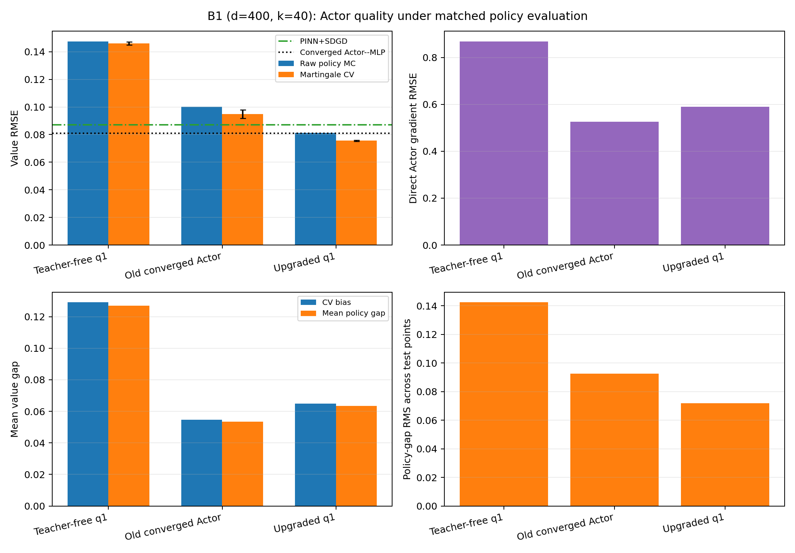

# B1 Actor-quality ceiling and one-update budget upgrade

## Numerical answer

Both requested experiments succeed.

First, replacing teacher-free `q1` with the old converged Actor under the same
64-step martingale-CV evaluator lowers `(400,40)` value RMSE from
**0.14614** to
**0.09482**, a
35.1% improvement. This
passes the predeclared 10% Actor-headroom gate and confirms that Actor quality,
rather than path count or the 16-step grid, was the actionable bottleneck.

Second, one higher-budget teacher-free improvement from the same pathwise `q0`
reaches **0.07558 ±
0.00049** with martingale CV. This is
48.3% below the old
q1 and 20.3%
below the old converged Actor under the same direct evaluator. It also beats
PINN+SDGD (0.08700) by
13.1% and the
converged Actor--MLP value result
(0.08087) by
6.5%.

## Matched results

| Actor | Direct gradient RMSE | Raw RMSE | CV RMSE | CV bias | Mean policy gap | Gap RMS | Variance reduction |
|:---|---:|---:|---:|---:|---:|---:|---:|
| Teacher-free q1 | 0.86903 | 0.14756 | 0.14614 ± 0.00108 | 0.12915 | 0.12697 | 0.14241 | 1.80x |
| Old converged Actor | 0.52618 | 0.10016 | 0.09482 ± 0.00315 | 0.05456 | 0.05339 | 0.09256 | 3.26x |
| Upgraded q1 | 0.58994 | 0.08121 | 0.07558 ± 0.00049 | 0.06491 | 0.06346 | 0.07175 | 3.35x |

All direct policy values use the same 960 frozen points, three Brownian seed
banks, 256 antithetic paths, and 64 Euler steps. RMSE intervals are 95% normal
approximations across the three evaluation seeds, conditional on each frozen
Actor. Teacher-free q1 reproduces the preceding 64-step archive bit for bit.



The upgraded raw estimator is 0.08121, just above
the converged Actor--MLP result. The martingale CV lowers it to
0.07558 with a
3.35x estimator-variance reduction.
Thus Actor quality and CV both contribute to the final win.

## Policy-gap diagnosis

The 64-step left-point approximation of
`0.5 E^q integral ||q-z*||^2 ds` closely tracks the observed mean value bias:

- old q1: bias 0.12915, gap
  0.12697, residual
  0.00218;
- old converged Actor: bias 0.05456, gap
  0.05339, residual
  0.00117;
- upgraded q1: bias 0.06491, gap
  0.06346, residual
  0.00145.

The upgraded Actor's direct `t=0` gradient RMSE
(0.58994) remains above the old
converged Actor's (0.52618), while its
trajectory policy-gap RMS is lower (0.07175
versus 0.09256). This explains why the
upgraded Actor gives the better policy value and shows that a single `t=0`
gradient RMSE does not rank policies as well as the controlled-trajectory gap.

The analytic gradient is used only after each checkpoint is frozen. It does
not enter labels, optimization, stopping, checkpoint selection, or the Gate A
threshold.

## Fixed upgrade budget and scope

The update uses exactly 8,192 training points, 512 validation points, 512 paths
per label, 32 SDE steps per label, the unchanged 4x384 Actor, and one policy
improvement. Labels come from differentiating the fixed-policy linear
evaluation of the frozen pathwise `q0`; no nonlinear MLP teacher is used.

Label generation took 84.15s and Actor
fitting took 12.83s. The best validation
checkpoint occurred at step 6000 of
6000. The optimizer therefore reached the fixed budget
cap rather than a plateau; this result should be described as a fixed-budget
upgrade, not an optimization-convergence claim.

The Actor still uses the terminal-gradient-derived rank-40 output subspace and
receives `k=40` explicitly. This remains a structural prior. No q2 or q3 was
trained.

Jobs `3375449` and
`3375455` completed `0:0` on GH200 nodes in
3.55 total allocated GPU-minutes. Validation checked
9 evaluation-seed records,
21 prediction arrays, and
1,203,840 finite prediction values. The full
test suite has 31 passing tests.

## Research decision

These results support the proposed core pipeline:

`Pathwise initialization -> one accurate policy improvement -> martingale-CV evaluation`.

For `(400,40)`, increasing the quality of the one linear policy-evaluation
update removes the previous failure without extra Actor Iteration rounds. A
paper-level confirmation should eventually repeat the upgraded training with
independent training/label seeds, but no additional q2/q3 experiment is
motivated by this result.

## Reproduction

From the repository root inside a single-GH200 allocation:

```bash
python -m pytest -q invariant_region_mlp/experiments/main_b1_sixmethods
python -m invariant_region_mlp.experiments.main_b1_sixmethods.run_actor_quality_ceiling
python -m invariant_region_mlp.experiments.main_b1_sixmethods.run_actor_quality_upgrade
python -m invariant_region_mlp.experiments.main_b1_sixmethods.actor_quality_upgrade_report
```

## Artifacts

- `ceiling/result.json`: paired old-q1 and converged-Actor ceiling diagnostic.
- `upgrade/result.json`: fixed-budget training record and upgraded-q1 evaluation.
- `comparison.csv`: compact matched comparison of all three Actors.
- `summary.json`: machine-readable conclusions and baseline comparisons.
- `validation.json`: protocol, archive, cache, checkpoint, and finiteness checks.
- `manifest.json`: SHA-256 hashes for committed report artifacts.
