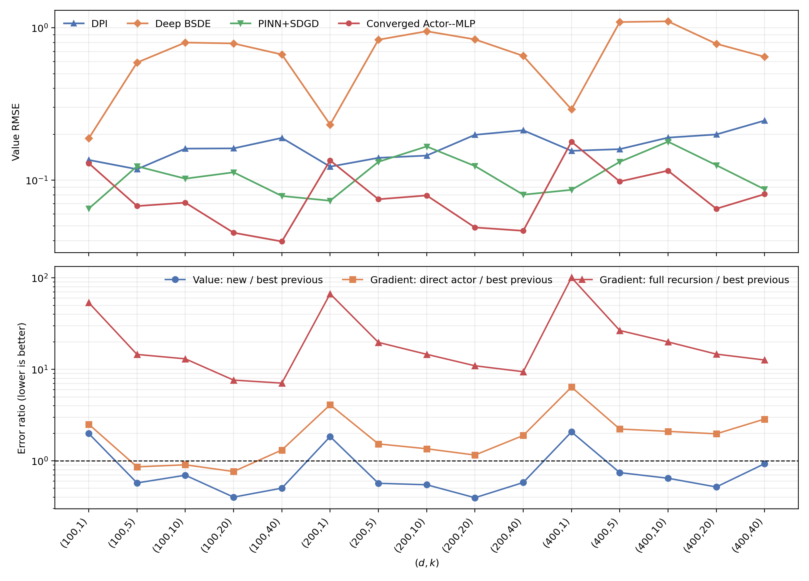

# Converged Actor--MLP against the five previous baselines

## Numerical answer

For **value prediction**, yes in most cells.  The converged Actor--MLP is the
most accurate method in **12/15** cells and in all
12 cells with `k >= 5`.  Its geometric-mean value-RMSE ratio to the best
previous method in each cell is **0.735**, a
26.5% reduction.  It loses the three `k=1` cells: `(100,1)` (1.99×), `(200,1)` (1.84×), `(400,1)` (2.07×).
Relative to the original small actor, it wins 15/15 cells with geometric-mean
RMSE ratio **0.347**.

For **gradient prediction**, no.  The actor's direct `q(t,x)` output beats the
best previous gradient predictor in only **3/15** cells, with geometric-mean error ratio
**1.788**.  The gradient returned by the full
recursive Actor--MLP estimator wins **0/15** and has geometric-mean ratio
**18.55**.

## Matched evaluation protocol

All methods use the original frozen Stage B points at `t=0`,
`x~N(0,I_d)`, with 960 points per cell.  Every method has the same test-point
SHA-256 within each `(d,k)`.  The converged Actor--MLP uses the same `n=3`,
`M=16`, ten repetition protocol and `B1|actor_mlp` random-number namespace as
the original actor.  MLP and Double use ten repetitions; DPI, Deep BSDE, and
PINN+SDGD use five independently trained seeds, as in the frozen main study.

Intervals are 95% normal approximations across seed-level RMSEs, conditional on
the one selected actor per cell.  Cell-level Wilcoxon tests below are
descriptive because the neural methods do not share training seeds.

## Value prediction

| d | k | MLP | Double | DPI | Deep BSDE | PINN+SDGD | Converged Actor--MLP |
|---:|---:|---:|---:|---:|---:|---:|---:|
| 100 | 1 | 714.3 ± 3.1 | 0.6381 ± 0.021 | 0.1356 ± 0.026 | 0.188 ± 0.0092 | **0.06497 ± 0.0067** | 0.129 ± 0.0021 |
| 100 | 5 | 244.5 ± 2.4 | 0.2596 ± 0.0053 | 0.1179 ± 0.0076 | 0.5914 ± 0.027 | 0.1232 ± 0.026 | **0.06754 ± 0.0012** |
| 100 | 10 | 220.6 ± 1.2 | 0.2408 ± 0.0063 | 0.161 ± 0.014 | 0.8006 ± 0.044 | 0.1022 ± 0.0084 | **0.0711 ± 0.00085** |
| 100 | 20 | 124 ± 0.99 | 0.1574 ± 0.0042 | 0.1616 ± 0.014 | 0.7894 ± 0.041 | 0.1125 ± 0.0064 | **0.04513 ± 0.00096** |
| 100 | 40 | 83.21 ± 0.74 | 0.1162 ± 0.0022 | 0.1893 ± 0.0079 | 0.668 ± 0.004 | 0.07866 ± 0.0042 | **0.03954 ± 0.0011** |
| 200 | 1 | 4548 ± 22 | 0.9688 ± 0.031 | 0.1226 ± 0.01 | 0.2314 ± 0.01 | **0.07322 ± 0.0074** | 0.1347 ± 0.0015 |
| 200 | 5 | 1676 ± 10 | 0.3876 ± 0.0092 | 0.14 ± 0.012 | 0.8349 ± 0.023 | 0.1318 ± 0.021 | **0.07487 ± 0.001** |
| 200 | 10 | 1531 ± 8.8 | 0.3542 ± 0.009 | 0.1449 ± 0.013 | 0.9493 ± 0.022 | 0.1663 ± 0.03 | **0.0793 ± 0.00099** |
| 200 | 20 | 862.4 ± 5.7 | 0.2211 ± 0.0078 | 0.1983 ± 0.021 | 0.8393 ± 0.01 | 0.1237 ± 0.015 | **0.04888 ± 0.00071** |
| 200 | 40 | 541.4 ± 4.7 | 0.1539 ± 0.0021 | 0.2124 ± 0.012 | 0.654 ± 0.0068 | 0.08023 ± 0.0055 | **0.04646 ± 0.00088** |
| 400 | 1 | 3.291e+04 ± 1.9e+02 | 1.794 ± 0.072 | 0.1557 ± 0.029 | 0.2914 ± 0.022 | **0.08632 ± 0.013** | 0.1786 ± 0.0027 |
| 400 | 5 | 1.269e+04 ± 85 | 0.7047 ± 0.019 | 0.1597 ± 0.02 | 1.091 ± 0.026 | 0.1318 ± 0.027 | **0.09791 ± 0.001** |
| 400 | 10 | 1.199e+04 ± 76 | 0.6426 ± 0.022 | 0.1901 ± 0.0095 | 1.103 ± 0.024 | 0.1788 ± 0.018 | **0.1153 ± 0.001** |
| 400 | 20 | 5955 ± 37 | 0.3539 ± 0.0082 | 0.1994 ± 0.011 | 0.7856 ± 0.0096 | 0.1253 ± 0.016 | **0.06485 ± 0.0011** |
| 400 | 40 | 4145 ± 30 | 0.258 ± 0.0081 | 0.2459 ± 0.014 | 0.645 ± 0.0066 | 0.087 ± 0.0067 | **0.08087 ± 0.0008** |

Against DPI, the new method wins 13/15 cells and has geometric-mean RMSE ratio
0.467.  Against PINN+SDGD it wins 12/15 with ratio
0.727.  Against the per-cell best of all five baselines, the 12/15 sign count
has two-sided sign-test `p=0.0352`, while the
Wilcoxon signed-rank result is `p=0.169`.  The latter does not cross 0.05 because the
three `k=1` losses are large.

| Comparator | Value wins | Value GM ratio | Wilcoxon p | Direct-actor gradient wins | Direct-gradient GM ratio | Full-gradient wins | Full-gradient GM ratio |
|---|---:|---:|---:|---:|---:|---:|---:|
| MLP | 15/15 | 5.33e-05 | 6.1e-05 | 15/15 | 1.26e-05 | 15/15 | 0.000131 |
| Double | 15/15 | 0.213 | 6.1e-05 | 15/15 | 0.0178 | 15/15 | 0.184 |
| DPI | 13/15 | 0.467 | 0.00061 | 7/15 | 1.16 | 0/15 | 12.1 |
| Deep BSDE | 15/15 | 0.124 | 6.1e-05 | 12/15 | 0.41 | 0/15 | 4.26 |
| PINN+SDGD | 12/15 | 0.727 | 0.169 | 3/15 | 1.74 | 0/15 | 18 |
| Best of five per cell | 12/15 | 0.735 | 0.169 | 3/15 | 1.79 | 0/15 | 18.6 |

## Gradient prediction

The direct actor diagnostic evaluates the frozen actor itself against exact
`z*(0,x)` on the same 960 points.  The full-gradient column evaluates the
gradient component returned by the recursive MLP solver.  These are different
objects and should not be conflated.

| d | k | Best previous gradient | Direct actor q | Full Actor--MLP gradient | Oracle-actor full gradient |
|---:|---:|:---|---:|---:|---:|
| 100 | 1 | PINN+SDGD: 0.1306 | 0.3276 | 6.981 | 6.565 |
| 100 | 5 | DPI: 0.2426 | 0.2082 | 3.526 | 3.367 |
| 100 | 10 | PINN+SDGD: 0.2517 | 0.2276 | 3.277 | 3.099 |
| 100 | 20 | PINN+SDGD: 0.2469 | 0.1886 | 1.882 | 1.851 |
| 100 | 40 | PINN+SDGD: 0.1801 | 0.2363 | 1.272 | 1.303 |
| 200 | 1 | PINN+SDGD: 0.1528 | 0.6259 | 10.22 | 9.109 |
| 200 | 5 | DPI: 0.2738 | 0.4186 | 5.388 | 4.865 |
| 200 | 10 | DPI: 0.3297 | 0.4465 | 4.809 | 4.343 |
| 200 | 20 | PINN+SDGD: 0.2545 | 0.2942 | 2.782 | 2.658 |
| 200 | 40 | PINN+SDGD: 0.1785 | 0.3375 | 1.681 | 1.751 |
| 400 | 1 | PINN+SDGD: 0.1643 | 1.05 | 16.53 | 12.9 |
| 400 | 5 | PINN+SDGD: 0.3014 | 0.6709 | 8.008 | 6.981 |
| 400 | 10 | DPI: 0.3834 | 0.8049 | 7.637 | 6.245 |
| 400 | 20 | PINN+SDGD: 0.2576 | 0.5081 | 3.778 | 3.548 |
| 400 | 40 | PINN+SDGD: 0.1841 | 0.5262 | 2.326 | 2.56 |

The full converged-actor gradient is already close to the Oracle-actor MLP
gradient: their geometric-mean error ratio is
**1.071**.  Yet it is
**18.55×** the best prior gradient error.  Thus the dominant gradient bottleneck is the
frozen `n=3, M=16` recursive/BEL estimator, not the learned actor.  Better actor
labels primarily improve the value estimate under this protocol.

## Compute and interpretation

Unique final label construction, actor optimization, and the ten-seed Stage B
evaluation total **1.383 GPU hours**.  For context, the
original measured totals are DPI 0.593, Deep BSDE
0.627, and PINN+SDGD
1.886 GPU hours.  These are measured
configurations rather than an equal-budget frontier.  Including provisional
actor pilots, the convergence investigation used
1.510 GH200 hours.

The `k=1` losses persist even with Oracle Actor: Oracle Actor--MLP also loses
PINN+SDGD in those three cells.  Actor improvement alone therefore cannot
remove that low-rank evaluation floor.  At `k>=5`, the converged actor changes
the original conclusion: Actor--MLP is now first in all 12 cells.

## Artifacts

- `comparison.csv`: complete per-cell value and gradient comparison.
- `pairwise_summary.csv`: wins, ratios, sign tests, and Wilcoxon tests.
- `summary.json`: headline results and measured compute.
- `validation.json`: input counts, hash pairing, and finite-value checks.
- `manifest.json`: SHA-256 hashes for this report and its artifacts.
