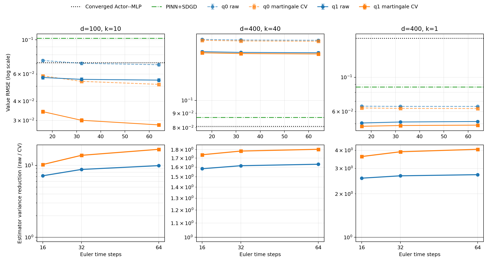

# Martingale control-variate Policy Evaluation pilot

## Numerical answer

The proposed control variate works and costs no extra Actor forward calls. It
reduces the antithetic-pair estimator variance for every tested actor and time
resolution. For `q1` at 64 Euler steps the reduction is
**16.72x** at `(100,10)`,
**1.804x** at `(400,40)`, and
**4.068x** at `(400,1)`.

The practical conclusion is conditional:

- `(100,10)` is a strong success. `q1` RMSE falls from 0.05701 for the
  published 16-step raw estimator to **0.02811** for 64-step martingale CV.
- `(400,40)` remains a clear failure. The corresponding RMSE is **0.14614**
  with bias **+0.12915**, versus 0.08700 for PINN+SDGD and 0.08087 for the
  converged Actor--MLP. Refining 16 to 64 steps changes CV RMSE by only
  -0.001377.
- `(400,1)` improves modestly from 0.05061 raw at 16 steps to **0.04818** CV at
  16 steps. Increasing to 64 steps gives 0.04900, so extra time resolution does
  not help this cell under the matched Brownian paths.

Thus the `(400,40)` gap is not mainly finite-path variance or 16-step Euler
error. The leading remaining explanation is policy error from the frozen small
`q1` label/training budget. No additional Actor iteration is justified by this
experiment.

## Matched q1 results

| (d,k) | q1 raw, n=16 | q1 CV, n=16 | q1 raw, n=64 | q1 CV, n=64 | Variance reduction, n=64 | CV bias, n=64 |
|:---:|---:|---:|---:|---:|---:|---:|
| (100,10) | 0.05701 ± 0.0014 | 0.03427 ± 0.00081 | 0.05481 ± 0.0013 | 0.02811 ± 0.00061 | 16.72x | 0.02059 |
| (400,40) | 0.1489 ± 0.0013 | 0.1475 ± 0.0012 | 0.1476 ± 0.0014 | 0.1461 ± 0.0011 | 1.804x | 0.1291 |
| (400,1) | 0.05061 ± 0.00056 | 0.04818 ± 6.4e-05 | 0.05173 ± 0.00058 | 0.049 ± 5.3e-05 | 4.068x | 0.03587 |

RMSE intervals are 95% normal approximations across three independent seed
banks. Raw and corrected values use exactly the same 256 antithetic paths and
the same Actor evaluations. Variance reduction is computed from independent
antithetic-pair means, so it includes covariance inside each pair. Empirical
cross-seed variance gives closely matching ratios.



## Time-discretization check

| (d,k) | Estimator | n=16 RMSE | n=32 RMSE | n=64 RMSE | n64-n16 |
|:---:|:---|---:|---:|---:|---:|
| (100,10) | Raw | 0.05701 | 0.05544 | 0.05481 | -0.002201 |
| (100,10) | Martingale CV | 0.03427 | 0.03011 | 0.02811 | -0.006162 |
| (400,40) | Raw | 0.1489 | 0.148 | 0.1476 | -0.001292 |
| (400,40) | Martingale CV | 0.1475 | 0.1466 | 0.1461 | -0.001377 |
| (400,1) | Raw | 0.05061 | 0.05134 | 0.05173 | 0.001111 |
| (400,1) | Martingale CV | 0.04818 | 0.04871 | 0.049 | 0.0008193 |

The 32- and 64-step paths are Brownian-bridge refinements of the original
16-step paths. For `(100,10)`, refining the grid lowers corrected bias from
0.02752 to 0.02059, so time discretization is material alongside Monte Carlo
variance. For `(400,40)`, corrected bias changes only from 0.13072 to 0.12915;
its large residual error cannot be removed by increasing paths or by this grid
refinement. At `(400,1)`, the small RMSE increase with refinement is consistent
with loss of favorable error cancellation, rather than a variance problem.

These errors are measured against the optimal analytic value `u*`. Therefore
the reported bias combines policy suboptimality and residual Euler bias; it is
not bias of the Monte Carlo estimator for the discretized policy value. The
martingale term has zero expectation and changes only estimator variance.

## One improvement remains enough

At 64 steps with the control variate, q0-to-q1 RMSE changes are:

- `(100,10)`: 0.05147 to
  0.02811.
- `(400,40)`: 0.1621 to
  0.1461.
- `(400,1)`: 0.06277 to
  0.049.

One policy improvement helps all three cells. This supports the simple pipeline
`pathwise initialization -> one policy improvement -> accurate linear policy
evaluation` and gives no evidence that more Actor Iteration rounds are useful.

## Scope, structure prior, and correctness

No actor was retrained or selected in this experiment. The actors remain
teacher-free with respect to nonlinear MLP labels, but they retain the
terminal-gradient-derived rank-`k` output subspace and receive `k` explicitly.
This is a structural prior and must be stated when comparing with general HJB
methods.

The full suite has 30 passing tests. A linear-terminal exact-policy test reaches
numerical zero variance and fixes the stochastic-integral sign and scaling.
Brownian refinement preserves every coarse increment and antithetic pair. All
six 16-step raw prediction banks match the published pilot **bit for bit**
(maximum absolute difference 0). Artifact validation checked 18 result rows,
54 seed records, 36 prediction arrays, and 103,680 finite predictions.

Job `3375175` completed `0:0` on one GH200 in
2.85 GPU-minutes. There were no failed runs,
NaNs, or memory failures.

## Reproduction

From the repository root inside a single-GH200 allocation:

```bash
python -m pytest -q invariant_region_mlp/experiments/main_b1_sixmethods
python -m invariant_region_mlp.experiments.main_b1_sixmethods.run_policy_evaluation_cv
python -m invariant_region_mlp.experiments.main_b1_sixmethods.policy_evaluation_cv_report
```

## Artifacts

- `result.json`: full protocol, seed rows, costs, and nested-grid diagnostics.
- `comparison.csv`: compact 18-row q0/q1 and 16/32/64-step comparison.
- `summary.json`: machine-readable conclusions and baseline comparisons.
- `validation.json`: parity, hashes, shapes, and finite-value checks.
- `scheduler_accounting.json`: exact Slurm allocation record.
- `manifest.json`: SHA-256 hashes for the report and compact artifacts.
