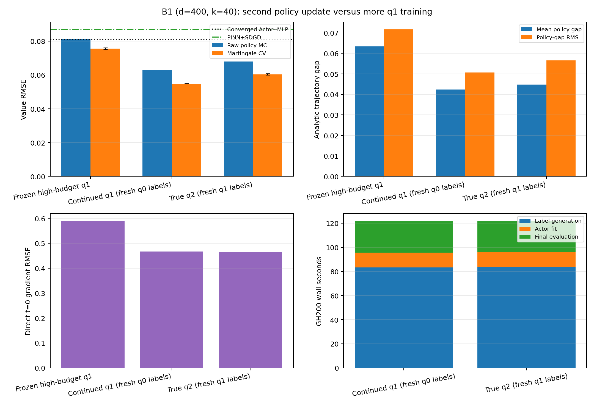

# B1 high-budget q2 versus continued-q1 control

## Numerical answer

The true second policy update improves over the frozen high-budget q1, but it
does **not** beat the matched extra-training control.

- Frozen q1: **0.07558 ± 0.00049**.
- Continued q1 with fresh q0-evaluation labels: **0.05481 ±
  0.00008**.
- True q2 with fresh q1-evaluation labels: **0.06040 ±
  0.00038**.

Relative to frozen q1, continued training improves CV RMSE by
27.5%
and q2 improves it by
20.1%. However,
q2's RMSE is 10.2%
higher than the control. The paired per-evaluation-seed difference
`q2 - continued q1` is **0.00559 ±
0.00046**.

The analytic policy-gap diagnostic reaches the same conclusion. Mean gap is
0.04235 for continued q1 and
0.04475 for q2; the paired difference is
0.00240 ± 0.00003. Thus the
ranking is not an artifact of martingale-CV sampling variance.

## Strictly matched comparison

| Actor | Direct grad. RMSE | Raw value RMSE | CV value RMSE | CV bias | Mean policy gap | Gap RMS | CV variance factor |
|:---|---:|---:|---:|---:|---:|---:|---:|
| Frozen high-budget q1 | 0.58994 | 0.08121 | 0.07558 ± 0.00049 | 0.06491 | 0.06346 | 0.07175 | 3.35x |
| Continued q1 (fresh q0 labels) | 0.46717 | 0.06310 | 0.05481 ± 0.00008 | 0.04404 | 0.04235 | 0.05072 | 4.47x |
| True q2 (fresh q1 labels) | 0.46424 | 0.06790 | 0.06040 ± 0.00038 | 0.04637 | 0.04475 | 0.05655 | 4.11x |

Both learned branches start from the identical frozen q1 state. They use the
same fresh 8,192/512 train/validation points, the same optimizer seed and
minibatch sequence, 512 paths per label, 32 label SDE steps, the unchanged
4x384 network, and exactly 6,000 optimizer steps. Label Monte Carlo streams
are independent as predeclared. Final values use the same 960 held-out points,
three Brownian banks, 256 antithetic paths, and 64 Euler steps.



The frozen-q1 arrays reproduce the preceding archive exactly. All three
Actors beat the earlier PINN+SDGD value RMSE
(0.08700) and converged Actor--MLP value RMSE
(0.08087) under their respective
reported protocols.

## What the control changes

Continued q1 receives another fresh set of labels from fixed-q0 linear policy
evaluation. True q2 instead receives labels from fixed-q1 linear policy
evaluation. Both begin from q1, so each branch has the same number of labels
at the same points and the same optimization budget. The result therefore does not support
attributing q2's gain over frozen q1 to the second policy update: the q0-label
control obtains a larger gain.

The trajectory result is especially useful because q2 has a slightly lower
direct `t=0` gradient RMSE than the control
(0.46424 versus
0.46717), yet it has worse value RMSE
and a 11.5%
higher policy-gap RMS. A single starting-time gradient metric again fails to
rank policy quality along controlled paths.

The conclusion is conditional on one paired training seed. The displayed
intervals measure the three final Monte Carlo evaluation banks for fixed
Actors; they do not include training-seed variation. Since q2 loses this
paired run, no q3 confirmation is triggered by the predeclared decision rule.

## Cost and stopping

| Branch | Label generation | Actor fit | Final 3-seed evaluation | Best/total step | Optimizer converged |
|:---|---:|---:|---:|---:|:---:|
| Continued q1 | 83.23s | 12.48s | 26.00s | 6000/6000 | no |
| True q2 | 83.75s | 12.57s | 25.65s | 6000/6000 | no |

Both branches select the final step and reach the fixed cap. These are
fixed-budget results, not optimizer-convergence claims. Their measured costs
are essentially identical.

Job `3376645` completed on `gh014` in
291 seconds. An earlier allocation
(`3375859` on `gh097`) failed before the workload began
with a Slurm interconnect-configuration error; its 13
allocated GPU-seconds are included in accounting. No cache or checkpoint came
from that failed allocation.

## Research decision

For this cell, retain the simpler one-policy-improvement method and spend any
extra budget on q0-evaluation labels or Actor fitting. Do not add q3. A concise
method description is:

`Pathwise initialization -> one well-trained policy improvement -> martingale-CV evaluation`.

The continued branch doubles the cumulative q0-label/training budget relative
to the original high-budget q1, so it should be described as a stronger
one-improvement fit rather than a free improvement. Before a publication-level
claim that a second update is harmful in general, repeat the paired experiment
with independent training and label seeds.

The analytic gradient is evaluation-only. It does not enter labels,
optimization, checkpoint selection, or stopping. The terminal-gradient-derived
rank-40 output subspace remains a disclosed structural prior. No q3 or q4 was
run.

## Validation and reproduction

Validation status is **PASS**. It independently recomputed
all metrics from 21 arrays containing
1,203,840 finite values, checked
9 evaluation records, four label
caches, both checkpoints, the paired protocol, and both Slurm allocations.
The repository test suite has 31 passing tests.

From the repository root inside one GH200 allocation:

```bash
python -m pytest -q invariant_region_mlp/experiments/main_b1_sixmethods
python -m invariant_region_mlp.experiments.main_b1_sixmethods.run_actor_q2_control
python -m invariant_region_mlp.experiments.main_b1_sixmethods.actor_q2_control_report
```

## Artifacts

- `result.json`: full paired protocol, training histories, evaluations, and costs.
- `comparison.csv`: compact three-Actor metric table.
- `summary.json`: machine-readable comparisons and research decision.
- `validation.json`: independent archive, protocol, cache, and checkpoint checks.
- `scheduler_accounting.json`: failed allocation and successful run accounting.
- `manifest.json`: SHA-256 hashes for the committed report artifacts.
