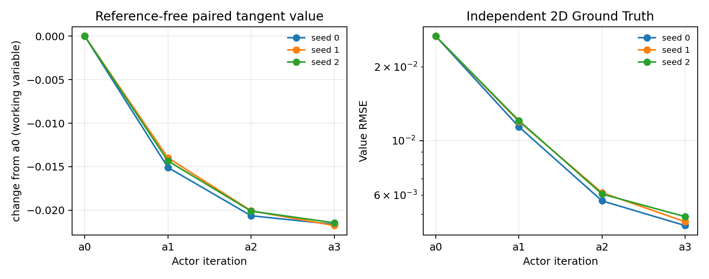
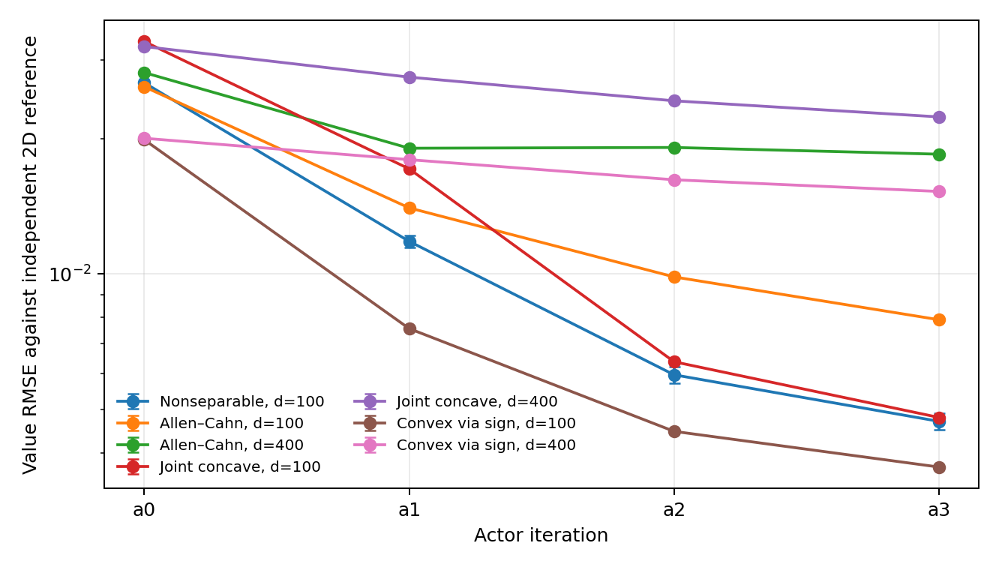
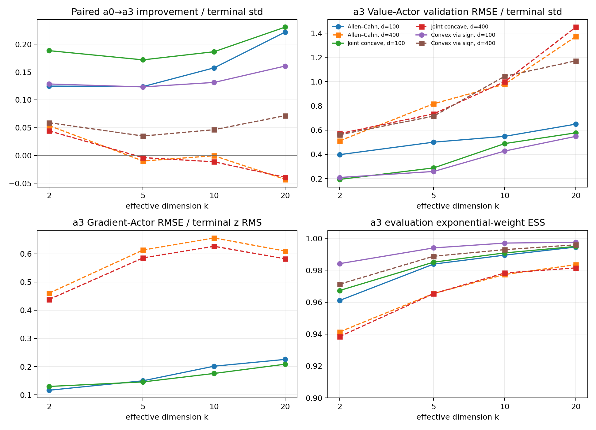
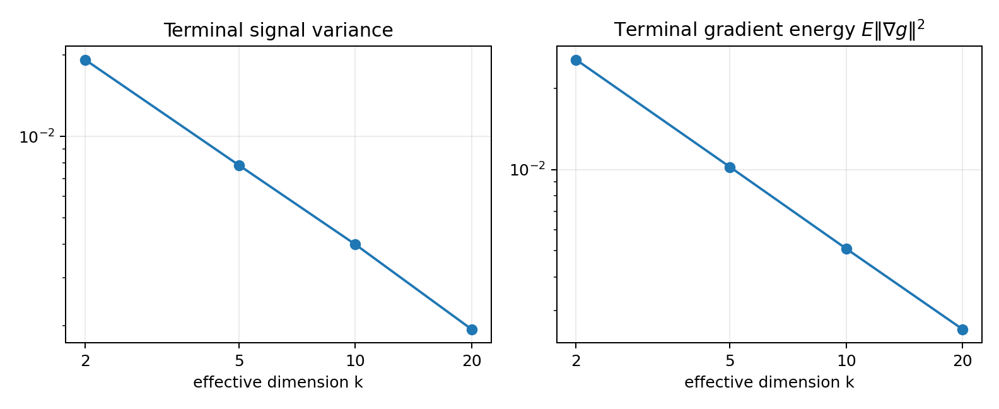

# Nonseparable Driver and High-Effective-Dimension Tangent-Actor Pilot

## Decision: **CONDITIONAL GO**

本轮验证完成了预定的两阶段实验，共 27 个训练配置、81 次 Actor 更新和 9 组独立二维 Ground Truth 评估。结论分成两部分：

1. **非可分 driver 验证成功。** 同一套通用 tangent coefficient、加权线性 Feynman–Kac 和 full-trajectory VJP 代码直接处理
   \[
   f(u,z)=u-u^3-\tfrac12\lvert z+uv\rvert^2,
   \]
   没有增加专用 solver。三个独立训练种子的最终 Value RMSE 为 `0.00451 / 0.00468 / 0.00491`，均值为 `0.00470 ± 0.00020`；每次 `a0→a1→a2→a3` 更新的 reference-free paired value 都下降。
2. **有效维数扩展只在 `d=100` 下稳定通过。** 三个既有 driver 在 `d=100,k=2,5,10,20` 的总配对改善全部显著，但 Value-Actor 和 Gradient-Actor 的信号归一化误差随 $k$ 增大。固定同一预算升到 `d=400` 后，Allen–Cahn 和 joint-concave 从 `k=5` 开始不再有净改善；sign-transformed convex 仍有净改善，但中间迭代出现退步。

因此，本轮支持继续研究 Tangent-Actor 方法，但**还不足以直接启动完整 ICML strong-baseline comparison**。下一轮应先解决 full-ambient Actor 在 `d=400` 的样本效率和逼近问题，优先增加不同训练点数量，而不是增加每点 MC paths 或盲目增加 iteration。

## Experiment scope and safeguards

- 分支：`ir-mlp-nonseparable-high-effective-dim`，从 `09d80221` 开始；实际 GPU 运行代码为 `4f80fa50`。
- 新 PDE：`d=100, k=2, T=0.5, η=1`，$v=\beta_1$，三个训练种子 `0,1,2`。
- 有效维数网格：Allen–Cahn、joint concave、joint convex via sign transformation；全部运行 `d∈{100,400}`、`k∈{2,5,10,20}`，每个配置一个训练种子。
- 初始阶段只运行 `d=100,k=2,5,10`。三个 family 的 `k=10` 配对改善 95% 上界均小于零、ESS 大于 0.5 且所有 rollout 有限，因此按预先写入协议的 gate 扩展到 `k=20` 和 `d=400`。
- 每轮统一使用 2,048 个训练点、256 个 validation 点、128 paths/label、16 个 SDE steps、2,500 optimizer steps 和 3×192 SiLU Actor。
- Reference-free evaluation 使用 256 个固定起点、512 条 antithetic paths 和 32 steps；Ground Truth evaluation 使用 384 个固定起点、512 paths 和 64 steps。
- Actor 始终读取完整的 `(t,x)∈R^(d+1)`；没有输入 $B^\top x$、oracle subspace projection、解析非终端标签、非线性 MLP teacher、外部 baseline 或超参数 sweep。
- checkpoint 仅按 held-out noisy tangent-label loss 选择；Ground Truth 在全部训练和 reference-free 比较冻结后才生成并使用。

完整配置见 [`experiment_protocol.json`](experiment_protocol.json)，运行环境见 [`runtime_environment_initial.json`](runtime_environment_initial.json) 和 [`runtime_environment_expansion.json`](runtime_environment_expansion.json)。

## Generic nonseparable implementation

通用切线代码仍然只计算

\[
c=f_u(r,q),\qquad b=f_z(r,q),\qquad h=f(r,q)-cr-b\cdot q.
\]

对新 driver，自动得到

\[
f_u=1-3u^2-(z+uv)\cdot v,\qquad f_z=-(z+uv),
\]

以及非零 mixed derivative

\[
\nabla_z f_u=-v.
\]

解析系数与 PyTorch autodiff 在 float64 测试中一致。联合 Hessian 在 $u∈[0,1]$ 上为半负定；测试还直接验证了切平面上界。17 项 CPU correctness tests 全部通过，包括四类 driver、符号变换、完整状态依赖 VJP、full-ambient Actor、二维参考收敛和训练代码无 reference/subspace 依赖。详见 [`numerical_correctness.json`](numerical_correctness.json)。

## Independent 2D numerical references

所有 `k=2` Ground Truth 都来自独立的二维周期 Fourier solver：fine grid `128²`、内部步长 `0.00025`；coarse grid `64²`、内部步长 `0.0005`。训练代码不导入这个 solver。

| Driver | Fine/coarse Value RMSE | Fine/coarse gradient vector RMSE | PDE residual RMSE | Numerical working-value range | In tangent domain |
|---|---:|---:|---:|---:|---:|
| Allen–Cahn | 8.44e-5 | 8.49e-5 | 3.46e-7 | [0.2000, 0.8362] | yes |
| Joint concave | 8.45e-5 | 8.46e-5 | 3.18e-7 | [0.2000, 0.8331] | yes |
| Joint convex, transformed | 7.78e-5 | 7.77e-5 | 4.00e-7 | [-0.8000, -0.2000] | yes |
| Nonseparable | 7.72e-5 | 7.80e-5 | 5.13e-7 | **[0.2000, 0.8000]** | **yes** |

新非可分问题的数值真解完整保持在 `[0,1]`。四个参考的 terminal interpolation RMSE 约为 `3.3e-5`，最大误差小于 `9.0e-5`。完整数据见 [`numerical_reference_validation.csv`](numerical_reference_validation.csv)。

## Nonseparable driver: three-seed result

下表的 `±` 是三个独立训练种子的标准差；`a0` 和 exact-tangent 使用固定测试 bank，因此跨训练种子相同。

| Actor | Paired change vs previous | Ground Truth Value RMSE | Relative L2 | Exact Value-Actor RMSE | Exact Gradient-Actor vector RMSE |
|---|---:|---:|---:|---:|---:|
| a0 | — | 0.026679 | 4.2766% | 0.132718 | 0.151251 |
| a1 | -0.014464 ± 0.000566 | 0.011828 ± 0.000372 | 1.8961% ± 0.0597% | 0.046967 ± 0.003223 | 0.060063 ± 0.001643 |
| a2 | -0.005799 ± 0.000272 | 0.005965 ± 0.000242 | 0.9563% ± 0.0388% | 0.029861 ± 0.002283 | 0.039398 ± 0.000962 |
| a3 | -0.001342 ± 0.000355 | **0.004698 ± 0.000198** | **0.7532% ± 0.0318%** | **0.023016 ± 0.001422** | **0.030325 ± 0.000559** |
| exact tangent | — | 0.003308 | 0.5303% | ≈0 | ≈0 |

三个种子的 a3 总配对变化分别为 `-0.021618`, `-0.021759`, `-0.021439`；对应逐状态 paired SE 约为 `0.00073`。三个种子的每一步更新也都显著为负。a3 的 noisy-label validation RMSE 为 Value `0.02113 ± 0.00011`、Gradient vector `0.03112 ± 0.00251`，与独立真值下的 Actor 误差一致。

`exact tangent` 是把独立二维参考的 $(u^*,z^*)$ 查表函数放入同一个 plain weighted-MC evaluator，仍受到有限 paths 和 Euler 离散的影响，因此 `0.003308` 是本协议下的数值地板，而不是参考 PDE 的误差。a3 已接近但尚未达到这个地板。

## Ground Truth accuracy at k=2

`k=2` 是唯一使用独立 Ground Truth 的有效维数。下表中的箭头依次表示 `a0→a1→a2→a3`；`exact floor` 使用完全相同的 MC evaluator。

| Driver | d | Value RMSE a0→a1→a2→a3 | a3 Relative L2 | a3 bias | Exact-tangent floor |
|---|---:|---|---:|---:|---:|
| Allen–Cahn | 100 | 0.02614 → 0.01404 → 0.00986 → **0.00791** | 1.154% | +0.00529 | 0.00372 |
| Allen–Cahn | 400 | 0.02811 → 0.01907 → 0.01915 → **0.01850** | 2.696% | +0.01555 | 0.00398 |
| Joint concave | 100 | 0.03297 → 0.01716 → 0.00638 → **0.00479** | 0.706% | +0.00230 | 0.00411 |
| Joint concave | 400 | 0.03214 → 0.02747 → 0.02433 → **0.02240** | 3.324% | +0.01954 | 0.00385 |
| Joint convex | 100 | 0.01992 → 0.00756 → 0.00446 → **0.00372** | 1.059% | -0.00181 | 0.00311 |
| Joint convex | 400 | 0.02008 → 0.01799 → 0.01622 → **0.01528** | 4.396% | -0.01211 | 0.00307 |

测试 bank 在两个 ambient dimensions 之间独立抽样，但 active coordinates 服从相同分布，协议和二维参考相同。exact-tangent floors 也保持在 `0.0031–0.0040`。因此 `d=400` 的 a3 RMSE 增大不是参考精度或 MC floor 造成的：相对 `d=100`，三个 driver 分别增大约 `2.34×`, `4.67×`, `4.11×`，且误差主要表现为系统性 bias。

## Effective-dimension scaling

为避免把信号缩小误判成算法改善，定义

\[
I_k=-\frac{\overline{V^{a_3}-V^{a_0}}}{\operatorname{std}(g_k)}.
\]

正数表示 paired tangent value 净下降，负数表示净退步。

| Driver | d | k=2 | k=5 | k=10 | k=20 |
|---|---:|---:|---:|---:|---:|
| Allen–Cahn | 100 | +0.1247 | +0.1238 | +0.1574 | +0.2218 |
| Allen–Cahn | 400 | +0.0538 | -0.0100 | -0.0005 | **-0.0430** |
| Joint concave | 100 | +0.1884 | +0.1718 | +0.1864 | +0.2307 |
| Joint concave | 400 | +0.0442 | -0.0038 | -0.0114 | **-0.0394** |
| Joint convex | 100 | +0.1284 | +0.1232 | +0.1312 | +0.1607 |
| Joint convex | 400 | +0.0589 | +0.0350 | +0.0463 | +0.0716 |

在 `d=100`，12 个 `(family,k)` 配置的总变化都显著为负，且每个相邻 iteration 都改善。`d=400` 的行为不同：

- Allen–Cahn 只有 `k=2` 保持显著净改善；`k=20` 显著退步，`k=5,10` 没有可分辨的净收益。
- Joint concave 只有 `k=2` 保持显著净改善；`k=20` 显著退步，`k=5,10` 没有可分辨的净收益。
- Joint convex 的四个 $k$ 都有显著净改善，但 `k=5,10,20` 的 a1→a2 更新退步，a3 只部分修复；迭代不再单调。

Value-Actor validation RMSE 除以 terminal signal standard deviation 后得到：

| Driver | d | k=2 | k=5 | k=10 | k=20 |
|---|---:|---:|---:|---:|---:|
| Allen–Cahn | 100 | 0.398 | 0.501 | 0.549 | 0.649 |
| Allen–Cahn | 400 | 0.512 | 0.817 | 0.979 | **1.372** |
| Joint concave | 100 | 0.193 | 0.288 | 0.489 | 0.577 |
| Joint concave | 400 | 0.571 | 0.734 | 1.000 | **1.449** |
| Joint convex | 100 | 0.209 | 0.259 | 0.427 | 0.548 |
| Joint convex | 400 | 0.562 | 0.715 | 1.044 | **1.171** |

对于带 $z$ 的两个 driver，把 Gradient-Actor vector RMSE 除以 terminal $z=\sqrt2\nabla g$ 的 RMS，`d=100` 从 `0.116–0.130` 增长到 `0.209–0.226`；`d=400` 为 `0.438–0.656`。这显示绝对误差随 $k$ 下降主要来自信号变小，信号归一化后的 Actor 精度实际恶化。

## Terminal signal and genuine k-direction audit

| k | Terminal std, d=100 | Terminal variance | E‖∇g‖² | Raw rank | Centered rank | Centered min/max singular ratio |
|---:|---:|---:|---:|---:|---:|---:|
| 2 | 0.13863 | 0.019219 | 0.025582 | 2 | 2 | 0.992 |
| 5 | 0.08848 | 0.007828 | 0.010235 | 5 | 5 | 0.969 |
| 10 | 0.06317 | 0.003990 | 0.005094 | 10 | 10 | 0.943 |
| 20 | 0.04401 | 0.001937 | 0.002560 | 20 | 20 | 0.915 |

`d=400` 的对应 centered singular ratio 为 `0.976, 0.958, 0.939, 0.899`，所有 raw 和 centered ranks 都严格等于 $k$。dense basis 的中位绝对元素在 `d=100/400` 约为 `0.07/0.034`，没有坐标稀疏性。因此 terminal gradients 确实覆盖 $k$ 个独立 ambient directions。

同时，题目给定的振幅 $0.3/k$ 使 terminal variance 和 gradient energy 约按 $1/k$ 下降。这控制了值域，却也让高 $k$ 问题的绝对信号更小。所有跨 $k$ 判断都必须同时查看归一化 Actor error 和 [`terminal_geometry.csv`](terminal_geometry.csv)，不能只看绝对 RMSE 或绝对 paired change。

## What causes the deterioration?

现有证据主要指向 **Actor approximation/generalization under full ambient input**，而不是标签噪声、evaluation MC 或指数权重退化。

| Group | Value fit RMSE / independent-label replication RMSE | Gradient fit RMSE / replication RMSE | Evaluation ESS | a3 mean-value MC SE |
|---|---:|---:|---:|---:|
| d=100 | 3.3–12.6 | 2.15–4.73 | 0.961–0.998 | 6.1e-5–2.47e-4 |
| d=400 | 9.8–31.4 | 8.88–14.94 | 0.938–0.996 | 5.7e-5–2.32e-4 |

两个独立 label banks 的差估计了 MC supervision noise（其方差为单个 label noise 的两倍）。在 `k=2` joint-concave 中，Gradient fit/replication 为 `0.0263/0.0122` (`d=100`) 和 `0.1043/0.0117` (`d=400`)；joint-convex 为 `0.0293/0.0102` 和 `0.0992/0.0100`。标签噪声几乎没变，Actor 残差却增大约四倍。独立 Ground Truth 又给出同样的 gradient degradation，因此这不是 noisy-label validation 的假象。

所有配置的 label-weight ESS 为 `0.978–0.998`，evaluation ESS 为 `0.938–0.998`，最大 evaluation weight 为 `1.93`，nonfinite count 全为零。MC mean SE 比失败配置中 `10^-3` 量级的系统性变化小一个数量级。指数权重和最终 MC evaluation 都不是当前首要瓶颈。

本轮仍不能仅凭一个固定预算区分“网络容量不足”和“2,048 个 full-ambient 训练点不足”。Allen–Cahn 没有 Gradient head，也在 `d=400` 失败，说明问题不只来自 $d$-维输出头；更可能是 full-ambient 方向学习的样本效率。对带 $z$ 的问题，输出维数从 100 增至 400 又进一步增加难度。

## Bregman identity diagnostics

审计在最终 Actor 控制的 held-out paths 上比较

\[
v^A-u^* \quad\text{与}\quad
\mathbb E^A\!\int C_sD_{-f}\big((u^*,z^*),A_s\big)\,ds.
\]

| Driver | d/seed | LHS mean | RHS mean | Mean discrepancy / conservative SE | Discrepancy RMSE / predicted MC noise |
|---|---|---:|---:|---:|---:|
| Nonseparable | 100/0 | 0.002393 | 0.001684 | 1.33 | 1.03 |
| Nonseparable | 100/1 | 0.003038 | 0.001681 | 2.43 | 0.96 |
| Nonseparable | 100/2 | 0.002437 | 0.001657 | 1.40 | 1.27 |
| Allen–Cahn | 100/0 | 0.005824 | 0.005236 | 0.87 | 1.16 |
| Allen–Cahn | 400/0 | 0.016140 | 0.014155 | 3.07 | 1.07 |
| Joint concave | 100/0 | 0.003127 | 0.001890 | 1.90 | 1.06 |
| Joint concave | 400/0 | 0.019248 | 0.018776 | 0.72 | 0.89 |
| Joint convex | 100/0 | 0.001379 | 0.001565 | -0.34 | 0.94 |
| Joint convex | 400/0 | 0.013687 | 0.013974 | -0.51 | 0.97 |

所有审计的 Bregman divergence 在 `-3e-6` 以下的比例均为零，最小值为 `-8.1e-8`，属于浮点误差。跨状态 discrepancy RMSE 都在预测 MC noise 的 `0.89–1.27×` 内。两个审计的均值 discrepancy 超过两个保守 SE，说明当前 64-step 离散和有限参考插值下仍有约 `10^-3` 的可见系统误差；因此结果支持恒等式的定性和路径级数值一致性，但不应宣称所有均值已统计收敛到零。完整结果见 [`bregman_identity.csv`](bregman_identity.csv)。

## Cost

- Slurm jobs `3382802` 和 `3383003` 均在单张 NVIDIA GH200 120GB 上正常结束，退出码均为 0。
- 两个 allocation 分别用时 `38:33` 和 `36:54`，合计 **1.2575 GH200 GPU-hours**，在预定的 1–2 GPU-hour 范围内。
- 每个配置三轮 labels + Actor training 的实测时间中位数为 `101.2 s`，范围 `52.6–125.5 s`。
- 每个配置四个 Actor 的 reference-free inference 总时间中位数为 `24.7 s`，范围 `21.3–31.1 s`。
- 45 个 Ground Truth/MC Actor evaluations 的 inference 总计 `1,204 s`；单次中位数 `20.3 s`。二维 reference 构造和 Bregman audit 也包含在 allocation wall time 中。

资源记录见 [`resource_accounting.csv`](resource_accounting.csv)。checkpoint、label cache 和逐点 prediction arrays 保留在本地以便审计，但因体积较大不提交；运行脚本可确定性重建它们。

## Answers to the research questions

1. **同一 Tangent-Actor algorithm 能否处理 genuinely nonseparable $f(u,z)$？** 能。三种子结果逐轮改善，最终 RMSE `0.00470 ± 0.00020`，mixed derivative、联合凹性、二维参考和 Bregman divergence 均通过独立检查。
2. **性能是否随 $k=2→5→10→20$ 恶化？** `d=100` 的 reference-free value improvement 仍稳定，但 Value/Gradient Actor 的信号归一化误差持续增加；`d=400` 中 Allen–Cahn 和 joint-concave 从 `k=5` 起失去净改善。有效维数和 ambient dimension 的组合已经造成实质退化。
3. **退化来自 Actor、noisy supervision 还是 MC estimation？** 主要证据指向 Actor 的 full-ambient approximation/generalization。`d=400` 的 label replication noise 与 `d=100` 相近，fit/noise ratio 却大幅上升；ESS、MC SE、有限性都正常。当前数据不能进一步唯一分解为网络容量还是训练点覆盖不足。
4. **是否已有足够证据进入完整 ICML strong-baseline comparison？** 尚未。非可分性和 `d=100,k≤20` 已经通过，但 `d=400` 的固定预算稳健性不足。先做一次小型 Actor scaling diagnosis 更有价值。

建议下一步固定 `d=400,k=5` 和 `k=10`，优先把不同训练点从 2,048 增至 8,192，同时保持 paths/label 不变；这直接测试样本覆盖。再用同一批高质量 labels 比较当前 3×192 与一个更宽 Actor，以分离数据量和容量。由于 replication noise 已明显低于 fit residual，不建议先增加 paths/label，也不建议继续增加 `a4,a5`。

## Reproducibility and complete outputs

- [`iteration_results.csv`](iteration_results.csv): 108 个 `a0–a3` iteration rows，含 paired changes、Actor validation、MC、ESS 和成本。
- [`configuration_summary.csv`](configuration_summary.csv): 27 个训练配置的汇总和 noise-corrected descriptive diagnostics。
- [`ground_truth_results.csv`](ground_truth_results.csv): 45 个 `k=2` Actor/reference rows，含 Value RMSE、Relative L2、bias 和 exact Actor errors。
- [`replicate_summary.csv`](replicate_summary.csv): 非可分三种子及所有单种子配置的 replicate 记录。
- [`terminal_geometry.csv`](terminal_geometry.csv): signal variance、gradient energy、raw/centered rank 和 singular values。
- [`numerical_reference_validation.csv`](numerical_reference_validation.csv): coarse/fine refinement、residual、terminal interpolation 和 invariant-domain 检查。
- [`bregman_identity.csv`](bregman_identity.csv): 全部有 Ground Truth 配置的 Bregman audit。
- [`result_integrity.json`](result_integrity.json): 从保存的 NPZ 独立重算 306 组数组统计，全部 finite、variance 非负，所有重算差异为零，并验证 Ground Truth 未参与训练或选择。
- 每个配置的完整原始 JSON 也保存在本目录；图位于 [`figures/`](figures/)。

本研究没有运行外部 baseline，也没有为本方法进行超参数 sweep。
