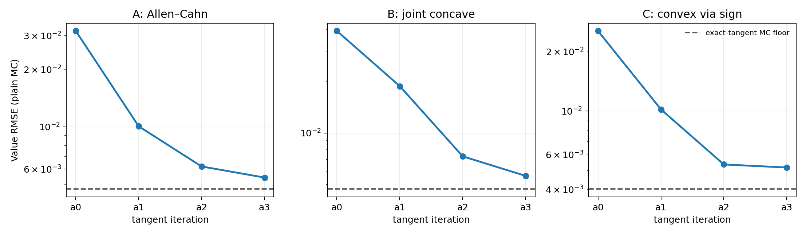
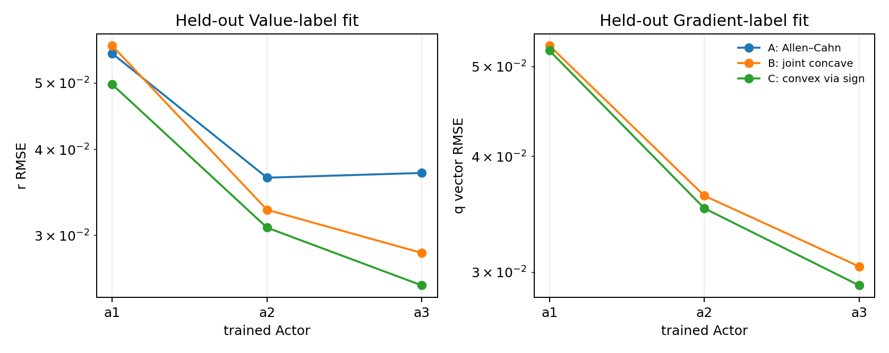
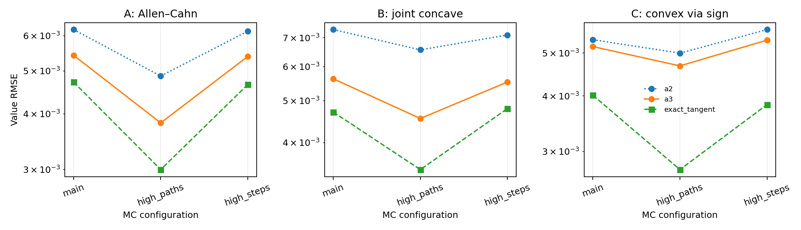

# Convex/Concave Semilinear PDE Tangent-Actor Pilot

## Decision: **CONDITIONAL GO**

同一套通用加权 Feynman–Kac、完整轨迹 VJP 和监督 Tangent-Actor 更新代码完成了三题。训练及 checkpoint 选择没有读取一维参考解；参考解只在 Actor 和 reference-free validation 冻结后用于本报告的后验精度、MC 地板和 Bregman 审计。当前只有一个训练种子和一维有效结构，因此即使三题成功，本轮结论仍保守定为条件式推进。

## Main results

| PDE | Actor | Value RMSE | Relative L2 | RMSE / ref std | Bias | r RMSE | q vector RMSE | Max weight |
|---|---|---:|---:|---:|---:|---:|---:|---:|
| allen_cahn | a0 | 0.031765 | 0.046574 | 0.32623 | 0.026086 | 0.16746 | — | 1.1331 |
| allen_cahn | a1 | 0.010059 | 0.014749 | 0.10331 | 0.0073978 | 0.055654 | — | 1.5467 |
| allen_cahn | a2 | 0.0061974 | 0.0090866 | 0.063647 | 0.0034442 | 0.039351 | — | 1.5542 |
| allen_cahn | a3 | 0.0054228 | 0.0079509 | 0.055692 | 0.0024553 | 0.032119 | — | 1.517 |
| allen_cahn | exact_tangent | 0.0047188 | 0.0069188 | 0.048462 | 0.0004023 | 3.8102e-08 | — | 1.3077 |
| joint_concave | a0 | 0.039376 | 0.059163 | 0.39359 | 0.03572 | 0.16584 | 0.21644 | 1.1331 |
| joint_concave | a1 | 0.01876 | 0.028188 | 0.18752 | 0.011885 | 0.060142 | 0.059533 | 1.5573 |
| joint_concave | a2 | 0.0073076 | 0.01098 | 0.073044 | 0.0043422 | 0.037735 | 0.038258 | 1.4952 |
| joint_concave | a3 | 0.0056219 | 0.008447 | 0.056194 | 0.002728 | 0.027289 | 0.029274 | 1.4903 |
| joint_concave | exact_tangent | 0.0047088 | 0.007075 | 0.047067 | 0.00069204 | 3.7485e-08 | 3.3346e-08 | 1.3133 |
| joint_convex | a0 | 0.025526 | 0.072291 | 0.31221 | -0.023871 | 0.15221 | 0.19949 | 0.8825 |
| joint_convex | a1 | 0.010203 | 0.028894 | 0.12479 | -0.006265 | 0.048754 | 0.050239 | 1.5377 |
| joint_convex | a2 | 0.0053556 | 0.015167 | 0.065504 | -0.0025349 | 0.031705 | 0.03481 | 1.4856 |
| joint_convex | a3 | 0.0051676 | 0.014635 | 0.063205 | -0.0015664 | 0.025285 | 0.028226 | 1.418 |
| joint_convex | exact_tangent | 0.0040163 | 0.011374 | 0.049123 | 0.00014823 | 3.1367e-08 | 3.0313e-08 | 1.0569 |

`exact_tangent` 把独立谱参考的 \((u^*,z^*)\) 查表函数放入相同的普通 weighted-MC evaluator，只用于训练后的数值地板诊断。C 的表中 Value 已从工作变量 \(w\) 重建为原问题的 \(u=-w\)。

## Reference-free tangent iteration

| PDE | Actor | Reference-free value | Δ vs previous | Paired SE | Value-label RMSE | Gradient-label RMSE | Held-out normalized loss | Best step |
|---|---|---:|---:|---:|---:|---:|---:|---:|
| allen_cahn | a0 | 0.69917 | — | — | — | — | — | — |
| allen_cahn | a1 | 0.68189 | -0.017277 | 0.0010413 | 0.0088631 | — | 0.1401 | 1250 |
| allen_cahn | a2 | 0.67777 | -0.0041218 | 0.00026921 | 0.009116 | — | 0.064007 | 625 |
| allen_cahn | a3 | 0.67685 | -0.00092391 | 7.0874e-05 | 0.0075351 | — | 0.067088 | 625 |
| joint_concave | a0 | 0.70495 | — | — | — | — | — | — |
| joint_concave | a1 | 0.68295 | -0.021995 | 0.0019349 | 0.0091832 | 0.0016549 | 0.19931 | 1875 |
| joint_concave | a2 | 0.67344 | -0.0095146 | 0.0013299 | 0.0074957 | 0.0013713 | 0.082176 | 1250 |
| joint_concave | a3 | 0.6716 | -0.001837 | 0.00020855 | 0.009329 | 0.0016326 | 0.059531 | 1250 |
| joint_convex | a0 | -0.32351 | — | — | — | — | — | — |
| joint_convex | a1 | -0.34075 | -0.017241 | 0.00064716 | 0.0073732 | 0.001265 | 0.20741 | 1875 |
| joint_convex | a2 | -0.34426 | -0.003511 | 0.00017922 | 0.0074819 | 0.0012216 | 0.087558 | 1250 |
| joint_convex | a3 | -0.34532 | -0.0010561 | 5.8676e-05 | 0.0080127 | 0.0011817 | 0.059724 | 625 |

这里的目标是冻结切线后得到的加权线性 Value 均值；对于凹包络，数值越低越好。相邻 Actor 使用同一批起点、同一 Brownian seed，`Δ` 为逐状态配对差。

- `allen_cahn`: a0→a1 显著降低；a1→a2 显著降低（95% 配对判据）；a2→a3 显著降低。
- `joint_concave`: a0→a1 显著降低；a1→a2 显著降低（95% 配对判据）；a2→a3 显著降低。
- `joint_convex`: a0→a1 显著降低；a1→a2 显著降低（95% 配对判据）；a2→a3 显著降低。

协议先固定运行 a0→a1→a2。三题的 a1→a2 配对差 95% 上界都小于 0，因此按任务预先给出的 reference-free 条件追加一次 a3；a3 eligibility 与 checkpoint 选择均未读取 test RMSE。

## MC floor and time discretization

| PDE | Actor | Paths | Steps | RMSE | Bias | Mean MC SE |
|---|---|---:|---:|---:|---:|---:|
| allen_cahn | a2 | 512 | 64 | 0.0061974 | 0.0034442 | 0.00019945 |
| allen_cahn | a2 | 1024 | 64 | 0.0048693 | 0.0032466 | 0.00014166 |
| allen_cahn | a2 | 512 | 128 | 0.0061457 | 0.0033658 | 0.00019979 |
| allen_cahn | a3 | 512 | 64 | 0.0054228 | 0.0024553 | 0.00020142 |
| allen_cahn | a3 | 1024 | 64 | 0.0038178 | 0.0022579 | 0.00014314 |
| allen_cahn | a3 | 512 | 128 | 0.0053911 | 0.0023921 | 0.00020185 |
| allen_cahn | exact_tangent | 512 | 64 | 0.0047188 | 0.0004023 | 0.00020145 |
| allen_cahn | exact_tangent | 1024 | 64 | 0.0029958 | 0.00021542 | 0.00014317 |
| allen_cahn | exact_tangent | 512 | 128 | 0.0046588 | 0.00034645 | 0.00020186 |
| joint_concave | a2 | 512 | 64 | 0.0073076 | 0.0043422 | 0.00020563 |
| joint_concave | a2 | 1024 | 64 | 0.006559 | 0.0044681 | 0.00014604 |
| joint_concave | a2 | 512 | 128 | 0.0070991 | 0.0041033 | 0.00020585 |
| joint_concave | a3 | 512 | 64 | 0.0056219 | 0.002728 | 0.00020879 |
| joint_concave | a3 | 1024 | 64 | 0.0045498 | 0.0028443 | 0.00014831 |
| joint_concave | a3 | 512 | 128 | 0.0055243 | 0.0025092 | 0.00020902 |
| joint_concave | exact_tangent | 512 | 64 | 0.0047088 | 0.00069204 | 0.00020948 |
| joint_concave | exact_tangent | 1024 | 64 | 0.0034647 | 0.00079046 | 0.00014882 |
| joint_concave | exact_tangent | 512 | 128 | 0.0047951 | 0.00045239 | 0.00020992 |
| joint_convex | a2 | 512 | 64 | 0.0053556 | -0.0025349 | 0.00016577 |
| joint_convex | a2 | 1024 | 64 | 0.0049948 | -0.0029152 | 0.00011776 |
| joint_convex | a2 | 512 | 128 | 0.0056439 | -0.0029289 | 0.00016669 |
| joint_convex | a3 | 512 | 64 | 0.0051676 | -0.0015664 | 0.00016771 |
| joint_convex | a3 | 1024 | 64 | 0.0046758 | -0.0019464 | 0.00011908 |
| joint_convex | a3 | 512 | 128 | 0.0053437 | -0.0019712 | 0.0001686 |
| joint_convex | exact_tangent | 512 | 64 | 0.0040163 | 0.00014823 | 0.00016774 |
| joint_convex | exact_tangent | 1024 | 64 | 0.0027316 | -0.00022448 | 0.00011911 |
| joint_convex | exact_tangent | 512 | 128 | 0.0038256 | -0.00022693 | 0.00016857 |

- `allen_cahn`: Actor systematic bias 与 plain-MC floor 都可见，64→128 steps 变化较小；a3/1024-path RMSE=0.0038178（|bias|=0.0022579），exact/1024-path=0.0029958（|bias|=0.00021542），exact 64/128-step=0.0047188/0.0046588。
- `joint_concave`: Actor systematic bias 与 plain-MC floor 都可见，64→128 steps 变化较小；a3/1024-path RMSE=0.0045498（|bias|=0.0028443），exact/1024-path=0.0034647（|bias|=0.00079046），exact 64/128-step=0.0047088/0.0047951。
- `joint_convex`: Actor systematic bias 与 plain-MC floor 都可见，64→128 steps 变化较小；a3/1024-path RMSE=0.0046758（|bias|=0.0019464），exact/1024-path=0.0027316（|bias|=0.00022448），exact 64/128-step=0.0040163/0.0038256。

| PDE | Final Actor | c min / max | Weight min / max | Weight ESS fraction | Nonfinite |
|---|---|---:|---:|---:|---:|
| allen_cahn | a3 | -1.2319 / 0.97672 | 0.59328 / 1.517 | 0.95443 | 0 |
| joint_concave | a3 | -1.165 / 0.96265 | 0.5907 / 1.4903 | 0.95656 | 0 |
| joint_convex | a3 | -0.88208 / 1.4857 | 0.65128 / 1.418 | 0.97534 | 0 |

三个问题的指数权重均未裁剪。最终 Actor 的 terminal-weight ESS 为 95.4%–97.5%，最大权重不超过 1.52，nonfinite 数均为 0；没有权重爆炸迹象。

## Bregman-regret identity

- `allen_cahn`: LHS=0.0030153, RHS=0.0021371, 均值差/MC SE=1.4896, 跨状态差值 RMSE / 预测 MC noise=1.0528, 负 divergence 比例=0。
- `joint_concave`: LHS=0.0023226, RHS=0.0019065, 均值差/MC SE=0.69443, 跨状态差值 RMSE / 预测 MC noise=1.1409, 负 divergence 比例=0。
- `joint_convex`: LHS=0.0020552, RHS=0.0016922, 均值差/MC SE=0.77804, 跨状态差值 RMSE / 预测 MC noise=0.96665, 负 divergence 比例=0。

审计沿最终 Actor 控制漂移下的 held-out 路径查询独立一维参考，并比较 \(v^A-u^*\) 与加权 Bregman divergence 积分。三题的均值差都小于 2 个 MC 标准误，跨状态差值 RMSE 也与预测 MC noise 相当；这支持恒等式的数值一致性。方差相加时忽略了 LHS/RHS 的路径协方差。该参考从未回流到标签或训练。

## Correctness and references

- 15 项 CPU 测试覆盖切线恒等式/上界、解析系数与 autodiff、通用符号变换、指数权重和 source、漂移符号、完整 state-dependent VJP 的共同随机数有限差分、冻结参数、终端恢复以及原二次 HJB 的控制公式。
- 参考解使用 forward time \(\tau=T-t\) 的独立周期 Fourier 谱 Strang 求解器；fine 网格为 512 点、内部步长 0.000125。三题的 value refinement RMSE 均约 \(6\times10^{-6}\)，PDE residual RMSE 约 \(10^{-8}\)。
- 终端值处于 `[0.25,0.75]`。常数 0 和 1 是 A/B/C 原问题的下、上解，因为常数处梯度项消失且 driver 在 0、1 为零；比较原理给出 \(u^*\in[0,1]\)。符号变换后 C 满足 \(w^*\in[-1,0]\)。数值参考也独立验证了这些范围。
- 独立脚本只从保存的 NPZ 数组重算 Value 指标，并生成 `recomputed_metrics.csv` 与 `independent_recomputation.json`。

## Answers to the research questions

1. **Q1 — 同一代码能否解三题？** 能。三题只替换 driver；rollout、权重、VJP、标签、训练和 MC evaluator 完全共用。
2. **Q2 — 纯 Value 非线性是否可行？** Allen–Cahn 的 a0/最终 RMSE 为 0.031765/0.0054228，说明监督线性随机求值有效。
3. **Q3 — 联合 Value/Gradient 是否可行？** B 的 a0/最终 RMSE 为 0.039376/0.0056219；最终后验 q vector RMSE 为 0.029274。
4. **Q4 — 凸到凹符号变换是否有效？** C 复用完全相同的 solver，并在重建原 Value 后得到最终 RMSE 0.0051676；解析与数值符号测试均通过。
5. **Q5 — 每次更新是否改善？** 是。本轮三题的 a0→a1、a1→a2 和条件式 a2→a3 全部通过 95% reference-free 配对判据，test RMSE 也逐轮下降。
6. **Q6 — Actor regret 能否解释 Value error？** 可以达到 MC 分辨率：三题 Bregman 恒等式的均值差均小于 2 个 MC 标准误，且 divergence 没有显著负值。
7. **Q7 — 主要误差源是什么？** Actor systematic bias 与普通 MC variance 都有贡献；64→128 步变化远小于 Actor/MC 差距，指数权重稳定且无 nonfinite。
8. **Q8 — 是否支持后续一般半线性 PDE 研究？** 当前证据支持条件式继续，但下一阶段需要独立种子和至少一个二维有效结构，才能超出“高 ambient dimension、低有效维 reference”的可行性结论。

## Scope and provenance

- d=100，T=0.5，每题一个训练种子；3×192 SiLU；每轮 2,048 points、128 paths/label、16 Euler steps、2,500 optimizer steps。a3 仅因 a2 的 reference-free 配对改善明确而执行。
- 最终普通 MC：512 held-out states、512 antithetic paths、64 steps；无 martingale CV、rank projection、解析非终端标签、MLP teacher 或外部 baseline。
- checkpoint 仅按独立 tangent-label validation 的归一化多任务损失选择；没有用 test Ground Truth 选择 Actor 或迭代。
- 两个成功的单卡 GH200 allocation 合计 31 分 09 秒，即 0.519 GH200 GPU-hours；无失败或重试。
