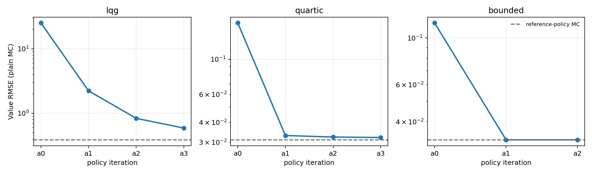
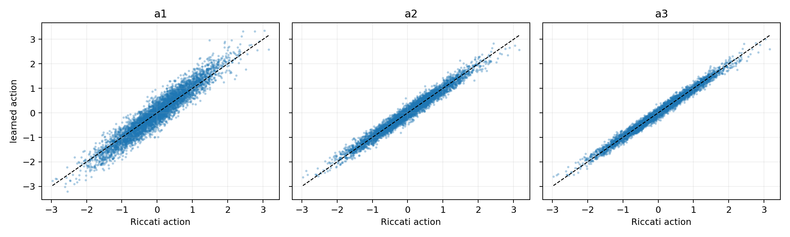
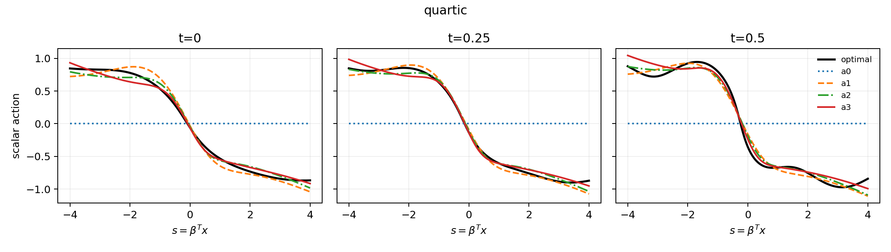
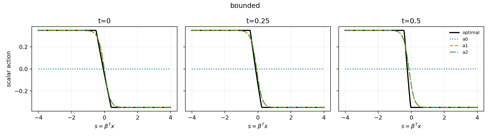

# General Semilinear HJB Actor Iteration — Rapid Feasibility Pilot

## Decision: **CONDITIONAL GO**

同一套 `ControlledHJB`、完整受控轨迹 VJP、greedy-action 标签和 Actor 训练代码成功执行了 LQG、四次控制成本和有界控制三个问题。所有训练均从零策略开始，未使用 Martingale CV、rank 投影、解析非终端标签、MLP teacher 或参考解选 checkpoint。结论是 **CONDITIONAL GO**：三类 Hamiltonian 都出现 reference-free policy improvement，但目前只有一个训练种子，LQG 仍有可见的 Actor 拟合误差。

## Main results

| PDE | d | Iteration | Value RMSE | Relative L2 | Policy regret | Action RMSE | GPU seconds |
|---|---:|---|---:|---:|---:|---:|---:|
| lqg | 100 | a0 | 25.116 | 0.32103 | 24.996 | 0.84383 | 7.67846 |
| lqg | 100 | a1 | 2.229 | 0.028491 | 2.178 | 0.28808 | 30.1802 |
| lqg | 100 | a2 | 0.8354 | 0.010678 | 0.74459 | 0.14981 | 43.9432 |
| lqg | 100 | a3 | 0.5907 | 0.0075503 | 0.46716 | 0.10918 | 42.0566 |
| lqg | 100 | optimal_reference_policy | 0.38605 | 0.0049345 | 0.16415 | 4.2478e-08 | 12.7585 |
| quartic | 100 | a0 | 0.16929 | 0.18007 | 0.14897 | 0.53065 | 8.19654 |
| quartic | 100 | a1 | 0.033077 | 0.035183 | 0.0098058 | 0.10902 | 27.6836 |
| quartic | 100 | a2 | 0.032366 | 0.034427 | 0.0073271 | 0.087792 | 45.27 |
| quartic | 100 | a3 | 0.03214 | 0.034187 | 0.0063303 | 0.073764 | 42.6953 |
| quartic | 100 | optimal_reference_policy | 0.031002 | 0.032976 | 0.0014949 | 2.3151e-07 | 19.7466 |
| bounded | 100 | a0 | 0.11782 | 0.11811 | 0.10364 | 0.31729 | 8.73831 |
| bounded | 100 | a1 | 0.032784 | 0.032865 | -0.0001168 | 0.075367 | 28.1378 |
| bounded | 100 | a2 | 0.032787 | 0.032868 | -0.00014508 | 0.074635 | 45.4155 |
| bounded | 100 | optimal_reference_policy | 0.032739 | 0.03282 | -0.0027967 | 2.0702e-07 | 20.1701 |

`optimal_reference_policy` 行是把解析/一维数值最优反馈放入相同 64-step、普通 antithetic MC 后得到的离散化与采样误差地板。Policy regret 为有限 MC 观测；若略为负值，只解释为采样误差。

## Reference-free policy improvement

| PDE | Iteration | Validation cost | Δ vs previous | Paired SE | Label replication RMSE | Actor validation MSE |
|---|---|---:|---:|---:|---:|---:|
| lqg | a0 | 102.98 | — | — | — | — |
| lqg | a1 | 80.38 | -22.598 | 0.11602 | 4.0069e-08 | 0.088586 |
| lqg | a2 | 78.926 | -1.4549 | 0.011918 | 0.0029205 | 0.022343 |
| lqg | a3 | 78.645 | -0.28051 | 0.0038868 | 0.0016349 | 0.012436 |
| quartic | a0 | 0.96459 | — | — | — | — |
| quartic | a1 | 0.82898 | -0.13561 | 0.0044624 | 0.0034817 | 0.012299 |
| quartic | a2 | 0.82662 | -0.0023643 | 0.00023557 | 0.0029794 | 0.0062744 |
| quartic | a3 | 0.82528 | -0.0013381 | 0.00022201 | 0.0028833 | 0.0054789 |
| bounded | a0 | 0.94201 | — | — | — | — |
| bounded | a1 | 0.84207 | -0.099947 | 0.0027273 | 0.0039802 | 0.0060249 |
| bounded | a2 | 0.84202 | -5.0781e-05 | 1.6152e-05 | 0.0036806 | 0.0047252 |

所有策略成本都使用相同起点和相同 Brownian 随机数。`Δ` 是逐状态配对差值的均值，`Paired SE` 是这些差值跨 256 个起点的标准误。

- lqg: a0→a1 显著降低；a1→a2 显著降低；a2→a3 显著降低。
- quartic: a0→a1 显著降低；a1→a2 显著降低；a2→a3 显著降低。
- bounded: a0→a1 显著降低；a1→a2 显著降低。

采用 reference-free 条件（a2 配对 z>1.96 且相对成本下降>0.1%）后，只对 LQG 与 Quartic 追加 a3；结果为 lqg Δ=-0.28051±0.0038868，quartic Δ=-0.0013381±0.00022201。Bounded 的 a2 相对收益低于阈值，未追加。

## Control diagnostics

- LQG 在随机时间与状态上的 a3 action RMSE 为 0.10918；比较覆盖整个 `[0,T]`，不只看 `t=0`。
- Quartic a3 的平均 Hamiltonian residual 为 0.0047248。
- Bounded a2 的平均 Hamiltonian residual 为 0.0037844，Actor 可行性违反率为 0；审计点 Actor/最优饱和率分别为 0.53516 / 0.73242。
- 四次方 greedy cubic 已与直接标量数值最小化核对；bounded Actor 在训练和仿真时都使用同一个 `A*tanh(raw)` 约束映射。

## Correctness and numerical references

- 11 个 CPU 数学/实现测试通过：Riccati 符号、两个 greedy 公式、四次方根与直接最小化、约束可行性、相同 Brownian 路径的中心差分、饱和边界附近的 pathwise gradient、冻结 Actor 权重且保留状态导数、参考网格细化、终端条件、有限值和训练泄漏检查。
- Quartic/Bounded 的 fine reference 使用 `dx=0.025, dt=0.0005, [-10,10]`。完整细化误差见 `reference_validation.json`。
- 独立脚本仅从保存的 NPZ prediction arrays 重算 Value 指标，并写出 `recomputed_metrics.csv` 与 `independent_recomputation.json`。

## Research questions

1. **同一核心代码能否处理三类 HJB？** 能。三个问题只替换问题接口和后验参考；模拟、VJP、标签、训练、validation 与普通 MC 都相同。
2. **监督 greedy action 是否能超越 `a=z` 假设？** 能。标量 action 的维数与 100 维状态分离，Quartic 使用三次方最优条件，Bounded 使用约束最优条件；训练核心没有 `actor_output == z` 假设。
3. **每次 improvement 是否都降低成本？** 是，本轮实际执行的每次更新，其 reference-free 配对差值的 95% 上界都小于零。不过 Bounded 的 a1→a2 相对下降只有约 0.006%，统计可分辨但实际收益很小。
4. **不用 Martingale CV 是否仍准确？** Quartic a3 与 Bounded a2 的 RMSE 已接近各自 reference-policy MC 地板；LQG a3 为 0.5907，地板为 0.38605。普通 MC 足以判别 policy improvement，但限制了标量题更细的 Value 排序。
5. **哪个 PDE 暴露最大弱点？** 按最终策略的 `RMSE / std(u*)`，当前最弱的是 **lqg**。
6. **弱点来自哪里？** LQG a3 的梯度标签复现相对差仅约 0.19%，但 held-out action MSE 为 0.01244，且最佳 checkpoint 仍在 2500/2500；这指向 Actor 拟合/优化预算，而非标签噪声或参考离散。Quartic/Bounded 的 Value 已受普通 MC 地板限制；Bounded 还把最优饱和率 73.2% 低估为约 53.5%，说明平滑 `tanh` Actor 对硬饱和区的逼近仍可改进。
7. **是否值得继续一般高维 semilinear HJB？** 值得。非二次与非光滑 Hamiltonian 都不要求改变核心算法。下一步应针对表中最弱问题提高 label 质量或策略表达，并增加独立训练种子，而不是先引入外部 baseline。

## Scope and provenance

- 维数：`d=100`；一次训练种子；三题均为 `a0→a1→a2`，满足 reference-free 实用收益条件的 LQG/Quartic 追加 `a3`。
- Actor：3×192 SiLU；每轮 2,048 train points、128 paths/label、16 Euler steps、2,500 optimizer steps。
- Final evaluation：512 states、512 paths、64 Euler steps、antithetic CRN、无 CV。
- 三个 GH200 作业合计墙钟 12 分 08 秒（训练主作业 6:20、修正不确定性的 evaluation 3:48、条件式 a3 2:00）。
- checkpoint 由独立 greedy-label validation MSE 选择；跨 iteration 与是否运行 a3 的判断只使用 reference-free policy validation。
- 本实验没有运行 PINN、Deep BSDE、DPI 或其他 baseline。
