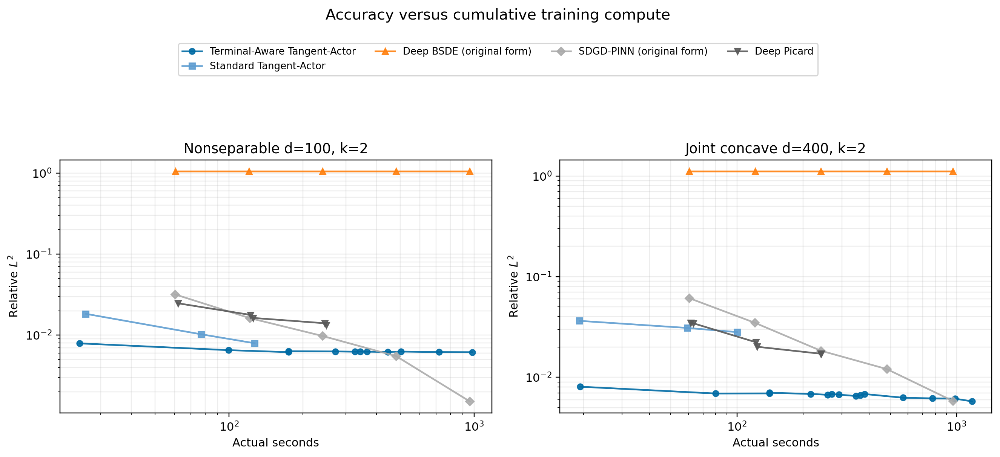
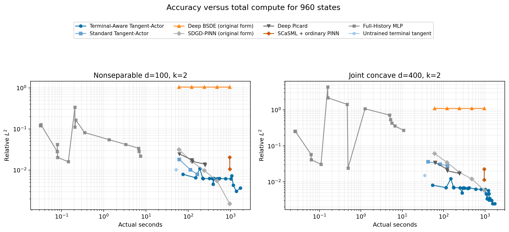
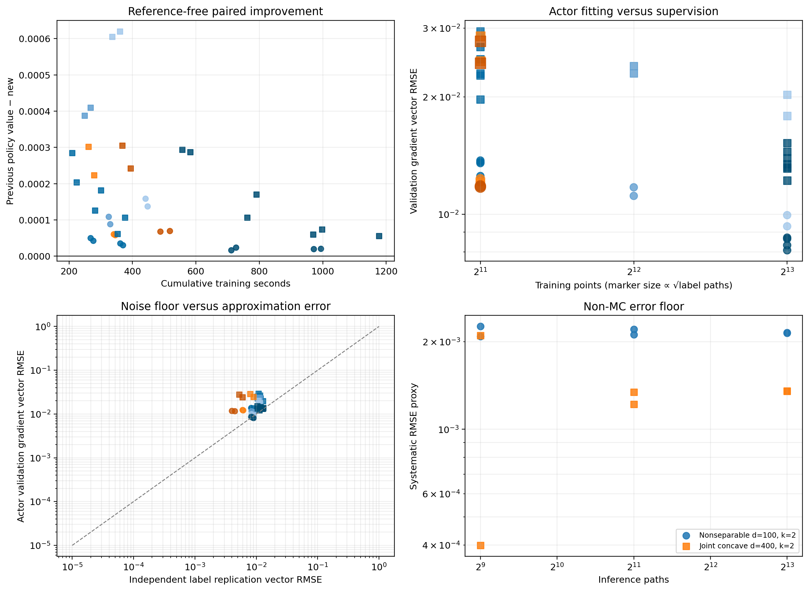

# Terminal-Aware Tangent-Actor: High-Budget Scaling Study

**Decision: CONDITIONAL GO.** The controlled pilot supports **H2 (data-limited)** on both PDEs. More training points improve the held-out Actor fit and the reference-free policy value much more efficiently than increasing paths per label. Extra iterations remain useful on the $d=400$ problem and rapidly diminish on the $d=100$ problem. At the strict 960-second total-compute envelope, the validation-selected method beats original SDGD-PINN on $d=400$ but loses on the nonseparable $d=100$ problem. The conclusion therefore supports continued targeted development, not a blanket baseline win.

## Protocol correction and selection firewall

The old Deep BSDE and SDGD rows embedded our Terminal-Aware construction and are excluded from every formal frontier. Deep BSDE is rerun with raw amortized $Y_0(x_0)$ and nonshared raw $Z_n(x)$ networks. SDGD is rerun as an ordinary tanh PINN with the authors' soft terminal value/gradient penalty. Corrected SCaSML uses that ordinary PINN and includes both terminal and PDE defects. Deep Picard and Full-History MLP keep terminal operations that belong to their published algorithms.

All Actor choices use held-out noisy tangent labels and a fixed 240-state, reference-free tangent-policy bank. The 960-state numerical Ground Truth is opened only after selection is frozen. The descriptive test-error envelope is reported separately and implements $E^*(C)=\min_{i:C_i\le C}E_i$ exactly.

## Stage-one controlled scaling

### Nonseparable $(d=100,k=2)$

| Controlled branch | Cumulative train s | Paired improvement | Actor value val. RMSE | Actor gradient val. vector RMSE | Gradient-label repl. RMSE | Selected step |
|---|---:|---:|---:|---:|---:|---:|
| more iterations (2048,128) | 271.79 ± 6.109 | 4.647e-05 ± 5.004e-06 | 0.01003 ± 0.0004307 | 0.01357 ± 6.601e-05 | 0.008698 ± 0.0005638 | 312.5 ± 265.17 |
| 4096 points (128 paths) | 327 ± 3.5663 | 9.88e-05 ± 1.487e-05 | 0.008523 ± 8.372e-05 | 0.01143 ± 0.0004105 | 0.008698 ± 0.0005638 | 562.5 ± 88.388 |
| 8192 points (128 paths) | 443.92 ± 4.621 | 0.0001481 ± 1.548e-05 | 0.007266 ± 2.069e-05 | 0.00963 ± 0.0004487 | 0.008698 ± 0.0005638 | 1875 ± 176.78 |
| 2048 points (256 paths) | 343.11 ± 3.7438 | 5.93e-05 ± 1.751e-06 | 0.009023 ± 0.0002034 | 0.01222 ± 0.0001356 | 0.006001 ± 9.166e-05 | 562.5 ± 88.388 |
| 2048 points (512 paths) | 502.62 ± 21.634 | 6.897e-05 ± 8.646e-07 | 0.008433 ± 0.0001682 | 0.01178 ± 6.149e-05 | 0.004209 ± 0.0003345 | 500 ± 0 |

### Joint concave $(d=400,k=2)$

| Controlled branch | Cumulative train s | Paired improvement | Actor value val. RMSE | Actor gradient val. vector RMSE | Gradient-label repl. RMSE | Selected step |
|---|---:|---:|---:|---:|---:|---:|
| more iterations (2048,128) | 216.89 ± 9.4977 | 0.0002445 ± 5.728e-05 | 0.01629 ± 0.002101 | 0.02812 ± 0.00183 | 0.01116 ± 0.0004257 | 187.5 ± 88.388 |
| 4096 points (128 paths) | 258.69 ± 13.031 | 0.0003988 ± 1.584e-05 | 0.01533 ± 0.002068 | 0.02347 ± 0.0007253 | 0.01116 ± 0.0004257 | 375 ± 0 |
| 8192 points (128 paths) | 348.39 ± 17.622 | 0.0006128 ± 1.027e-05 | 0.01422 ± 0.001515 | 0.01906 ± 0.00169 | 0.01116 ± 0.0004257 | 875 ± 353.55 |
| 2048 points (256 paths) | 270.21 ± 13.089 | 0.0002628 ± 5.522e-05 | 0.01573 ± 0.002238 | 0.02663 ± 0.002771 | 0.008459 ± 0.0006761 | 250 ± 0 |
| 2048 points (512 paths) | 381.22 ± 18.225 | 0.0002738 ± 4.474e-05 | 0.01571 ± 0.002217 | 0.02607 ± 0.002383 | 0.005609 ± 0.0005258 | 250 ± 0 |

Increasing to 8192 nested training points is the only factor that wins on all four benchmark-seed tasks. Raising label paths halves replication noise, but the smaller reduction in held-out Actor error and policy value does not justify its extra cost. This is why stage two continues only the 8192-point branch.

## Iteration and staged continuation

### Nonseparable $(d=100,k=2)$

| Branch | Actor | Train s | Paired previous−new | MC 95% CI | Value val. RMSE | Gradient val. RMSE | Meaningful by frozen rule |
|---|---|---:|---:|---:|---:|---:|---:|
| more iterations (2048,128) | a4 | 271.79 ± 6.109 | 4.647e-05 ± 5.004e-06 | [2.65e-05, 6.65e-05] | 0.01003 ± 0.0004307 | 0.01357 ± 6.601e-05 | 0/2 seeds |
| more iterations (2048,128) | a5 | 365.52 ± 6.1334 | 3.272e-05 ± 3.426e-06 | [2.25e-05, 4.29e-05] | 0.008221 ± 0.0004041 | 0.01313 ± 0.0008487 | 0/2 seeds |
| 8192 points (128 paths) | a4_points8192 | 443.92 ± 4.621 | 0.0001481 ± 1.548e-05 | [0.000136, 0.000161] | 0.007266 ± 2.069e-05 | 0.00963 ± 0.0004487 | 2/2 seeds |
| continued 8192-point branch | a5_points8192 | 718.86 ± 10.714 | 1.996e-05 ± 5.325e-06 | [1.21e-05, 2.78e-05] | 0.006244 ± 6.679e-05 | 0.00868 ± 4.606e-05 | 0/2 seeds |
| continued 8192-point branch | a6_points8192 | 982.61 ± 15.507 | 2.022e-05 ± 4.87e-07 | [1.43e-05, 2.61e-05] | 0.005709 ± 0.000193 | 0.008207 ± 0.0001732 | 0/2 seeds |

### Joint concave $(d=400,k=2)$

| Branch | Actor | Train s | Paired previous−new | MC 95% CI | Value val. RMSE | Gradient val. RMSE | Meaningful by frozen rule |
|---|---|---:|---:|---:|---:|---:|---:|
| more iterations (2048,128) | a4 | 216.89 ± 9.4977 | 0.0002445 ± 5.728e-05 | [0.000232, 0.000257] | 0.01629 ± 0.002101 | 0.02812 ± 0.00183 | 2/2 seeds |
| more iterations (2048,128) | a5 | 290.94 ± 12.915 | 0.0001536 ± 3.925e-05 | [0.000145, 0.000162] | 0.01543 ± 0.001572 | 0.02396 ± 0.001431 | 2/2 seeds |
| more iterations (2048,128) | a6 | 364.76 ± 16.463 | 8.416e-05 ± 3.192e-05 | [6.9e-05, 9.94e-05] | 0.0157 ± 0.002789 | 0.02118 ± 0.002117 | 1/2 seeds |
| 8192 points (128 paths) | a4_points8192 | 348.39 ± 17.622 | 0.0006128 ± 1.027e-05 | [0.000588, 0.000637] | 0.01422 ± 0.001515 | 0.01906 ± 0.00169 | 2/2 seeds |
| continued 8192-point branch | a5_points8192 | 569.58 ± 17.763 | 0.0002903 ± 4.531e-06 | [0.000271, 0.00031] | 0.01118 ± 0.000761 | 0.01485 ± 0.0005234 | 2/2 seeds |
| continued 8192-point branch | a6_points8192 | 775.98 ± 20.27 | 0.0001385 ± 4.505e-05 | [0.000126, 0.000151] | 0.009185 ± 0.001357 | 0.01369 ± 0.0003427 | 2/2 seeds |
| continued 8192-point branch | a7_points8192 | 983.37 ± 19.79 | 6.653e-05 ± 9.831e-06 | [5.76e-05, 7.54e-05] | 0.008992 ± 0.0006655 | 0.01266 ± 0.0006429 | 0/2 seeds |
| continued 8192-point branch | a8_points8192 | 1177.3 | 5.6e-05 | [5e-05, 6.2e-05] | 0.008915 | 0.01319 | 0/1 seeds |

## Posthoc Ground Truth accuracy

| Benchmark | Validation-selected Actor | MC paths | Train s | Value RMSE | Relative L2 | Bias | Total s |
|---|---|---:|---:|---:|---:|---:|---:|
| Nonseparable $(d=100,k=2)$ | points8192_continued/a6_points8192 | 512 | 982.61 ± 15.507 | 0.0038501 ± 6.8251e-05 | 0.0061613 ± 0.00010922 | 0.001991 ± 9.417e-07 | 1028.2 ± 14.837 |
| Nonseparable $(d=100,k=2)$ | points8192_continued/a6_points8192 | 2048 | 982.61 ± 15.507 | 0.0026842 ± 5.1174e-05 | 0.0042955 ± 8.1895e-05 | 0.001924 ± 1.974e-05 | 1165.1 ± 12.774 |
| Nonseparable $(d=100,k=2)$ | points8192_continued/a6_points8192 | 8192 | 982.61 ± 15.507 | 0.0022892 ± 6.8141e-06 | 0.0036635 ± 1.0905e-05 | 0.001982 ± 5.519e-06 | 1715 ± 7.8246 |
| Joint concave $(d=400,k=2)$ | points8192_continued/a7_points8192, points8192_continued/a8_points8192 | 512 | 1087.3 ± 127.22 | 0.0041538 ± 0.00035018 | 0.0061269 ± 0.00051652 | 0.001192 ± 0.0002809 | 1121.3 ± 128.25 |
| Joint concave $(d=400,k=2)$ | points8192_continued/a7_points8192, points8192_continued/a8_points8192 | 2048 | 1087.3 ± 127.22 | 0.0023237 ± 4.5993e-05 | 0.0034275 ± 6.7841e-05 | 0.001068 ± 1.387e-06 | 1222.9 ± 131.5 |
| Joint concave $(d=400,k=2)$ | points8192_continued/a7_points8192, points8192_continued/a8_points8192 | 8192 | 1087.3 ± 127.22 | 0.0016645 ± 2.823e-06 | 0.0024551 ± 4.164e-06 | 0.001101 ± 3.277e-05 | 1631.4 ± 143.58 |

## MC versus systematic error

| Benchmark | Actor | Paths | Euler steps | Observed RMSE | MC RMSE contribution | Systematic RMSE proxy | MC fraction of MSE |
|---|---|---:|---:|---:|---:|---:|---:|
| Nonseparable $(d=100,k=2)$ | points8192_continued/a6_points8192 | 512 | 32 | 0.0038504 | 0.0031778 | 0.0021724 | 68.16% |
| Nonseparable $(d=100,k=2)$ | points8192_continued/a6_points8192 | 2048 | 32 | 0.0026844 | 0.0015886 | 0.0021634 | 35.05% |
| Nonseparable $(d=100,k=2)$ | points8192_continued/a6_points8192 | 8192 | 32 | 0.0022892 | 0.00079372 | 0.0021472 | 12.02% |
| Joint concave $(d=400,k=2)$ | points8192_continued/a7_points8192 | 512 | 32 | 0.0044014 | 0.003867 | 0.0021021 | 77.19% |
| Joint concave $(d=400,k=2)$ | points8192_continued/a8_points8192 | 512 | 32 | 0.0039062 | 0.0038858 | 0.00039878 | 98.96% |
| Joint concave $(d=400,k=2)$ | points8192_continued/a7_points8192 | 2048 | 32 | 0.0022912 | 0.0019391 | 0.0012203 | 71.63% |
| Joint concave $(d=400,k=2)$ | points8192_continued/a8_points8192 | 2048 | 32 | 0.0023562 | 0.0019365 | 0.0013423 | 67.55% |
| Joint concave $(d=400,k=2)$ | points8192_continued/a7_points8192 | 8192 | 32 | 0.0016665 | 0.00096803 | 0.0013565 | 33.74% |
| Joint concave $(d=400,k=2)$ | points8192_continued/a8_points8192 | 8192 | 32 | 0.0016625 | 0.00096893 | 0.0013509 | 33.97% |

The lowest high-precision systematic RMSE proxy is **0.00135092**, obtained for `joint_concave_d400_k2` at `points8192_continued/a8_points8192` with 8192 inference paths. Bootstrap intervals resample the fixed 960-state test workload and propagate the stored per-state MC variance estimate.

### Euler sensitivity

| Benchmark | Euler steps | Observed RMSE | Systematic RMSE proxy | 95% CI for systematic RMSE |
|---|---:|---:|---:|---:|
| Nonseparable $(d=100,k=2)$ | 16 | 0.0045418 | 0.0042563 | [0.0041112, 0.0043971] |
| Nonseparable $(d=100,k=2)$ | 32 | 0.0026844 | 0.0021634 | [0.0020372, 0.0022852] |
| Nonseparable $(d=100,k=2)$ | 64 | 0.0019172 | 0.0010712 | [0.00092038, 0.0012151] |
| Joint concave $(d=400,k=2)$ | 16 | 0.0031482 | 0.0024856 | [0.0023116, 0.0026503] |
| Joint concave $(d=400,k=2)$ | 32 | 0.0023239 | 0.0012813 | [0.0010681, 0.0014718] |
| Joint concave $(d=400,k=2)$ | 64 | 0.0020748 | 0.0007316 | [0.00031324, 0.00097845] |

## Corrected strong baselines

| Benchmark | Method | Budget checkpoint | Actual train s | Relative L2 | RMSE | Training status |
|---|---|---|---:|---:|---:|---|
| Nonseparable $(d=100,k=2)$ | Deep BSDE, original form | B3 | 240.87 ± 0.36202 | 1.0495 ± 0.073893 | 0.65584 ± 0.046174 | completed_checkpoints_recovered_after_strict_json_failure |
| Nonseparable $(d=100,k=2)$ | Deep BSDE, original form | B4 | 480.87 ± 0.36202 | 1.0495 ± 0.073893 | 0.65584 ± 0.046174 | completed_checkpoints_recovered_after_strict_json_failure |
| Nonseparable $(d=100,k=2)$ | Deep BSDE, original form | B5 | 960.37 ± 0.34509 | 1.0495 ± 0.073893 | 0.65584 ± 0.046174 | completed_checkpoints_recovered_after_strict_json_failure |
| Nonseparable $(d=100,k=2)$ | SDGD-PINN, original form | B3 | 240.88 ± 0.25194 | 0.0097746 ± 0.0020861 | 0.006108 ± 0.0013036 | completed |
| Nonseparable $(d=100,k=2)$ | SDGD-PINN, original form | B4 | 480.98 ± 0.086541 | 0.0055125 ± 0.001551 | 0.0034446 ± 0.00096916 | completed |
| Nonseparable $(d=100,k=2)$ | SDGD-PINN, original form | B5 | 960.52 ± 0.4849 | 0.0015228 ± 0.00010614 | 0.00095155 ± 6.6325e-05 | completed |
| Joint concave $(d=400,k=2)$ | Deep BSDE, original form | B3 | 240.63 ± 0.46032 | 1.1129 ± 0.029391 | 0.75447 ± 0.019926 | completed_checkpoints_recovered_after_strict_json_failure |
| Joint concave $(d=400,k=2)$ | Deep BSDE, original form | B4 | 480.63 ± 0.46032 | 1.1129 ± 0.029391 | 0.75447 ± 0.019926 | completed_checkpoints_recovered_after_strict_json_failure |
| Joint concave $(d=400,k=2)$ | Deep BSDE, original form | B5 | 960.63 ± 0.46032 | 1.1129 ± 0.029391 | 0.75447 ± 0.019926 | completed_checkpoints_recovered_after_strict_json_failure |
| Joint concave $(d=400,k=2)$ | SDGD-PINN, original form | B3 | 240.64 ± 0.49049 | 0.018392 ± 0.00017522 | 0.012469 ± 0.00011879 | completed |
| Joint concave $(d=400,k=2)$ | SDGD-PINN, original form | B4 | 480.77 ± 0.89356 | 0.012082 ± 0.0021388 | 0.008191 ± 0.00145 | completed |
| Joint concave $(d=400,k=2)$ | SDGD-PINN, original form | B5 | 960.3 ± 0.27039 | 0.0058324 ± 0.0002711 | 0.0039541 ± 0.0001838 | completed |

Original-form Deep BSDE produced all timed checkpoints, but its BSDE rollout became non-finite before B1. The final strict-JSON write therefore failed; metadata were recovered from the immutable checkpoint files without retraining, unavailable validation objectives are null, and the table reports the finite raw $Y_0(x)$ outputs post hoc. This instability is part of the baseline result.

The stable original-form SDGD-PINN is the informative high-budget comparator. At strict matched total-compute envelopes: Nonseparable $(d=100,k=2)$ — B4: TA 0.0062488, SDGD-PINN 0.0097746 (TA lower); B5: TA 0.0061795, SDGD-PINN 0.0055125 (SDGD-PINN lower) Joint concave $(d=400,k=2)$ — B4: TA 0.0065209, SDGD-PINN 0.018392 (TA lower); B5: TA 0.0061718, SDGD-PINN 0.012082 (TA lower)

The historical terminal-aware Deep BSDE, SDGD-PINN and SCaSML measurements are preserved in `historical_terminal_aware_baselines.csv` but are ineligible here.

## Accuracy-compute envelopes

### Training compute

| Benchmark | Budget | Method | Validation-selected rel. L2 | Descriptive envelope rel. L2 | Actual selected s |
|---|---|---|---:|---:|---:|
| Nonseparable $(d=100,k=2)$ | B3 | Terminal-Aware Tangent-Actor | 0.0063344 ± 8.1621e-05 | 0.0061729 ± 9.0493e-06 | 175.19 ± 6.2693 |
| Nonseparable $(d=100,k=2)$ | B3 | Deep BSDE, original form | 1.0495 ± 0.073893 | 1.0495 ± 0.073893 | 120.87 ± 0.36202 |
| Nonseparable $(d=100,k=2)$ | B3 | SDGD-PINN, original form | 0.01625 ± 0.00099376 | 0.01625 ± 0.00099376 | 121.31 ± 0.094553 |
| Nonseparable $(d=100,k=2)$ | B3 | Deep Picard | 0.015752 ± 0.0028566 | 0.015752 ± 0.0028566 | 181.08 ± 82.729 |
| Nonseparable $(d=100,k=2)$ | B4 | Terminal-Aware Tangent-Actor | 0.0062016 ± 8.8776e-05 | 0.0061591 ± 2.8578e-05 | 443.92 ± 4.621 |
| Nonseparable $(d=100,k=2)$ | B4 | Deep BSDE, original form | 1.0495 ± 0.073893 | 1.0495 ± 0.073893 | 240.87 ± 0.36202 |
| Nonseparable $(d=100,k=2)$ | B4 | SDGD-PINN, original form | 0.0097746 ± 0.0020861 | 0.0097746 ± 0.0020861 | 240.88 ± 0.25194 |
| Nonseparable $(d=100,k=2)$ | B4 | Deep Picard | 0.013209 ± 0.00073863 | 0.013209 ± 0.00073863 | 249.49 ± 14.026 |
| Nonseparable $(d=100,k=2)$ | B5 | Terminal-Aware Tangent-Actor | 0.0061795 ± 0.00010644 | 0.0061417 ± 5.3089e-05 | 718.86 ± 10.714 |
| Nonseparable $(d=100,k=2)$ | B5 | Deep BSDE, original form | 1.0495 ± 0.073893 | 1.0495 ± 0.073893 | 480.87 ± 0.36202 |
| Nonseparable $(d=100,k=2)$ | B5 | SDGD-PINN, original form | 0.0055125 ± 0.001551 | 0.0055125 ± 0.001551 | 480.98 ± 0.086541 |
| Nonseparable $(d=100,k=2)$ | B5 | Deep Picard | 0.013209 ± 0.00073863 | 0.013209 ± 0.00073863 | 249.49 ± 14.026 |
| Joint concave $(d=400,k=2)$ | B3 | Terminal-Aware Tangent-Actor | 0.006833 ± 0.00064259 | 0.0066091 ± 0.0003259 | 216.89 ± 9.4977 |
| Joint concave $(d=400,k=2)$ | B3 | Deep BSDE, original form | 1.1129 ± 0.029391 | 1.1129 ± 0.029391 | 121.13 ± 0.24679 |
| Joint concave $(d=400,k=2)$ | B3 | SDGD-PINN, original form | 0.034806 ± 0.0012304 | 0.034806 ± 0.0012304 | 120.65 ± 0.52901 |
| Joint concave $(d=400,k=2)$ | B3 | Deep Picard | 0.018778 ± 0.0018899 | 0.018778 ± 0.0018899 | 178.85 ± 78.325 |
| Joint concave $(d=400,k=2)$ | B4 | Terminal-Aware Tangent-Actor | 0.0065209 ± 0.00058857 | 0.0064721 ± 0.00051963 | 348.39 ± 17.622 |
| Joint concave $(d=400,k=2)$ | B4 | Deep BSDE, original form | 1.1129 ± 0.029391 | 1.1129 ± 0.029391 | 240.63 ± 0.46032 |
| Joint concave $(d=400,k=2)$ | B4 | SDGD-PINN, original form | 0.018392 ± 0.00017522 | 0.018392 ± 0.00017522 | 240.64 ± 0.49049 |
| Joint concave $(d=400,k=2)$ | B4 | Deep Picard | 0.017145 ± 0.0004201 | 0.017145 ± 0.0004201 | 241.09 ± 9.6953 |
| Joint concave $(d=400,k=2)$ | B5 | Terminal-Aware Tangent-Actor | 0.0061718 ± 0.00051415 | 0.0061718 ± 0.00051415 | 775.98 ± 20.27 |
| Joint concave $(d=400,k=2)$ | B5 | Deep BSDE, original form | 1.1129 ± 0.029391 | 1.1129 ± 0.029391 | 480.63 ± 0.46032 |
| Joint concave $(d=400,k=2)$ | B5 | SDGD-PINN, original form | 0.012082 ± 0.0021388 | 0.012082 ± 0.0021388 | 480.77 ± 0.89356 |
| Joint concave $(d=400,k=2)$ | B5 | Deep Picard | 0.017145 ± 0.0004201 | 0.017145 ± 0.0004201 | 241.09 ± 9.6953 |

### Total compute for 960 predictions

| Benchmark | Budget | Method | Validation-selected rel. L2 | Descriptive envelope rel. L2 | Actual selected s |
|---|---|---|---:|---:|---:|
| Nonseparable $(d=100,k=2)$ | B3 | Terminal-Aware Tangent-Actor | 0.0063344 ± 8.1621e-05 | 0.0061729 ± 9.0493e-06 | 220.82 ± 5.5666 |
| Nonseparable $(d=100,k=2)$ | B3 | Deep BSDE, original form | 1.0495 ± 0.073893 | 1.0495 ± 0.073893 | 120.87 ± 0.36199 |
| Nonseparable $(d=100,k=2)$ | B3 | SDGD-PINN, original form | 0.01625 ± 0.00099376 | 0.01625 ± 0.00099376 | 121.31 ± 0.094559 |
| Nonseparable $(d=100,k=2)$ | B3 | Deep Picard | 0.015752 ± 0.0028566 | 0.015752 ± 0.0028566 | 181.08 ± 82.729 |
| Nonseparable $(d=100,k=2)$ | B3 | Full-History MLP | 0.02181 ± 0.00026993 | 0.015999 ± 0.0004142 | 7.438 ± 0.32439 |
| Nonseparable $(d=100,k=2)$ | B4 | Terminal-Aware Tangent-Actor | 0.0062488 ± 7.9383e-05 | 0.004547 ± 7.7937e-05 | 392.78 ± 31.346 |
| Nonseparable $(d=100,k=2)$ | B4 | Deep BSDE, original form | 1.0495 ± 0.073893 | 1.0495 ± 0.073893 | 240.87 ± 0.362 |
| Nonseparable $(d=100,k=2)$ | B4 | SDGD-PINN, original form | 0.0097746 ± 0.0020861 | 0.0097746 ± 0.0020861 | 240.88 ± 0.25193 |
| Nonseparable $(d=100,k=2)$ | B4 | Deep Picard | 0.013209 ± 0.00073863 | 0.013209 ± 0.00073863 | 249.5 ± 14.026 |
| Nonseparable $(d=100,k=2)$ | B4 | Full-History MLP | 0.02181 ± 0.00026993 | 0.015999 ± 0.0004142 | 7.438 ± 0.32439 |
| Nonseparable $(d=100,k=2)$ | B5 | Terminal-Aware Tangent-Actor | 0.0061795 ± 0.00010644 | 0.004547 ± 7.7937e-05 | 764.47 ± 10.104 |
| Nonseparable $(d=100,k=2)$ | B5 | Deep BSDE, original form | 1.0495 ± 0.073893 | 1.0495 ± 0.073893 | 480.87 ± 0.362 |
| Nonseparable $(d=100,k=2)$ | B5 | SDGD-PINN, original form | 0.0055125 ± 0.001551 | 0.0055125 ± 0.001551 | 480.98 ± 0.086566 |
| Nonseparable $(d=100,k=2)$ | B5 | Deep Picard | 0.013209 ± 0.00073863 | 0.013209 ± 0.00073863 | 249.5 ± 14.026 |
| Nonseparable $(d=100,k=2)$ | B5 | Full-History MLP | 0.02181 ± 0.00026993 | 0.015999 ± 0.0004142 | 7.438 ± 0.32439 |
| Joint concave $(d=400,k=2)$ | B3 | Terminal-Aware Tangent-Actor | 0.0070284 ± 0.00068617 | 0.0066914 ± 0.00020957 | 174.26 ± 5.3763 |
| Joint concave $(d=400,k=2)$ | B3 | Deep BSDE, original form | 1.1129 ± 0.029391 | 1.1129 ± 0.029391 | 121.13 ± 0.24677 |
| Joint concave $(d=400,k=2)$ | B3 | SDGD-PINN, original form | 0.034806 ± 0.0012304 | 0.034806 ± 0.0012304 | 120.65 ± 0.52898 |
| Joint concave $(d=400,k=2)$ | B3 | Deep Picard | 0.018778 ± 0.0018899 | 0.018778 ± 0.0018899 | 178.85 ± 78.325 |
| Joint concave $(d=400,k=2)$ | B3 | Full-History MLP | 0.27054 ± 0.00053887 | 0.02403 ± 0.00072824 | 10.833 ± 0.3025 |
| Joint concave $(d=400,k=2)$ | B4 | Terminal-Aware Tangent-Actor | 0.0065209 ± 0.00058857 | 0.0048936 ± 0.00016142 | 382.02 ± 16.997 |
| Joint concave $(d=400,k=2)$ | B4 | Deep BSDE, original form | 1.1129 ± 0.029391 | 1.1129 ± 0.029391 | 240.63 ± 0.46035 |
| Joint concave $(d=400,k=2)$ | B4 | SDGD-PINN, original form | 0.018392 ± 0.00017522 | 0.018392 ± 0.00017522 | 240.64 ± 0.49046 |
| Joint concave $(d=400,k=2)$ | B4 | Deep Picard | 0.017145 ± 0.0004201 | 0.017145 ± 0.0004201 | 241.09 ± 9.6953 |
| Joint concave $(d=400,k=2)$ | B4 | Full-History MLP | 0.27054 ± 0.00053887 | 0.02403 ± 0.00072824 | 10.833 ± 0.3025 |
| Joint concave $(d=400,k=2)$ | B5 | Terminal-Aware Tangent-Actor | 0.0061718 ± 0.00051415 | 0.0048936 ± 0.00016142 | 809.51 ± 19.824 |
| Joint concave $(d=400,k=2)$ | B5 | Deep BSDE, original form | 1.1129 ± 0.029391 | 1.1129 ± 0.029391 | 480.63 ± 0.46032 |
| Joint concave $(d=400,k=2)$ | B5 | SDGD-PINN, original form | 0.012082 ± 0.0021388 | 0.012082 ± 0.0021388 | 480.77 ± 0.89361 |
| Joint concave $(d=400,k=2)$ | B5 | Deep Picard | 0.017145 ± 0.0004201 | 0.017145 ± 0.0004201 | 241.09 ± 9.6953 |
| Joint concave $(d=400,k=2)$ | B5 | Full-History MLP | 0.27054 ± 0.00053887 | 0.02403 ± 0.00072824 | 10.833 ± 0.3025 |

## Resource and correctness audit

| Job | Stage | State | Wall s | GPUs | Allocated GPU h | Node |
|---:|---|---|---:|---:|---:|---|
| 3387497 | actor scaling pilot | COMPLETED | 1147 | 4 | 1.274 | gh031 |
| 3388473 | actor continuation and original Deep BSDE | COMPLETED_WITH_FAILED_STEPS | 1847 | 4 | 2.052 | gh055 |
| 3390185 | original SDGD-PINN recovery | COMPLETED | 981 | 4 | 1.090 | gh101 |
| 3390345 | posthoc actor and original-baseline evaluation | COMPLETED | 1945 | 4 | 2.161 | gh103 |

Total scheduler allocation was **6.578 GH200 GPU-hours**, including the Deep-BSDE allocation whose child steps failed after writing their timed checkpoints. The rejected QOS-limited submission received no job ID and consumed zero allocation.

The independent metric replay checked **105** prediction rows; maximum absolute discrepancy was **0** and the audit passed: **True**. The protocol audit passed: **True**. It verifies exact nested state prefixes, non-Terminal-Aware competitor configurations, the Ground Truth selection firewall, and budget-envelope eligibility.

## Answers to the research questions

1. **Beyond $a_3$:** Yes on the joint-concave d=400 problem; gains persist but diminish. On the nonseparable d=100 problem the gains are positive but below the frozen practical threshold from a4 onward.
2. **Additional supervision data:** It breaks the apparent plateau but does not eliminate the remaining error floor: 8192 points is consistently the strongest controlled extension and materially lowers Actor fitting error.
3. **More MC paths per label:** No. They reduce label replication noise, but yield much less policy improvement per GPU second than more points.
4. **Lowest systematic floor:** at the most precise common 32-step protocol, `joint_concave_d400_k2`, `points8192_continued/a8_points8192`, with 8192 paths gives RMSE proxy **0.00135092**. The 64-step/2048-path sensitivity run lowers the two-seed mean proxy to **0.000731604** on joint concave and **0.00107118** on nonseparable, but those estimates have wider MC uncertainty.
5. **Deep BSDE at 480/960 seconds:** Nonseparable $(d=100,k=2)$ — B4: TA 0.0062016, Deep BSDE 1.0495 (TA lower); B5: TA 0.0061795, Deep BSDE 1.0495 (TA lower) Joint concave $(d=400,k=2)$ — B4: TA 0.0065209, Deep BSDE 1.1129 (TA lower); B5: TA 0.0061718, Deep BSDE 1.1129 (TA lower) These are posthoc errors of its finite raw $Y_0$ checkpoints; the underlying BSDE rollout was numerically unstable. Thus this run shows robustness against the observed original-form failure, but does not establish superiority to a successfully converged Deep BSDE.
6. **Best accuracy at matched total-compute budgets:** Nonseparable $(d=100,k=2)$ — B1 terminal_tangent_Ag (0.010282), B2 Terminal-Aware Tangent-Actor (0.0079159), B3 Terminal-Aware Tangent-Actor (0.0063344), B4 Terminal-Aware Tangent-Actor (0.0062488), B5 SDGD-PINN, original form (0.0055125) Joint concave $(d=400,k=2)$ — B1 Terminal-Aware Tangent-Actor (0.0080674), B2 Terminal-Aware Tangent-Actor (0.0069037), B3 Terminal-Aware Tangent-Actor (0.0070284), B4 Terminal-Aware Tangent-Actor (0.0065209), B5 Terminal-Aware Tangent-Actor (0.0061718) The descriptive test envelope remains diagnostic only.
7. **Scaling limitation:** There is no evidence of an immediate structural plateau: additional state coverage lowers the non-MC floor. The remaining limits are Actor approximation/data coverage and Euler bias; the 16→64-step sensitivity is material on both PDEs.

**Final recommendation: CONDITIONAL GO.** Continue only with methods that improve state-space coverage or Actor representation. Do not spend the next budget increase primarily on more MC paths per label, and do not present the excluded terminal-aware competitor variants as external baselines.
