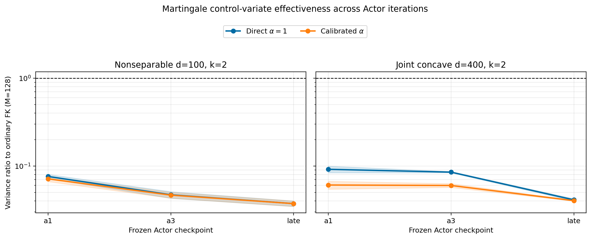
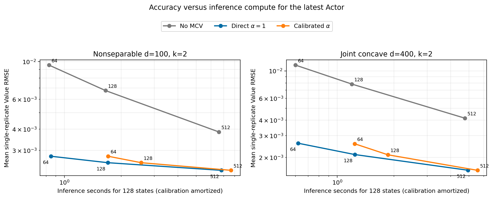

# Rapid Martingale Control-Variate Validation for Tangent-Actor

**Decision: GO.** The decision uses independently calibrated coefficients, eight fresh MC replications, paired Brownian streams and antithetic pair averages as the variance units. Ground Truth is used only for the posthoc accuracy columns.

## Frozen protocol

No Actor was retrained and the original FK solver was not modified. For every Euler step the auxiliary estimator accumulates $H\leftarrow H+C_mq(t_m,X_m)^\top\Delta W_m$ at the left endpoint before the state and exponential weight are advanced. The ordinary and MCV predictions use the same Brownian paths. A separate 512-path stream estimates one scalar $\alpha$ per Actor after within-state centering.

The ordinary implementation reports `martingale_control_variate=False`; identical-seed ordinary values and the $\alpha=0$ augmented values agree to the tolerance recorded in the correctness audit.

## Variance ratio across iterations

The 95% intervals below are paired state bootstraps of the replicate-variance ratio; all variants share Brownian streams within each replicate. Each consolidated interval is the envelope of the two independently trained Actor seeds, while the CSV retains both seed-specific intervals.

| Benchmark | Actor | M | Direct R [paired 95% CI envelope] | Calibrated R [paired 95% CI envelope] | Direct reduction | Calibrated reduction |
|---|---|---:|---:|---:|---:|---:|
| Nonseparable d=100, k=2 | a1 | 64 | 0.07584 [0.05984, 0.1001] | 0.07386 [0.05892, 0.09756] | 13.29 ± 1.634× | 13.62 ± 1.478× |
| Nonseparable d=100, k=2 | a1 | 128 | 0.07598 [0.06054, 0.09373] | 0.07132 [0.05635, 0.08802] | 13.2 ± 1.015× | 14.09 ± 1.387× |
| Nonseparable d=100, k=2 | a1 | 512 | 0.07066 [0.05813, 0.08483] | 0.06781 [0.05423, 0.08269] | 14.17 ± 0.6453× | 14.8 ± 1.214× |
| Nonseparable d=100, k=2 | a3 | 64 | 0.05352 [0.04438, 0.06304] | 0.05298 [0.04441, 0.06256] | 18.69 ± 0.3564× | 18.88 ± 0.3684× |
| Nonseparable d=100, k=2 | a3 | 128 | 0.04691 [0.03691, 0.05973] | 0.04653 [0.03707, 0.05869] | 21.48 ± 2.64× | 21.62 ± 2.365× |
| Nonseparable d=100, k=2 | a3 | 512 | 0.04829 [0.04033, 0.05887] | 0.04816 [0.04025, 0.05799] | 20.72 ± 0.8175× | 20.78 ± 0.7558× |
| Nonseparable d=100, k=2 | late | 64 | 0.03619 [0.02987, 0.04235] | 0.03614 [0.02976, 0.04266] | 27.66 ± 1.055× | 27.69 ± 1.061× |
| Nonseparable d=100, k=2 | late | 128 | 0.03723 [0.03012, 0.04675] | 0.03721 [0.03028, 0.04687] | 27 ± 2.75× | 27.02 ± 2.802× |
| Nonseparable d=100, k=2 | late | 512 | 0.04004 [0.03255, 0.04974] | 0.04001 [0.03231, 0.04962] | 25.05 ± 1.956× | 25.08 ± 2.026× |
| Joint concave d=400, k=2 | a1 | 64 | 0.09146 [0.07632, 0.1057] | 0.0566 [0.04872, 0.06612] | 10.94 ± 0.4287× | 17.67 ± 0.1458× |
| Joint concave d=400, k=2 | a1 | 128 | 0.09162 [0.07354, 0.1138] | 0.06066 [0.0475, 0.07592] | 11 ± 1.357× | 16.67 ± 2.454× |
| Joint concave d=400, k=2 | a1 | 512 | 0.091 [0.07825, 0.1064] | 0.05785 [0.04976, 0.06825] | 10.99 ± 0.2434× | 17.29 ± 0.4177× |
| Joint concave d=400, k=2 | a3 | 64 | 0.07981 [0.06664, 0.09596] | 0.05901 [0.04919, 0.07161] | 12.54 ± 0.4633× | 16.97 ± 0.974× |
| Joint concave d=400, k=2 | a3 | 128 | 0.08507 [0.07295, 0.1014] | 0.05993 [0.04947, 0.07314] | 11.76 ± 0.2744× | 16.73 ± 1.193× |
| Joint concave d=400, k=2 | a3 | 512 | 0.08092 [0.06653, 0.09731] | 0.0588 [0.04854, 0.06904] | 12.36 ± 0.2062× | 17.04 ± 1.011× |
| Joint concave d=400, k=2 | late | 64 | 0.03948 [0.03337, 0.04582] | 0.03826 [0.03263, 0.04376] | 25.34 ± 0.6907× | 26.14 ± 0.4156× |
| Joint concave d=400, k=2 | late | 128 | 0.04107 [0.03509, 0.04947] | 0.04021 [0.03503, 0.04732] | 24.37 ± 1.013× | 24.87 ± 0.4339× |
| Joint concave d=400, k=2 | late | 512 | 0.04031 [0.03385, 0.04752] | 0.03875 [0.0325, 0.04555] | 24.82 ± 0.8112× | 25.83 ± 1.013× |

## Calibration

| Benchmark | Actor | Calibrated alpha | Calibration s | Pair corr(P,H) |
|---|---|---:|---:|---:|
| Nonseparable d=100, k=2 | a1 | 0.9395 ± 0.006894 | 7.033 ± 0.2301 | 0.9636 ± 0.0004593 |
| Nonseparable d=100, k=2 | a3 | 0.9821 ± 0.003914 | 6.511 ± 0.2607 | 0.9754 ± 5.086e-06 |
| Nonseparable d=100, k=2 | late | 1 ± 0.006573 | 6.855 ± 0.2008 | 0.9816 ± 0.0001865 |
| Joint concave d=400, k=2 | a1 | 0.8432 ± 0.00177 | 5.14 ± 0.4396 | 0.9703 ± 0.001227 |
| Joint concave d=400, k=2 | a3 | 0.8645 ± 0.01243 | 4.965 ± 0.4762 | 0.9688 ± 0.002725 |
| Joint concave d=400, k=2 | late | 0.9666 ± 0.00225 | 4.949 ± 0.5527 | 0.9792 ± 0.0003548 |

## Runtime and memory

| Benchmark | Actor | M | Plain s | MCV s | Overhead | Extra peak MiB |
|---|---|---:|---:|---:|---:|---:|
| Nonseparable d=100, k=2 | a1 | 128 | 1.664 ± 0.05019 | 1.711 ± 0.05185 | 2.82% | 0.00488 |
| Nonseparable d=100, k=2 | a1 | 512 | 6.627 ± 0.1749 | 6.817 ± 0.1894 | 2.87% | 0.00488 |
| Nonseparable d=100, k=2 | a3 | 128 | 1.57 ± 0.0744 | 1.613 ± 0.08011 | 2.69% | 0.00488 |
| Nonseparable d=100, k=2 | a3 | 512 | 6.256 ± 0.3282 | 6.424 ± 0.3521 | 2.67% | 0.00488 |
| Nonseparable d=100, k=2 | late | 128 | 1.654 ± 0.03212 | 1.7 ± 0.03498 | 2.82% | 0.00488 |
| Nonseparable d=100, k=2 | late | 512 | 6.609 ± 0.2241 | 6.806 ± 0.2463 | 2.98% | 0.00488 |
| Joint concave d=400, k=2 | a1 | 128 | 1.203 ± 0.1041 | 1.245 ± 0.1134 | 3.48% | 0.00488 |
| Joint concave d=400, k=2 | a1 | 512 | 4.772 ± 0.4441 | 4.949 ± 0.4764 | 3.68% | 0.00488 |
| Joint concave d=400, k=2 | a3 | 128 | 1.197 ± 0.1127 | 1.24 ± 0.1196 | 3.52% | 0.00488 |
| Joint concave d=400, k=2 | a3 | 512 | 4.781 ± 0.4662 | 4.969 ± 0.4871 | 3.94% | 0.00488 |
| Joint concave d=400, k=2 | late | 128 | 1.196 ± 0.1351 | 1.239 ± 0.1414 | 3.64% | 0.00488 |
| Joint concave d=400, k=2 | late | 512 | 4.757 ± 0.5259 | 4.941 ± 0.566 | 3.84% | 0.00488 |

## Posthoc accuracy and unchanged bias

| Benchmark | M | No-MCV replicate RMSE | Direct replicate RMSE | Calibrated replicate RMSE | Direct 8-replicate-mean RMSE |
|---|---:|---:|---:|---:|---:|
| Nonseparable d=100, k=2 | 64 | 0.0095381 ± 0.0001427 | 0.0027721 ± 4.1408e-05 | 0.0027724 ± 4.1825e-05 | 0.0022324 ± 6.4546e-05 |
| Nonseparable d=100, k=2 | 128 | 0.0067547 ± 7.9375e-05 | 0.0025405 ± 8.9981e-07 | 0.0025404 ± 9.7844e-07 | 0.0022675 ± 2.6492e-05 |
| Nonseparable d=100, k=2 | 512 | 0.0038528 ± 3.1989e-05 | 0.0022903 ± 2.9338e-05 | 0.0022904 ± 2.8854e-05 | 0.0022153 ± 3.6718e-05 |
| Joint concave d=400, k=2 | 64 | 0.011146 ± 0.00019415 | 0.0026065 ± 8.3358e-05 | 0.0025793 ± 7.3296e-05 | 0.0016092 ± 4.5792e-05 |
| Joint concave d=400, k=2 | 128 | 0.0078327 ± 0.00021508 | 0.0021117 ± 3.399e-05 | 0.0021021 ± 2.4853e-05 | 0.0015226 ± 6.4877e-05 |
| Joint concave d=400, k=2 | 512 | 0.0041555 ± 5.2683e-05 | 0.0015775 ± 5.5125e-06 | 0.0015744 ± 6.3161e-06 | 0.0014017 ± 7.3177e-06 |

The replicate RMSE includes frozen Actor/Euler bias and finite-path noise. The eight-replicate-mean RMSE suppresses most of the latter and exposes the remaining floor; MCV cannot change that floor because it leaves the discrete policy-value expectation unchanged.

Calibration is a one-time per-Actor cost. Calibrated efficiency includes one eighth of that cost per reported replicate; direct MCV has no calibration cost.

## Sampling and resource diagnostics

For late Actors, antithetic pairing alone has payoff and martingale variance ratios **0.616** and **0.605** relative to ordinary independent-path averaging. Thus antithetic sampling already removes **38.4%** of payoff variance by this diagnostic, and the reported MCV gain is additional. Exponential-weight ESS fractions range from **0.957** to **0.968**.

The completed Slurm allocations used **0.449 GH200 GPU-hours** across **2** jobs. Exact job IDs, nodes, elapsed times and launcher commits are in `execution_manifest.json`.

## Correctness and interpretation

The martingale-zero 95% interval contains zero in **97.2%** of direct-MCV rows. The paired MCV-minus-ordinary mean interval contains zero in **97.2%** of corrected rows. These are multiple 95% checks, so an occasional miss is expected. Metric replay checked **108** rows with maximum discrepancy **0**. Coverage passed: **True**; correctness audit passed: **True**.

MCV changes sampling variance only. Differences in posthoc Value RMSE across variants at finite $M$ are MC realization effects; the frozen Actor and Euler bias are unchanged.

## Answers

1. **Does MCV help?** Yes. The best late-Actor mean effective variance reduction is **26.1×**.
2. **Does it help more for later Actors?** Yes. Direct-MCV mean variance ratio changes from **0.0828** at a1 to **0.0391** for the late Actors.
3. **Paths saved for the same standard error:** approximately **96.1%**, or a **25.7×** path reduction, for the preferred late-Actor variant under the observed $1/M$ scaling.
4. **Does $\alpha=1$ suffice?** Yes; calibration gives less than a 10% relative variance advantage.
5. **Accuracy per GPU second:** the preferred estimator gives **24.9×** effective variance reduction per GPU second, with mean kernel overhead **3.15%**. Its total RMSE benefit can be smaller when Actor/Euler bias dominates.
6. **Optional inference enhancement:** Yes. Keep it inference-only and default to the direct coefficient when calibration is unnecessary.
