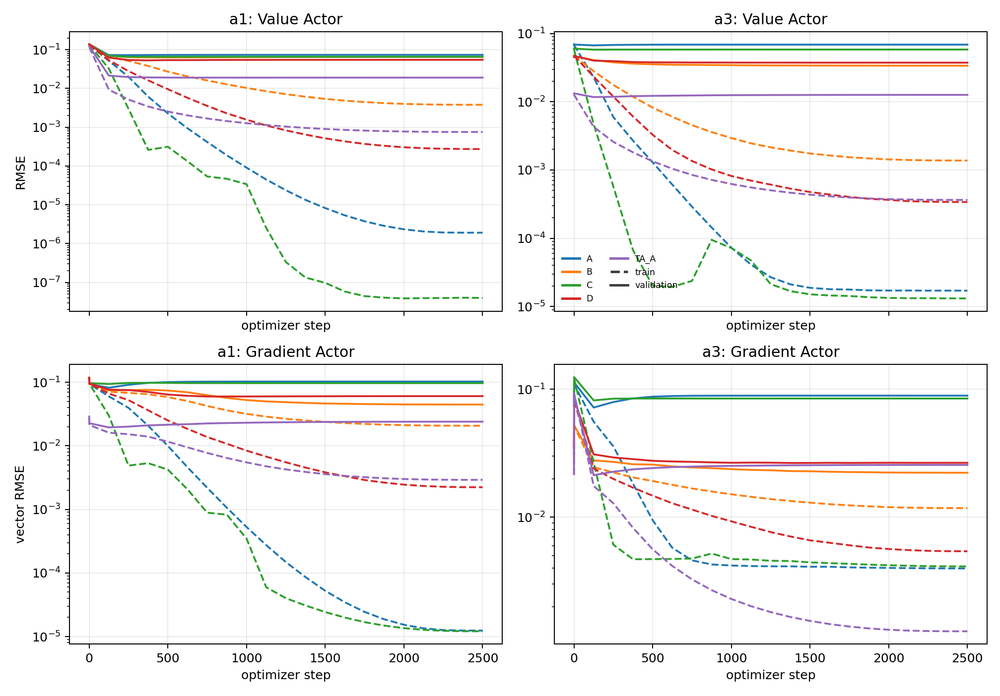
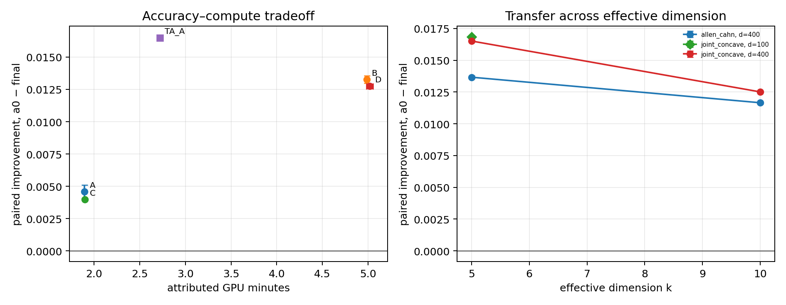
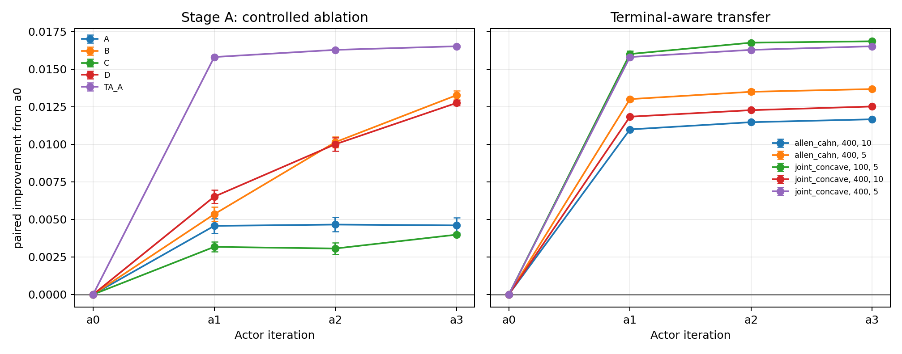

# High-Dimensional Tangent-Actor Scaling Diagnosis

## Decision: **GO**

本轮已经定位并修复了旧 Tangent-Actor 在 `d=400,k≥5` 的失效。结论不是“网络太小”，而是两层问题叠加：

1. **标准 full-ambient Actor 的样本覆盖不足。** 把训练点从 2,048 增到 8,192，在两个网络宽度下都恢复了逐轮 Policy Value 改善；单独把 3×192 加宽到 3×512 没有收益，并扩大了 Gradient Actor 的泛化差距。
2. **直接学习完整的 `(u,z)` 浪费了已知终端结构。** 终端感知 3×192 Actor 在相同 2,048 个标签、相同优化预算和相同种子下，超过了 8,192 点的标准 Actor，同时只需要后者约 54% 的归因计算量。

选出的最小修复 `TA_A` 在所有迁移配置上都稳定工作：joint-concave `d=400,k=5/10`、Allen–Cahn `d=400,k=5/10` 以及稳健性检查 `d=100,k=5`，每个配置两个独立训练种子。所有 10 个终端感知迁移/稳健性 run 的 `a1,a2,a3` 都继续降低 paired tangent-policy Value；没有一次迭代退步。

因此可以进入完整 ICML strong-baseline comparison，但结论边界必须保持清楚：`k=5,10` 没有独立 Ground Truth，本轮确认的是 reference-free tangent-policy Value 改善和 Actor 学习恢复，尚未把这些数值解释为 PDE 真解误差。

## Protocol and safeguards

- 分支：`ir-mlp-tangent-actor-scaling-fix`，从 `cde7b4a2` 开始。
- Stage A GPU 运行代码：`80b3ad73`；Stage B/C：`d8b30b4a`。
- Stage A：joint-concave `d=400,k=5`，A/B/C/D 和 TA_A 各两个训练种子，共 10 runs、30 次 Actor 更新。
- Stage B：选定 TA_A 后迁移到 joint-concave `d=400,k=10` 和 Allen–Cahn `d=400,k=5/10`，各两个种子。
- Stage C：joint-concave `d=100,k=5`，两个种子。
- 每轮保持 128 paths/label、16 个 SDE steps、2,500 optimizer steps、batch 512；没有增加 MC paths 或 Actor iteration。
- Policy evaluation 使用 256 个固定独立状态、512 条 antithetic paths 和 32 steps。
- 2,048 点 bank 是 8,192 点 bank 的严格前缀。A–D 和 TA_A 的 `a1` 使用完全相同的训练/验证点、标签 MC 随机流和标签；后续迭代因 source policy 不同而使用各自标签，但训练点流和 MC seed 规则保持一致。
- 标签 validation、policy evaluation bank 和训练 bank 使用不同的确定性随机流。
- Actor 始终读取完整 `(t,x)∈R^(d+1)`；没有 `Bᵀx` 输入、oracle projection、解析非终端标签、非线性 teacher 或外部 baseline。
- checkpoint 只按 held-out noisy tangent-label loss 选择。Stage B 的方法选择在所有 Stage A runs 完成后冻结，使用 reference-free paired improvement、held-out Actor fit、replication noise、ESS 和成本；没有精确解或 exact test value。

完整协议见 [`experiment_protocol.json`](experiment_protocol.json)，Stage B 冻结选择见 [`stage_b_selection.json`](stage_b_selection.json)，确定性 seeds/hashes 见 [`reproducibility_metadata.json`](reproducibility_metadata.json)。

## Terminal-aware Actor

令 `τ=T-t`。实现对任意有界 tangent domain `[r_low,r_high]` 使用

\[
p_g(x)=\frac{g(x)-r_{\rm low}}{r_{\rm high}-r_{\rm low}},
\]

\[
r_\theta(t,x)=r_{\rm low}+(r_{\rm high}-r_{\rm low})
\operatorname{sigmoid}\!\left(\operatorname{logit}p_g(x)+\tau R_\theta(t,x)\right),
\]

\[
q_\theta(t,x)=\sqrt2\nabla g(x)+\tau Q_\theta(t,x).
\]

这同时覆盖正值 concave driver 的 `(0,1)` 和 sign-transformed convex driver 的 `(-1,0)`。网络第一层仍有 `d+1` 个输入，终端函数只以解析 skip 的形式出现。终端梯度由可微 Torch 张量运算构造，没有从受控路径计算图 detach，因此 full-trajectory VJP 包含其状态依赖。

数值测试覆盖 Allen–Cahn、joint concave、joint convex sign transform 和 nonseparable driver：float64 终端 Value 最大误差不超过 `1.67e-16`，终端 Gradient 最大误差为零；负值参数化严格落在 `(-1,0)`。额外测试直接对 `q(T-τ,X)` 对 `X` 求导，并通过完整 weighted-rollout VJP 验证状态图没有断开。所有实验中的 Value saturation fraction 都为零。

## Stage A: controlled data–capacity ablation

定义

\[
I_j=\frac1n\sum_i\left(\widehat V^{a_0}(x_i)-\widehat V^{a_j}(x_i)\right).
\]

正数表示 tangent-policy Value 改善。下表 `±` 是两个训练种子的标准差；每个 run 内最终逐状态 paired SE 为 `0.00054–0.00069`。

| Setting | Points | Actor | Parameters | Final `I₃` | Held-out Value RMSE | Held-out Gradient vector RMSE | Attributed GPU min |
|---|---:|---|---:|---:|---:|---:|---:|
| A | 2,048 | standard 3×192 | 228,689 | `0.004597 ± 0.000506` | `0.06700 ± 0.00031` | `0.07202 ± 0.00101` | 1.89 |
| B | 8,192 | standard 3×192 | 228,689 | `0.013261 ± 0.000297` | `0.03376 ± 0.00312` | `0.02227 ± 0.00024` | 4.99 |
| C | 2,048 | standard 3×512 | 936,849 | `0.003979 ± 0.000051` | `0.05797 ± 0.00190` | `0.08188 ± 0.00008` | 1.90 |
| D | 8,192 | standard 3×512 | 936,849 | `0.012745 ± 0.000180` | `0.03741 ± 0.00178` | `0.02656 ± 0.00140` | 5.02 |
| **TA_A** | 2,048 | terminal-aware 3×192 | 228,689 | **`0.016519 ± 0.000065`** | **`0.01170 ± 0.00075`** | **`0.02132 ± 0.00204`** | **2.72** |

所有 10 个 Stage A runs 的最终 paired improvement 都显著为正。旧协议的 A 类配置不再失败，是因为原来只在 step `1/625/1250/1875/2500` 检查；新曲线发现 A 的最佳 checkpoint 一致在 step 125。这个修正恢复了小幅改善，但没有消除泛化瓶颈。

### Data effect

- B−A 的平均 `I₃` 增量为 `+0.008664`，总改善达到 A 的 `2.88×`。
- D−C 的增量为 `+0.008766`，总改善达到 C 的 `3.20×`。
- 更多数据把窄网络的 held-out Gradient vector RMSE 从 `0.0720` 降到 `0.0223`，宽网络从 `0.0819` 降到 `0.0266`。
- 两个种子的 Gradient label replication RMSE 始终约为 `0.0069`；监督噪声没有随 Actor 配置变化，fit residual 的变化来自学习器。

训练数据增加确实恢复了可靠 improvement，因此旧失效有明确的 sample-efficiency 成分。

### Capacity effect

- 在 2,048 点下，C−A 的 `I₃` 为 `-0.000618`；Gradient validation RMSE 反而增加 `0.00985`。
- 在 8,192 点下，D−B 的 `I₃` 为 `-0.000517`；Value/Gradient validation RMSE 都略差。
- C/D 的训练误差比对应窄网络更低，但验证误差没有降低。这是更大的泛化差距，不能解释成“容量仍不足”。

因此单独增加参数量不是修复，高维输出头的参数个数也不是主要限制。

### Terminal-aware effect

- TA_A 的 `I₃` 是 A 的 `3.59×`，并比高数据 B 高 `24.6%`。
- 相对 A，held-out Value/Gradient RMSE 分别降低 `82.5%/70.4%`。
- 相对 B，TA_A 的 Value RMSE 低 `65.3%`，Gradient RMSE 相近且略低。
- TA_A 使用 B 的 `54.5%` 归因计算，单位 GPU 分钟改善为 A 的 `2.50×`、B 的 `2.29×`。
- `a1` 已取得最终 TA_A 改善的 `95.7%`；`a2,a3` 仍分别贡献约 `0.000478` 和 `0.000238`，两个种子方向一致。

## Optimization diagnosis

密集 trace 每 125 steps 记录 train/validation Value 和 Gradient loss、gradient norm、learning rate、saturation 和 warm-start step 0。

| Variant | Mean initial normalized validation loss | Best | Step 2500 | Largest checkpoint-window mean gradient norm |
|---|---:|---:|---:|---:|
| A | 1.714 | 0.976 | 1.239 | 24.6 |
| B | 1.343 | 0.376 | 0.376 | 25.7 |
| C | 1.728 | 1.013 | 1.045 | 27.2 |
| D | 1.339 | 0.393 | 0.399 | 25.9 |
| TA_A | **0.633** | **0.0613** | **0.0782** | **4.41** |

A/C 的训练误差持续降到近零，而 validation 在 125 steps 后恶化或持平，说明其早停来自泛化而非 optimizer 没有拟合训练集。B/D 在更大数据下可以训练到 step `1500–2500`，validation 继续改善。TA_A 从更好的 warm-start function class 开始，梯度尺度也明显更温和；它后期同样出现轻微过拟合，但 held-out checkpoint 能稳定捕获最佳区间。

因此没有运行额外 learning-rate schedule：诊断不支持 optimization 是主要瓶颈，继续搜索 schedule 会把泛化问题误当成优化问题。

## Stage B/C transfer

下表仍报告 reference-free paired improvement；`±` 是两个训练种子的标准差。所有配置的每个相邻 Actor iteration 都改善。

| Driver | d | k | `I₁` | `I₂` | `I₃` | Final Value RMSE | Final Gradient vector RMSE | ESS | Attributed GPU min |
|---|---:|---:|---:|---:|---:|---:|---:|---:|---:|
| Joint concave | 100 | 5 | `0.016005 ± 0.000216` | `0.016758 ± 0.000032` | **`0.016851 ± 0.000013`** | 0.00866 | 0.01027 | 0.98498 | 3.32 |
| Joint concave | 400 | 5 | `0.015803 ± 0.000040` | `0.016281 ± 0.000020` | **`0.016519 ± 0.000065`** | 0.01170 | 0.02132 | 0.98425 | 2.72 |
| Joint concave | 400 | 10 | `0.011832 ± 0.000011` | `0.012267 ± 0.000007` | **`0.012512 ± 0.000019`** | 0.00964 | 0.01508 | 0.99278 | 3.22 |
| Allen–Cahn | 400 | 5 | `0.013001 ± 0.000113` | `0.013490 ± 0.000147` | **`0.013671 ± 0.000106`** | 0.01136 | — | 0.98553 | 1.73 |
| Allen–Cahn | 400 | 10 | `0.010985 ± 0.000034` | `0.011466 ± 0.000084` | **`0.011659 ± 0.000079`** | 0.00882 | — | 0.99265 | 1.73 |

每个 run 内最终 paired SE 为 `0.000365–0.000566`，远小于 `0.0117–0.0169` 的 improvement。最终 MC mean SE 为 `0.000104–0.000151`。所有 rollout finite，最终 ESS 为 `0.984–0.993`。

题目固定的 terminal amplitude `0.3/k` 使 signal 随 k 下降。除以 terminal standard deviation 后，joint-concave 的 `I₃/std(g)` 从 `k=5` 的 `0.188` 增至 `k=10` 的 `0.202`；Allen–Cahn 从 `0.156` 增至 `0.188`。因此绝对 improvement 随 k 降低不是性能退化。信号归一化 Value fit 仅从 joint-concave 的 `0.133` 增至 `0.156`，Gradient fit/terminal-z RMS 基本不变：`0.1494→0.1492`。

`d=100→400,k=5` 时，joint-concave 的信号归一化 Value error 从 `0.098` 增到 `0.133`，Gradient error 从 `0.072` 增到 `0.149`。所以 ambient dimension 仍增加 Actor 学习难度，但 TA_A 在两个维度下得到几乎相同的 normalized policy improvement (`0.190` 与 `0.188`)；剩余表示误差不再阻止求解器改善。

## MC noise, label noise, and stability

- Stage A 的 final Value label replication RMSE 约 `0.0041–0.0043`，Gradient vector replication RMSE 约 `0.0069–0.0073`。
- A/C 的 final Gradient fit 分别是 replication noise 的约 `10.5×/11.9×`；TA_A 为 `2.94×`。终端感知表示已经把误差推近监督噪声层级。
- 所有 Stage A final policy-evaluation ESS 为 `0.972–0.985`；迁移为 `0.984–0.993`。
- 没有 nonfinite rollout，terminal-aware Value 没有 saturation。
- MC uncertainty 比恢复后的 paired changes 小一到两个数量级，不能解释成功或失败。

这些结果排除了 label paths、指数权重和最终 Policy Evaluation 作为旧 scaling failure 的主要来源。

## Compute

- Slurm job `3383662`：Stage A，单张 NVIDIA GH200 120GB，`31:46`，正常退出。
- Slurm job `3383796`：Stage B/C，同型号单卡，`20:37`，正常退出。
- 总 allocation：**`52:23 = 0.8731 GH200 GPU-hour`**。
- 18 个 runs、54 次 Actor updates。归因统计合计约 2,365 s labels、309 s Actor fitting 和 508 s inference；这些按每个配置独立运行估算，会重复计入 Stage A 共享的 `a1` label bank，适合配置间公平 cost comparison，不等于实际 allocation wall time。
- Stage A 每轮 Actor fitting 的中位数约 5.0 s；时间主要花在线性 Feynman–Kac 标签和独立 Policy Evaluation。

逐 iteration 成本见 [`compute_accounting.csv`](compute_accounting.csv)，allocation 记录见 [`allocation_accounting.csv`](allocation_accounting.csv)。大型 label caches、checkpoints 和逐点 prediction arrays 保留在工作区但不提交；它们可由固定 seed 重建。

## Answers to the seven questions

1. **增加训练数据能否恢复可靠 improvement？** 能。B/A 和 D/C 两组对照都把净改善提高约三倍，且两个种子复现。
2. **更宽网络能否独立帮助？** 不能。C 比 A、D 比 B 都略差；宽网只降低训练误差并扩大泛化差距。
3. **终端感知 Actor 在等预算下是否实质更好？** 是。TA_A 与 A 使用相同 labels、架构宽度、optimizer budget 和 seeds，`I₃` 提高 `3.59×`，Value/Gradient fit 大幅改善；没有 saturation 或计算图错误。
4. **能否在 `d=400,k=5/10` 恢复 improvement？** 能。joint-concave 和 Allen–Cahn 的四个目标配置、两个种子、三个 iteration 全部改善。
5. **修复能否跨 driver family 迁移？** 能。它同时适用于带完整 Gradient head 的 joint-concave 和只有 Value head 的 Allen–Cahn。
6. **最具成本效益的配置是什么？** 2,048 点、3×192 的 terminal-aware Actor。继续增加到 TA_B 当前没有必要：TA_A 已超过高数据标准 B，并节省约 45.5% 归因计算。
7. **剩余瓶颈是否本质上仍是高维表示学习？** 旧失效的主因是 full-ambient 表示的样本效率和泛化，而非网络容量、MC 或 ESS。ambient dimension 仍使 Gradient fit 变难，但终端 skip 已把已知结构从学习任务中移除，使剩余表示误差不再阻断 Policy Improvement。

## Reproducibility and complete outputs

- [`ablation_results.csv`](ablation_results.csv)：18 个 seed-level run summaries。
- [`training_curves.csv`](training_curves.csv)：完整 train/validation、Value/Gradient、gradient norm、LR、saturation 和 warm-start trace。
- [`reference_free_improvement.csv`](reference_free_improvement.csv)：72 个 `a0–a3` rows，含 paired changes、MC SE 和 ESS。
- [`compute_accounting.csv`](compute_accounting.csv)：逐 iteration label/training/inference 成本和 peak memory。
- [`analysis_summary.json`](analysis_summary.json)：两种子配置级聚合。
- [`result_integrity.json`](result_integrity.json)：18 runs 均通过 finite、ESS、checkpoint selection、共享初始标签和终端 identity 审计。
- [`reproducibility_metadata.json`](reproducibility_metadata.json)：完整配置、seed、bank hash 和运行环境。
- correctness tests 位于 `experiments/tangent_actor_scaling_diagnosis/test_correctness.py`；相关新旧测试共 26 项通过。

本轮没有运行外部 baseline，也没有使用 Ground Truth 选择 Actor、iteration 或方法。
