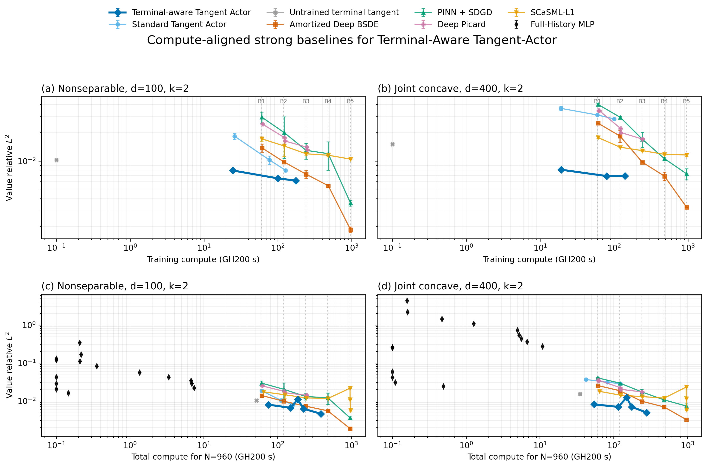
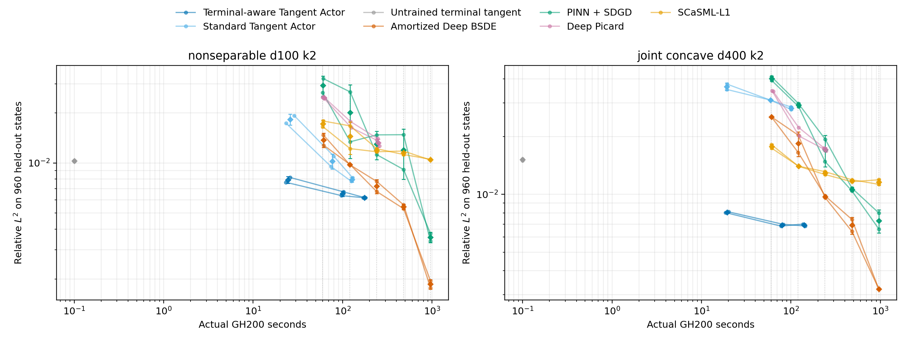
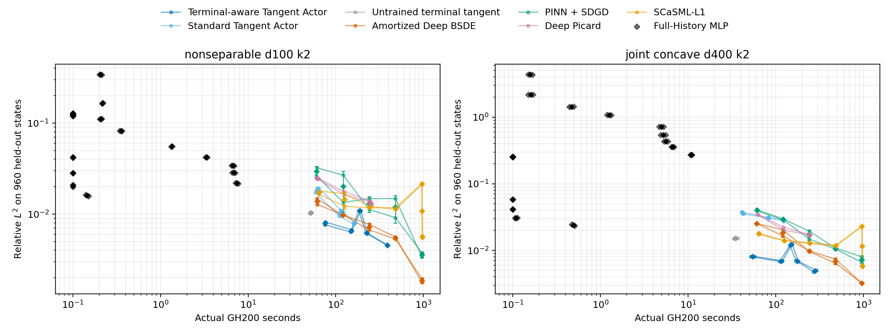

# Strong-Baseline Pilot: Terminal-Aware Tangent-Actor Iteration

**Decision: CONDITIONAL GO.** Terminal-Aware Tangent-Actor is clearly competitive at moderate compute on both pilot PDEs, but the evidence does not yet support an unconditional full-suite claim. The primary method has a shared matched training comparison only at B2, the pilot has two seeds and two effective-dimension-two problems, and amortized Deep BSDE is still improving when it obtains the lowest B5 error. Test errors below are post hoc; no final-test value selected a checkpoint, hyperparameter, or inference budget.

## Experimental contract

Each benchmark has a fixed bank of 240 validation and 960 held-out test states shared by every method, with $x\sim\mathcal N(0,I_d)$ and $t=0$. The reference is an independent two-dimensional periodic Fourier solver (128×128 grid, $\Delta t=2.5\times10^{-4}$). Training time includes label generation, SDE simulation, optimization, validation, and checkpoint I/O. CUDA is synchronized around all timings.

The external implementations were adapted only where the prediction task required it: Deep BSDE learns amortized $Y_0(x_0)$ and shared $Z(t,x)$; PINN uses hard terminal enforcement and SDGD; Deep Picard uses the authors' terminal embedding and centered gradient estimator; Full-History MLP is inference-only; SCaSML-L1 charges both PINN backbone training and defect-correction inference. The inspected official sources and frozen revisions are recorded in `official_source_review.json` and `OFFICIAL_SOURCE_REVIEW.md`.

## Main measured findings

The only training budget populated by the primary Tangent-Actor and external methods on both benchmarks is B2. Within the predeclared ±25% window, ours has the lowest mean error in both cases:

| Benchmark | Budget | Ours: rel. L2 (train s) | Strongest external: rel. L2 (train s) | Ours reduction |
|---|---|---:|---:|---:|
| nonseparable_d100_k2 | B2 | 0.006531 (99.8) | Amortized Deep BSDE 0.009772 (120.9) | 33.2% |
| joint_concave_d400_k2 | B2 | 0.006920 (140.5) | SCaSML-L1 0.014017 (121.5) | 50.6% |

This is a medium-budget advantage rather than uniform dominance. At B5, Deep BSDE reaches relative $L^2$ 0.001861 on the nonseparable problem and 0.003207 on the joint-concave problem, below the best tested Tangent-Actor MC values 0.004547 and 0.004894. Those Tangent-Actor points cost only 389 and 280 total seconds, respectively, while Deep BSDE costs about 961 seconds.

The terminal-aware construction is material. Standard Tangent-Actor remains at relative $L^2$ 0.007949 on the nonseparable problem and 0.028118 at $d=400$, whereas the primary method reaches 0.006173 and 0.006904 before increasing inference MC. The untrained terminal tangent is also weaker on both benchmarks.

## Numerical reference and correctness

| Benchmark | Reference refinement RMSE | PDE residual RMSE | Test value range | In [0,1] |
|---|---:|---:|---:|---:|
| nonseparable_d100_k2 | 7.72e-05 | 5.13e-07 | [0.4384, 0.7276] | True |
| joint_concave_d400_k2 | 8.45e-05 | 3.18e-07 | [0.4760, 0.8321] | True |

Twelve operator/sign/unit tests passed. Independent recomputation checked 186 stored prediction vectors; the maximum RMSE discrepancy was 0 and every row passed at tolerance $10^{-12}$.

## Stage-A calibration

Calibration used only frozen, reference-free validation objectives and measured throughput. It selected Deep BSDE 3×192 with 16 time steps, SDGD-PINN 3×192 with 16 sampled coordinates, and the feasible Deep Picard setting 3×256 with 2048 points and 128 paths. The official-style 4×512 Picard trial had lower round-one validation loss, but round one uses a zero source and does not represent the cost of later network-sourced rounds; it is retained in `hyperparameter_trials.csv` rather than extrapolated as if every round cost 21 seconds.

## Actual training-time alignment

### nonseparable_d100_k2

| Method | B1 (60s) | B2 (120s) | B3 (240s) | B4 (480s) | B5 (960s) |
|---|---:|---:|---:|---:|---:|
| Terminal-aware Tangent Actor | — | 99.8 ± 3.96 | — | — | — |
| Standard Tangent Actor | 74.2 | 127 ± 3.19 | — | — | — |
| Untrained terminal tangent $A_g$ | — | — | — | — | — |
| Amortized Deep BSDE | 61.1 ± 0.175 | 121 ± 0.344 | 241 ± 0.753 | 481 ± 0.214 | 961 ± 0.000177 |
| PINN + SDGD | 60.5 ± 0.681 | 122 ± 0.0505 | 241 ± 0.0356 | 480 ± 0.0907 | 961 ± 1.04 |
| Deep Picard | 61.9 ± 2.7 | 124 ± 1.98 | 243 ± 4.82 | — | — |
| SCaSML-L1 | 60.5 ± 0.681 | 122 ± 0.0505 | 241 ± 0.0356 | 480 ± 0.0907 | 961 ± 1.04 |
| Full-History MLP | — | — | — | — | — |

### joint_concave_d400_k2

| Method | B1 (60s) | B2 (120s) | B3 (240s) | B4 (480s) | B5 (960s) |
|---|---:|---:|---:|---:|---:|
| Terminal-aware Tangent Actor | — | 140 ± 5.78 | — | — | — |
| Standard Tangent Actor | 59.4 ± 0.293 | 100 ± 0.305 | — | — | — |
| Untrained terminal tangent $A_g$ | — | — | — | — | — |
| Amortized Deep BSDE | 60.7 ± 0.441 | 120 ± 0.249 | 241 ± 0.0621 | 481 ± 0.487 | 961 ± 0.00329 |
| PINN + SDGD | 60.8 ± 0.138 | 122 ± 0.519 | 241 ± 1.14 | 480 ± 0.237 | 961 ± 0.801 |
| Deep Picard | 62.4 ± 1.26 | 123 ± 1.03 | 238 ± 5.34 | — | — |
| SCaSML-L1 | 60.8 ± 0.138 | 122 ± 0.519 | 241 ± 1.14 | 480 ± 0.237 | 961 ± 0.801 |
| Full-History MLP | — | — | — | — | — |

A dash means no complete real checkpoint fell within ±25% of the target. Full-History MLP has no training phase and is therefore deliberately absent from training-budget comparisons.

## Accuracy versus training compute

### nonseparable_d100_k2

| Budget | Method | Actual train s | Relative L2 | Value RMSE | RMSE/ref. std |
|---|---|---:|---:|---:|---:|
| B1 | Standard Tangent Actor | 74.19 | 0.009522 | 0.00595 | 0.1166 |
| B1 | Amortized Deep BSDE | 61.14 ± 0.1746 | 0.01378 ± 0.001377 | 0.008608 ± 0.0008604 | 0.1687 ± 0.01686 |
| B1 | PINN + SDGD | 60.5 ± 0.6809 | 0.02935 ± 0.004024 | 0.01834 ± 0.002515 | 0.3594 ± 0.04928 |
| B1 | Deep Picard | 61.94 ± 2.703 | 0.02472 ± 0.0002651 | 0.01545 ± 0.0001657 | 0.3027 ± 0.003246 |
| B1 | SCaSML-L1 | 60.5 ± 0.6809 | 0.01723 ± 0.0009316 | 0.01077 ± 0.0005821 | 0.211 ± 0.01141 |
| B2 | Terminal-aware Tangent Actor | 99.76 ± 3.955 | 0.006531 ± 0.0002391 | 0.004081 ± 0.0001494 | 0.07997 ± 0.002928 |
| B2 | Standard Tangent Actor | 127.3 ± 3.19 | 0.007949 ± 0.0002703 | 0.004967 ± 0.0001689 | 0.09734 ± 0.00331 |
| B2 | Amortized Deep BSDE | 120.9 ± 0.3443 | 0.009772 ± 2.476e-05 | 0.006106 ± 1.547e-05 | 0.1197 ± 0.0003032 |
| B2 | PINN + SDGD | 121.6 ± 0.05047 | 0.0201 ± 0.009458 | 0.01256 ± 0.00591 | 0.2461 ± 0.1158 |
| B2 | Deep Picard | 124 ± 1.982 | 0.01704 ± 0.00103 | 0.01065 ± 0.0006435 | 0.2087 ± 0.01261 |
| B2 | SCaSML-L1 | 121.6 ± 0.05047 | 0.01446 ± 0.003197 | 0.009036 ± 0.001998 | 0.1771 ± 0.03915 |
| B3 | Amortized Deep BSDE | 240.5 ± 0.7526 | 0.007237 ± 0.0007081 | 0.004522 ± 0.0004425 | 0.08862 ± 0.008671 |
| B3 | PINN + SDGD | 240.6 ± 0.0356 | 0.013 ± 0.002502 | 0.008121 ± 0.001564 | 0.1591 ± 0.03064 |
| B3 | Deep Picard | 243 ± 4.823 | 0.01388 ± 0.0002046 | 0.008671 ± 0.0001279 | 0.1699 ± 0.002506 |
| B3 | SCaSML-L1 | 240.6 ± 0.0356 | 0.01194 ± 0.0003588 | 0.007459 ± 0.0002242 | 0.1462 ± 0.004393 |
| B4 | Amortized Deep BSDE | 480.6 ± 0.2144 | 0.005451 ± 0.0002028 | 0.003406 ± 0.0001267 | 0.06675 ± 0.002483 |
| B4 | PINN + SDGD | 480.3 ± 0.09069 | 0.01197 ± 0.004007 | 0.007477 ± 0.002504 | 0.1465 ± 0.04906 |
| B4 | SCaSML-L1 | 480.3 ± 0.09069 | 0.01152 ± 0.0003943 | 0.007199 ± 0.0002464 | 0.1411 ± 0.004829 |
| B5 | Amortized Deep BSDE | 961.2 ± 0.0001773 | 0.001861 ± 0.0001244 | 0.001163 ± 7.771e-05 | 0.02279 ± 0.001523 |
| B5 | PINN + SDGD | 961.2 ± 1.04 | 0.00357 ± 0.0002533 | 0.002231 ± 0.0001583 | 0.04372 ± 0.003101 |
| B5 | SCaSML-L1 | 961.2 ± 1.04 | 0.01047 ± 8.155e-05 | 0.006543 ± 5.096e-05 | 0.1282 ± 0.0009986 |

Best observed checkpoint for each method (descriptive, post hoc):

| Method | Checkpoint | Train s | Relative L2 |
|---|---|---:|---:|
| Amortized Deep BSDE | B5 | 961 | 0.001861 |
| PINN + SDGD | B5 | 961 | 0.00357 |
| Terminal-aware Tangent Actor | a3 | 175 | 0.006173 |
| Standard Tangent Actor | a3 | 127 | 0.007949 |
| Untrained terminal tangent $A_g$ | untrained | 0 | 0.01028 |
| SCaSML-L1 | PINN_B5 | 961 | 0.01047 |
| Deep Picard | round40 | 249 | 0.01321 |

Primary Tangent-Actor phase diagnostics:

| Actor | Cumulative train s | Relative L2 | RMSE | Actor value val. RMSE | Actor gradient val. vector RMSE | Value-label repl. RMSE | Gradient-label repl. vector RMSE | Weight ESS fraction |
|---|---:|---:|---:|---:|---:|---:|---:|---:|
| a1 | 24.56 ± 1.855 | 0.007916 ± 0.0003744 | 0.004946 ± 0.000234 | 0.01487 ± 0.0007995 | 0.02088 ± 0.003099 | 0.00687 ± 0.0003335 | 0.009387 ± 0.0004493 | 0.9987 ± 2.763e-05 |
| a2 | 99.76 ± 3.955 | 0.006531 ± 0.0002391 | 0.004081 ± 0.0001494 | 0.012 ± 0.001147 | 0.01752 ± 0.0008149 | 0.00635 ± 0.0002629 | 0.008466 ± 0.0007048 | 0.976 ± 8.988e-05 |
| a3 | 175.2 ± 6.269 | 0.006173 ± 9.049e-06 | 0.003857 ± 5.655e-06 | 0.01029 ± 0.0001433 | 0.01462 ± 1.267e-05 | 0.006217 ± 0.0005509 | 0.00891 ± 0.0006577 | 0.98 ± 0.0003809 |

### joint_concave_d400_k2

| Budget | Method | Actual train s | Relative L2 | Value RMSE | RMSE/ref. std |
|---|---|---:|---:|---:|---:|
| B1 | Standard Tangent Actor | 59.36 ± 0.293 | 0.03095 ± 2.809e-06 | 0.02098 ± 1.904e-06 | 0.249 ± 2.259e-05 |
| B1 | Amortized Deep BSDE | 60.71 ± 0.441 | 0.02531 ± 6.266e-05 | 0.01716 ± 4.248e-05 | 0.2036 ± 0.000504 |
| B1 | PINN + SDGD | 60.84 ± 0.1375 | 0.0401 ± 0.001239 | 0.02719 ± 0.0008397 | 0.3226 ± 0.009963 |
| B1 | Deep Picard | 62.43 ± 1.259 | 0.03451 ± 0.0001597 | 0.0234 ± 0.0001083 | 0.2776 ± 0.001285 |
| B1 | SCaSML-L1 | 60.84 ± 0.1375 | 0.01777 ± 0.0005235 | 0.01205 ± 0.0003549 | 0.1429 ± 0.004211 |
| B2 | Terminal-aware Tangent Actor | 140.5 ± 5.785 | 0.00692 ± 0.0001137 | 0.004691 ± 7.707e-05 | 0.05566 ± 0.0009144 |
| B2 | Standard Tangent Actor | 100.2 ± 0.3054 | 0.02812 ± 0.000599 | 0.01906 ± 0.0004061 | 0.2262 ± 0.004818 |
| B2 | Amortized Deep BSDE | 120.5 ± 0.2487 | 0.01844 ± 0.002691 | 0.0125 ± 0.001824 | 0.1483 ± 0.02164 |
| B2 | PINN + SDGD | 121.5 ± 0.5193 | 0.02921 ± 0.0007578 | 0.0198 ± 0.0005138 | 0.2349 ± 0.006096 |
| B2 | Deep Picard | 122.7 ± 1.026 | 0.02121 ± 0.001552 | 0.01438 ± 0.001052 | 0.1706 ± 0.01248 |
| B2 | SCaSML-L1 | 121.5 ± 0.5193 | 0.01402 ± 4.014e-06 | 0.009503 ± 2.721e-06 | 0.1127 ± 3.229e-05 |
| B3 | Amortized Deep BSDE | 241.1 ± 0.06207 | 0.009718 ± 0.0001372 | 0.006589 ± 9.303e-05 | 0.07817 ± 0.001104 |
| B3 | PINN + SDGD | 240.9 ± 1.141 | 0.01711 ± 0.003201 | 0.0116 ± 0.00217 | 0.1376 ± 0.02575 |
| B3 | Deep Picard | 238 ± 5.339 | 0.01725 ± 0.0002665 | 0.0117 ± 0.0001807 | 0.1388 ± 0.002144 |
| B3 | SCaSML-L1 | 240.9 ± 1.141 | 0.0129 ± 0.0003203 | 0.008749 ± 0.0002172 | 0.1038 ± 0.002577 |
| B4 | Amortized Deep BSDE | 480.8 ± 0.487 | 0.006901 ± 0.0007016 | 0.004678 ± 0.0004757 | 0.05551 ± 0.005644 |
| B4 | PINN + SDGD | 480.3 ± 0.2367 | 0.0106 ± 0.0002513 | 0.007187 ± 0.0001704 | 0.08528 ± 0.002022 |
| B4 | SCaSML-L1 | 480.3 ± 0.2367 | 0.01177 ± 0.000195 | 0.007981 ± 0.0001322 | 0.09469 ± 0.001569 |
| B5 | Amortized Deep BSDE | 961.2 ± 0.003288 | 0.003207 ± 3.149e-06 | 0.002174 ± 2.135e-06 | 0.0258 ± 2.533e-05 |
| B5 | PINN + SDGD | 961.1 ± 0.8007 | 0.007296 ± 0.0009916 | 0.004946 ± 0.0006723 | 0.05869 ± 0.007976 |
| B5 | SCaSML-L1 | 961.1 ± 0.8007 | 0.01159 ± 0.0004502 | 0.007861 ± 0.0003052 | 0.09327 ± 0.003622 |

Best observed checkpoint for each method (descriptive, post hoc):

| Method | Checkpoint | Train s | Relative L2 |
|---|---|---:|---:|
| Amortized Deep BSDE | B5 | 961 | 0.003207 |
| Terminal-aware Tangent Actor | a2 | 79.9 | 0.006904 |
| PINN + SDGD | B5 | 961 | 0.007296 |
| SCaSML-L1 | PINN_B5 | 961 | 0.01159 |
| Untrained terminal tangent $A_g$ | untrained | 0 | 0.01515 |
| Deep Picard | round39 | 242 | 0.01707 |
| Standard Tangent Actor | a3 | 100 | 0.02812 |

Primary Tangent-Actor phase diagnostics:

| Actor | Cumulative train s | Relative L2 | RMSE | Actor value val. RMSE | Actor gradient val. vector RMSE | Value-label repl. RMSE | Gradient-label repl. vector RMSE | Weight ESS fraction |
|---|---:|---:|---:|---:|---:|---:|---:|---:|
| a1 | 19.34 ± 1.005 | 0.008067 ± 5.469e-05 | 0.005469 ± 3.708e-05 | 0.02097 ± 0.003463 | 0.03156 ± 0.002623 | 0.007405 ± 0.0004864 | 0.01232 ± 0.0007663 | 0.9987 ± 1.245e-05 |
| a2 | 79.86 ± 3.433 | 0.006904 ± 0.0001024 | 0.00468 ± 6.942e-05 | 0.01795 ± 0.0007764 | 0.03354 ± 0.0006682 | 0.006981 ± 0.0002391 | 0.01161 ± 0.0001836 | 0.9854 ± 7.77e-05 |
| a3 | 140.5 ± 5.785 | 0.00692 ± 0.0001137 | 0.004691 ± 7.707e-05 | 0.01821 ± 0.0003458 | 0.0326 ± 0.0002167 | 0.007344 ± 0.0001546 | 0.01245 ± 0.0001386 | 0.9871 ± 0.0003453 |

## Accuracy versus total compute for N=960

Stochastic inference budgets are chosen with the independent validation bank within each fixed trained checkpoint; final-test error never ranks inference variants. Across trained checkpoints, the selected row is the closest real total time within the ±25% budget window. The best eligible method at each total-cost budget is:

| Benchmark | Budget | Best eligible method | Rel. L2 | Actual total s | Seeds |
|---|---|---|---:|---:|---:|
| nonseparable_d100_k2 | B1 | Terminal-aware Tangent Actor | 0.007651 | 74.9 | 1 |
| nonseparable_d100_k2 | B2 | Terminal-aware Tangent Actor | 0.006362 | 147.3 | 1 |
| nonseparable_d100_k2 | B3 | Terminal-aware Tangent Actor | 0.006173 | 225.7 | 2 |
| nonseparable_d100_k2 | B4 | Terminal-aware Tangent Actor | 0.004547 | 388.7 | 2 |
| nonseparable_d100_k2 | B5 | Amortized Deep BSDE | 0.001861 | 961.2 | 2 |
| joint_concave_d400_k2 | B1 | Terminal-aware Tangent Actor | 0.008067 | 54.5 | 2 |
| joint_concave_d400_k2 | B2 | Terminal-aware Tangent Actor | 0.006904 | 115.1 | 2 |
| joint_concave_d400_k2 | B3 | Terminal-aware Tangent Actor | 0.004894 | 280.0 | 2 |
| joint_concave_d400_k2 | B4 | Amortized Deep BSDE | 0.006901 | 480.8 | 2 |
| joint_concave_d400_k2 | B5 | Amortized Deep BSDE | 0.003207 | 961.2 | 2 |

### nonseparable_d100_k2

Closest real total-cost points:

| Method | B1 (60s) | B2 (120s) | B3 (240s) | B4 (480s) | B5 (960s) |
|---|---:|---:|---:|---:|---:|
| Terminal-aware Tangent Actor | 74.9 | 147 | 226 ± 6.43 | 389 ± 5.28 | — |
| Standard Tangent Actor | 61.2 ± 3.99 | 112 ± 4.02 | — | — | — |
| Untrained terminal tangent $A_g$ | 51.8 ± 2.09 | — | — | — | — |
| Amortized Deep BSDE | 61.2 ± 0.176 | 121 ± 0.344 | 241 ± 0.753 | 481 ± 0.214 | 961 ± 0.000166 |
| PINN + SDGD | 60.5 ± 0.681 | 122 ± 0.0505 | 241 ± 0.0357 | 480 ± 0.0907 | 961 ± 1.04 |
| Deep Picard | 61.9 ± 2.7 | 124 ± 1.98 | 243 ± 4.82 | — | — |
| SCaSML-L1 | 64.3 ± 0.607 | 125 ± 0.12 | 244 ± 0.0821 | 484 ± 0.0504 | 976 ± 0.566 |
| Full-History MLP | — | — | — | — | — |

Final Tangent-Actor inference tradeoff:

| Variant | Train s | Inference s for N=960 | Total s | Relative L2 | MC mean SE | Validation RMSE |
|---|---:|---:|---:|---:|---:|---:|
| paths128 | 175.2 ± 6.269 | 13.05 ± 0.5202 | 188.2 ± 6.789 | 0.0109 ± 1.035e-06 | 0.000206 ± 8.31e-07 | 0.006524 ± 0.0001596 |
| paths2048 | 175.2 ± 6.269 | 213.5 ± 0.9903 | 388.7 ± 5.279 | 0.004547 ± 7.794e-05 | 5.13e-05 ± 8.11e-09 | 0.002874 ± 3.085e-05 |
| paths512 | 175.2 ± 6.269 | 50.48 ± 0.1604 | 225.7 ± 6.43 | 0.006173 ± 9.049e-06 | 0.000103 ± 1.09e-07 | 0.003827 ± 0.0001373 |

SCaSML-L1 inference tradeoff:

| Variant | Train s | Inference s for N=960 | Total s | Relative L2 | MC mean SE | Validation RMSE |
|---|---:|---:|---:|---:|---:|---:|
| paths128 | 961.2 ± 1.04 | 14.55 ± 0.4732 | 975.7 ± 0.5663 | 0.005618 ± 0.0002141 | 0.00011 ± 2.81e-07 | 0.003537 ± 5.061e-05 |
| paths32 | 961.2 ± 1.04 | 3.769 ± 0.1894 | 964.9 ± 0.8501 | 0.01082 ± 0.0001578 | 0.00022 ± 1.33e-06 | 0.006946 ± 0.0007541 |
| paths8 | 961.2 ± 1.04 | 1.026 ± 0.06902 | 962.2 ± 0.9705 | 0.02144 ± 0.0002906 | 0.000437 ± 7.07e-06 | 0.0129 ± 0.0005097 |

### joint_concave_d400_k2

Closest real total-cost points:

| Method | B1 (60s) | B2 (120s) | B3 (240s) | B4 (480s) | B5 (960s) |
|---|---:|---:|---:|---:|---:|
| Terminal-aware Tangent Actor | 54.5 ± 3.62 | 115 ± 5.67 | 280 ± 15.4 | — | — |
| Standard Tangent Actor | — | 123 ± 1.85 | — | — | — |
| Untrained terminal tangent $A_g$ | — | — | — | — | — |
| Amortized Deep BSDE | 60.8 ± 0.44 | 121 ± 0.249 | 241 ± 0.0621 | 481 ± 0.487 | 961 ± 0.00323 |
| PINN + SDGD | 60.8 ± 0.138 | 122 ± 0.519 | 241 ± 1.14 | 480 ± 0.237 | 961 ± 0.801 |
| Deep Picard | 62.4 ± 1.26 | 123 ± 1.03 | 238 ± 5.34 | — | — |
| SCaSML-L1 | 63.9 ± 0.0632 | 125 ± 0.427 | 244 ± 1.24 | 483 ± 0.16 | 973 ± 0.104 |
| Full-History MLP | — | — | — | — | — |

Final Tangent-Actor inference tradeoff:

| Variant | Train s | Inference s for N=960 | Total s | Relative L2 | MC mean SE | Validation RMSE |
|---|---:|---:|---:|---:|---:|---:|
| paths128 | 140.5 ± 5.785 | 8.858 ± 0.5785 | 149.3 ± 6.363 | 0.01217 ± 0.0004326 | 0.000246 ± 9.81e-07 | 0.007985 ± 6.088e-05 |
| paths2048 | 140.5 ± 5.785 | 139.5 ± 9.596 | 280 ± 15.38 | 0.004894 ± 0.0001614 | 6.15e-05 ± 1.39e-07 | 0.003212 ± 9.122e-05 |
| paths512 | 140.5 ± 5.785 | 35.18 ± 2.034 | 175.7 ± 7.819 | 0.00692 ± 0.0001137 | 0.000123 ± 3.43e-07 | 0.004411 ± 0.000149 |

SCaSML-L1 inference tradeoff:

| Variant | Train s | Inference s for N=960 | Total s | Relative L2 | MC mean SE | Validation RMSE |
|---|---:|---:|---:|---:|---:|---:|
| paths128 | 961.1 ± 0.8007 | 12.14 ± 0.6971 | 973.2 ± 0.1036 | 0.005813 ± 0.0002205 | 0.000125 ± 3.89e-07 | 0.00403 ± 9.017e-05 |
| paths32 | 961.1 ± 0.8007 | 3.106 ± 0.1727 | 964.2 ± 0.6281 | 0.01156 ± 4.719e-05 | 0.000252 ± 7.32e-07 | 0.007849 ± 6.631e-05 |
| paths8 | 961.1 ± 0.8007 | 0.8372 ± 0.04527 | 961.9 ± 0.7555 | 0.02302 ± 0.0002729 | 0.000507 ± 2.31e-06 | 0.01533 ± 0.0005823 |

Full-History MLP has no training cost and all tested configurations finish far below B1, so it appears on the continuous total-compute plot but not in a 60-second matched cell. Its best tested results are descriptive post-hoc values:

| Benchmark | Best tested configuration | Rel. L2 | Inference s for N=960 |
|---|---|---:|---:|
| nonseparable_d100_k2 | n2_M64 | 0.015999 | 0.145 |
| joint_concave_d400_k2 | n2_M64 | 0.024030 | 0.491 |

The level-3 recursion is unstable for these cubic value-gradient drivers: increasing its sample base lowers error, but it remains worse than level 2 and becomes expensive. Full-History MLP is therefore an extremely fast, lower-accuracy option in this pilot rather than the accuracy leader.

## Convergence and stability

| Benchmark | Method | Last train s | Last RMSE | Assessment |
|---|---|---:|---:|---|
| joint_concave_d400_k2 | Amortized Deep BSDE | 961 | 0.002173 | still improving; compute-limited |
| joint_concave_d400_k2 | Amortized Deep BSDE | 961 | 0.002176 | still improving; compute-limited |
| joint_concave_d400_k2 | Deep Picard | 234 | 0.01182 | still improving; compute-limited |
| joint_concave_d400_k2 | Deep Picard | 248 | 0.01142 | reasonably stable over last measured checkpoint |
| joint_concave_d400_k2 | SCaSML-L1 | 961 | 0.008076 | reasonably stable over last measured checkpoint |
| joint_concave_d400_k2 | SCaSML-L1 | 962 | 0.007645 | still improving; compute-limited |
| joint_concave_d400_k2 | PINN + SDGD | 961 | 0.005422 | still improving; compute-limited |
| joint_concave_d400_k2 | PINN + SDGD | 962 | 0.004471 | still improving; compute-limited |
| joint_concave_d400_k2 | Standard Tangent Actor | 100 | 0.01878 | still improving; compute-limited |
| joint_concave_d400_k2 | Standard Tangent Actor | 100 | 0.01935 | still improving; compute-limited |
| joint_concave_d400_k2 | Terminal-aware Tangent Actor | 145 | 0.004637 | reasonably stable over last measured checkpoint |
| joint_concave_d400_k2 | Terminal-aware Tangent Actor | 136 | 0.004746 | reasonably stable over last measured checkpoint |
| joint_concave_d400_k2 | Untrained terminal tangent $A_g$ | 0 | 0.01036 | untrained ablation |
| joint_concave_d400_k2 | Untrained terminal tangent $A_g$ | 0 | 0.01018 | untrained ablation |
| nonseparable_d100_k2 | Amortized Deep BSDE | 961 | 0.001218 | still improving; compute-limited |
| nonseparable_d100_k2 | Amortized Deep BSDE | 961 | 0.001108 | still improving; compute-limited |
| nonseparable_d100_k2 | Deep Picard | 240 | 0.008581 | still improving; compute-limited |
| nonseparable_d100_k2 | Deep Picard | 259 | 0.007928 | still improving; compute-limited |
| nonseparable_d100_k2 | SCaSML-L1 | 960 | 0.006507 | still improving; compute-limited |
| nonseparable_d100_k2 | SCaSML-L1 | 962 | 0.006579 | still improving; compute-limited |
| nonseparable_d100_k2 | PINN + SDGD | 960 | 0.002119 | still improving; compute-limited |
| nonseparable_d100_k2 | PINN + SDGD | 962 | 0.002343 | still improving; compute-limited |
| nonseparable_d100_k2 | Standard Tangent Actor | 125 | 0.004848 | still improving; compute-limited |
| nonseparable_d100_k2 | Standard Tangent Actor | 130 | 0.005086 | still improving; compute-limited |
| nonseparable_d100_k2 | Terminal-aware Tangent Actor | 171 | 0.003861 | reasonably stable over last measured checkpoint |
| nonseparable_d100_k2 | Terminal-aware Tangent Actor | 180 | 0.003853 | still improving; compute-limited |
| nonseparable_d100_k2 | Untrained terminal tangent $A_g$ | 0 | 0.006378 | untrained ablation |
| nonseparable_d100_k2 | Untrained terminal tangent $A_g$ | 0 | 0.006473 | untrained ablation |

Deep BSDE and SDGD-PINN are still improving at B5 on both benchmarks and must be described as compute-limited. SCaSML is mixed across seeds. Deep Picard reaches only about 238–249 seconds in 40 complete rounds, so B4 and B5 are unavailable and its result is also compute-limited. Deep Picard and Tangent-Actor validation targets change between rounds, so their round-local label losses are not interpreted as one monotone global objective. The post-hoc test trend is reported only as a diagnostic. All per-method traces are under `figures/convergence_*.png`.

## Runtime accounting and failures

`runtime_accounting.csv` separates maximum charged training time, every measured N=960 inference time, and total time. Scheduler-level allocation is:

| Job | Stage | State | Node | Wall s | GPUs | Allocated GPU h | Productive |
|---:|---|---|---|---:|---:|---:|---:|
| 3384215 | calibration | COMPLETED | gh151 | 181 | 1 | 0.050 | True |
| 3384225 | aborted_main_launch | CANCELLED | gh104 | 82 | 4 | 0.091 | False |
| 3384394 | main_training | COMPLETED | gh104 | 2521 | 4 | 2.801 | True |
| 3384642 | evaluation_and_repair | COMPLETED | gh014 | 963 | 4 | 1.070 | True |

Productive jobs used 3.921 allocated GPU-hours. Including the canceled infrastructure launch gives 4.013 GPU-hours. Method frontiers use synchronized single-GPU elapsed times rather than four-GPU allocation wall time. Per-process logs remain under `slurm/` in the workspace.

The evaluation recorded 0 handled failures or guards. Details are in `evaluation_failures.csv`; no failed result was silently replaced or interpolated.

## Answers to the research questions

1. **Is Terminal-Aware Tangent-Actor competitive?** Yes at moderate compute. At the common B2 training budget it lowers relative $L^2$ by 33.2% versus Deep BSDE on the nonseparable problem and by 50.6% versus SCaSML-L1 at $d=400$. It does not have a B5 training checkpoint and therefore does not displace Deep BSDE's best long-budget accuracy.
2. **Best accuracy under matched training budgets.** Ours wins the shared B2 comparison on both PDEs. Where ours has no eligible checkpoint, Deep BSDE is the strongest external method at B3–B5 on both problems; SCaSML-L1 is strongest at joint-concave B1, while Standard Tangent-Actor is the single-seed nonseparable B1 leader.
3. **Best accuracy under matched total costs.** Ours has the lowest eligible mean error at nonseparable B1–B4 and joint-concave B1–B3. The nonseparable B1 and B2 Tangent-Actor cells contain only one seed because the other seed lies just outside the time window. Deep BSDE wins B5 on both PDEs; joint-concave B4 has no eligible Tangent-Actor point.
4. **Do multiple Actor iterations justify their cost?** The move from a1 to a2 reduces mean relative error by 17.5% on the nonseparable PDE and 14.4% at $d=400$, so a2 is justified. The move from a2 to a3 improves the nonseparable error by only 5.5% and worsens the $d=400$ mean by 0.23%. A third update is not robustly justified; use a2 by default or a reference-free validation stopping rule.
5. **Are baselines converged?** No for Deep BSDE or SDGD-PINN: both improve through B5. Deep Picard is limited by the 40-round run ending near B3. SCaSML is mixed, and Full-History MLP's tested level-3 recursion remains unstable. These outcomes are compute-limited diagnostics rather than claims of inherent solver inaccuracy.
6. **Does the advantage persist across both PDEs?** Yes at the one shared matched training budget and across all moderate total-cost cells where ours is eligible. The scope is still narrow: two seeds, two $k=2$ PDEs, and one independent reference construction per PDE.
7. **Expand or revise?** **CONDITIONAL GO.** Keep the method and proceed to a focused confirmation: add a third seed, include higher effective dimension or another independently referenced PDE, retain Deep BSDE through B5 (and a common B6 only if every continuously trained method is extended), and predeclare an a2/validation stopping rule. A broad ICML suite should follow only if that confirmation preserves the advantage.

## Reproducibility artifacts

The complete scalar outputs are `timing_calibration.csv`, `compute_budget_alignment.csv`, `total_compute_budget_alignment.csv`, `training_frontier.csv`, `total_compute_frontier.csv`, `convergence_diagnostics.csv`, `hyperparameter_trials.csv`, `runtime_accounting.csv`, `scheduler_accounting.csv`, and `metric_recomputation_audit.csv`. `execution_manifest.json`, `runtime_environment.json`, and `protocol.json` record the jobs, hardware, software, seeds, and frozen configurations. Heavy deterministic references, checkpoints, raw traces, and prediction arrays remain in the experiment workspace and are excluded from Git.
